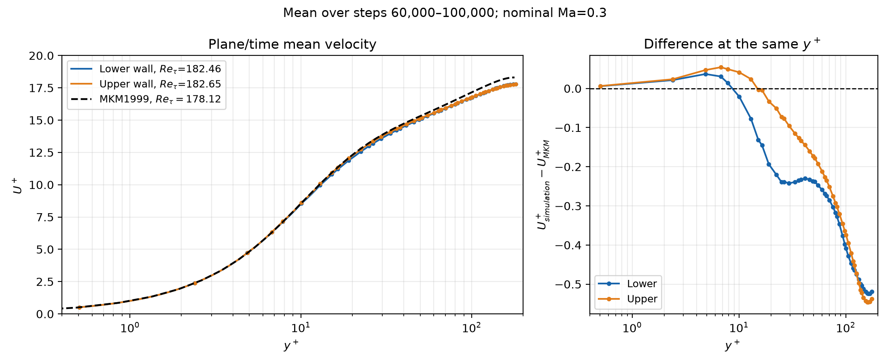

# 三维槽道湍流 DNS 算例

这个 case 计算两块静止平行壁面之间的三维槽道流动：沿流向和展向周期，
上下壁无滑移、恒温，由动态平均压力梯度维持恒定质量流量。
从平滑平均速度剖面叠加扰动开始，观察扰动增长和转捩，随后统计平均速度、雷诺应力及壁面摩擦，
并将平均速度的 **y⁺–U⁺** 曲线与 **Moser、Kim、Mansour（1999）** 的经典槽道数据对比。

生产推进使用 **C++/OpenMP/AVX2/FMA**，Python/Torch 负责几何、状态、日志和结果管理。
当前只保留最优生产路径及独立的小网格正确性参照；每一步性能优化的做法、收益和取舍见[perf.md](perf.md)。

## 目录与入口

| 路径 | 用途 |
|---|---|
| [long_run.py](long_run.py) | 运行参数、十万步推进、扰动计划、统计和原子检查点 |
| [run_logged.py](run_logged.py) | 持久日志、退出状态、成功后的自动后处理 |
| [channel.py](channel.py) | 物理参数、计算域、网格生成、初场及扰动 |
| [grouped_fused.py](grouped_fused.py)、[native_step.py](native_step.py) | 组内对流/LDG融合、恒流量RK、CFL/检查和平均场累计 |
| [native/](native/) | 手写AVX2内核；分组、halo裁剪、scratch复用、非临时存储 |
| [postprocess.py](postprocess.py) | 从检查点导出三维平均场、剖面和壁面单位 |
| [compare_wall_units.py](compare_wall_units.py) | 与MKM1999生成对比PNG/PDF、差值CSV/JSON |
| [benchmark.py](benchmark.py) | 当前完整步进的计时、阶段分解、缺页和CPU占用 |
| `test_*.py` | 守恒、壁面、解析解、多步扰动及统计正确性测试 |
| [reference/](reference/) | MKM1999原始参考表及来源说明 |
| [results/](results/) | 保留的最新完整计算结果 |

底层通用几何与FR/LDG离散由项目公共库[fr/core.py](../../fr/core.py)和
[fr/second_order.py](../../fr/second_order.py)提供。

## 算的物理问题和默认参数

| 项目 | 当前默认值 |
|---|---|
| 区域 | `[0,4π] × [-1,1] × [0,4π/3]`，半槽高h=1 |
| 方向 | x流向、y壁法向、z展向；x/z周期 |
| 固壁 | y=±1，静止、无滑移、恒温 |
| 方程 | 可压缩Navier–Stokes，γ=1.4、R=1、Pr=0.71 |
| 驱动 | 恒质量流量，体积平均ρu目标为15.67873098359455 |
| 黏度 | μ=1/178.12，恒定 |
| 网格/阶数 | **64×24×32个单元，p=3** |
| 参考Mach数 | **Ma=0.3**，以参考速度15和壁面声速定义 |
| 壁温 | `Tw=(15/Ma)^2/γ`，Ma=0.3时约1785.7143 |
| 时间推进 | SSPRK(4,3)，CFL=1.2，每步同时受声学与显式黏性限制 |
| 运行 | 100000步，8线程，FP64 SoA |
| 扰动 | 幅度0.5，初场一次，第10000/20000/30000步各一次，共4次 |
| 平均场 | 第60000步起，累计至100000步；一阶/二阶场矩梯形时间积分 |
| 诊断与保存 | 每10000步；原子覆盖`checkpoint.pt`，持续记录日志 |

每个RK阶段根据无外力动量RHS求均匀压力梯度G，使总流向动量的变化为零；
动量源为G，能量源为Gu，不对速度场逐点缩放。
178.12是用于配置黏度和参考尺度的Reτ，不强制实际壁面Reτ恒等于该值。
实际uτ和Reτ在后处理中根据平均壁面剪切、壁面密度计算。

Ma不是局部最大Mach数。Ma=0.3提高了可用时间步，也会改变可压缩性与Rusanov数值耗散，
因此与不可压参考数据的差异不能全部归为离散误差。

## 网格在哪里配置、如何生成

**不需要Gmsh，也不需要预先生成`.msh`文件。** 运行时由`Channel`调用`CartesianFR`自动生成结构化网格。

- 单元数：命令行 `--cells NX NY NZ`，默认在[long_run.py](long_run.py)中定义。
- 计算域：同一入口配置为4π×2×4π/3；不是早期小算例的2π×2×π区域。
- 生成位置：[channel.py](channel.py)的`Channel.__init__`；底层单元映射见[CartesianFR](../../fr/core.py)。
- x、z单元边界等距；y方向使用双曲正切拉伸，强度`stretch=1.2`。

壁法向单元边界为：

\[
\eta_j=-1+\frac{2j}{N_y},\qquad
 y_j=\frac{\tanh(1.2\eta_j)}{\tanh(1.2)},\quad j=0,\ldots,N_y.
\]

每个单元、每个方向用p+1=4个Gauss解点，默认共有
`64×24×32×4³ = 3,145,728`个解点；逻辑方向解点数为256×96×128。
参考节点通过仿射映射落到各物理单元中。初场和扰动的波数按实际周期长度计算。
启动时检查最近壁面Gauss点参考y⁺≤1。

以下命令会自动生成对应网格并开始计算：

```bash
# 以下所有命令均从仓库根目录执行。
venv/bin/python case/channel-dns/run_logged.py \
  --cells 64 24 32 --mach 0.3 \
  --output case/channel-dns/results/new-run
```

最终`mean_fields.pt`保存了单元边界`edges`；结合p=3的Gauss节点即可恢复解点坐标。
网格生成是内存操作，不会额外向仓库写入重复的体积网格文件。

## 如何运行与恢复

需要Linux、AVX2 CPU、支持C++17/OpenMP的g++和项目Python依赖。
原生动态库按源码、头文件、编译参数哈希自动构建到`/tmp/fr-channel-native/`，首次运行可能有编译开销。

```bash
# 完整显式配置，与保留的最新结果对应。
venv/bin/python case/channel-dns/run_logged.py \
  --output case/channel-dns/results/new-run \
  --cells 64 24 32 --mach 0.3 --steps 100000 --threads 8 --cfl 1.2 \
  --interval 10000 --perturbation 0.5 --perturb-until 30000 --sample-start-step 60000

# 大网格、Ma=0.1；其他物理和统计配置相同。
venv/bin/python case/channel-dns/run_logged.py \
  --output case/channel-dns/results/new-large --cells 128 32 48 --mach 0.1

# 从已有目录恢复；--steps是绝对总步数，原统计继续累计。
venv/bin/python case/channel-dns/run_logged.py \
  --output case/channel-dns/results/new-run --resume --steps 200000
```

恢复时网格、Ma、CFL、扰动和统计起点等参数必须与检查点匹配。
更改统计窗口、清空旧平均场需要显式重置积分，不能只修改恢复命令中的起点。
每万步先诊断再施加计划扰动，随后保存检查点。无效状态报错退出，保留上一个完整磁盘检查点。

长任务建议用用户级systemd运行，以免交互会话结束导致退出：

```bash
systemd-run --user --unit=channel-dns --property=WorkingDirectory="$PWD" \
  /usr/bin/taskset -c 0,2,4,6,8,10,12,14 "$PWD/venv/bin/python" -u \
  "$PWD/case/channel-dns/run_logged.py" --output "$PWD/case/channel-dns/results/new-run"

systemctl --user status channel-dns
```

上述CPU编号对应本次i7-14700，换机器时应按其拓扑调整。
`run_logged.py`保存stdout/stderr、faulthandler、进程信息与退出码，成功后自动导出平均场。
更多参数见`venv/bin/python case/channel-dns/long_run.py --help`。

## 最新结果与y⁺–U⁺对比

保留结果在[results/mkm180-small-ma03-100k-20261027/](results/mkm180-small-ma03-100k-20261027/)，
2026-10-27 15:05正常完成，后处理退出码为0。图中使用**第60000～100000步平均场**，
上下壁分别以实际壁面尺度无量纲化，黑色虚线为MKM1999原始数据。



| 量 | 本次结果 | MKM参考 |
|---|---:|---:|
| 下壁Reτ | 182.462 | 178.12 |
| 上壁Reτ | 182.650 | 178.12 |
| 下壁uτ | 1.01697 | 参考尺度为1 |
| 上壁uτ | 1.01804 | 参考尺度为1 |

y⁺≤10的均值曲线接近参考，外层U⁺偏低约2%～3%。Reτ、Ma和统计时长均不同；
该结果不等于已完成网格无关性、统计收敛或所有湍流统计量验证。

[PNG](u_plus_mkm_comparison.png) ·
[PDF](results/mkm180-small-ma03-100k-20261027/postprocess/u_plus_mkm_comparison.pdf) ·
[差值CSV](results/mkm180-small-ma03-100k-20261027/postprocess/mkm_comparison.csv) ·
[壁面尺度与统计信息](results/mkm180-small-ma03-100k-20261027/postprocess/metrics.json)

## 硬件与实测性能

| 项目 | 配置 |
|---|---|
| CPU | **Intel Core i7-14700**，8P+12E，共20核/28逻辑线程 |
| 实际使用 | 8个物理P核，绑定0,2,4,6,8,10,12,14；未使用E核或P核SMT |
| 向量化 | AVX2、4路FP64、FMA；该机器不支持AVX512 |
| 缓存 | 每P核2 MiB L2，整片约33 MiB LLC |
| 软件 | Linux、Python 3.12.3、Torch 2.14.1+cu130、g++ 13.3.0 |
| 计算设备 | CPU；Torch版本带CUDA不代表本次使用了GPU |

| 测量口径 | 性能 |
|---|---:|
| 最新完整任务：64×24×32、Ma=0.3、100000步 | **12473.15 s，约3小时28分钟** |
| 全程平均，包含期间诊断与检查点 | **0.124731 s/步** |
| 清理后完整步进微基准，包含平均场、CFL/检查，3轮各20步 | **0.117993 s/步，中位数** |
| 上述微基准三轮 | 0.116049 / 0.118267 / 0.117993 s/步，minor faults均为0 |
| 全程推进的无量纲物理时间 | 8.6427904 |
| 平均场覆盖的无量纲物理时间 | 3.3842994 |

生产实现固定4×4×4组，使用scratch复用、对流/LDG融合、组内RK、逐面Riemann、
非临时存储、末阶段更新/检查/CFL/统计融合与halo依赖裁剪。
不启用fast-math或倒数复用。优化前后的同批对照及未采用实验见[perf.md](perf.md)。
微基准不包括每万步的诊断及磁盘保存，不能将其与全程平均的差异当作新增优化收益。

## 输出文件与后处理

结果目录内：

- `checkpoint.pt`：最终保守状态、12场矩时间积分、统计时长、配置及历史，可恢复。
- `run.json`、`status.json`、`process.json`、`exit-*.json`、`run-*.log`：配置、进度与日志。
- `turbulence.json`：每万步的瞬时空间诊断；脉动相对各高度当时的x-z平面均值定义。
- `postprocess/mean_fields.pt`：三维时间平均ρ、速度、压力、温度与六分量雷诺应力。
- `postprocess/profiles.csv`、`wall_units.csv`、`metrics.json`：平面/时间剖面及实际壁面单位。

结果整体迁入本目录后，原日志和进程记录中的旧绝对路径作为历史记录保留；
读取和复现请使用本README的新路径。原检查点、平均场和图片未修改。

```bash
venv/bin/python case/channel-dns/postprocess.py \
  case/channel-dns/results/mkm180-small-ma03-100k-20261027/checkpoint.pt

venv/bin/python case/channel-dns/compare_wall_units.py \
  case/channel-dns/results/mkm180-small-ma03-100k-20261027

# 当前完整步进性能；预热后打印单步与各原生阶段耗时。
venv/bin/python case/channel-dns/benchmark.py --warmup 20 --steps 20 --repeats 5

# 正确性回归。
venv/bin/python -m unittest discover -s case/channel-dns -p 'test_*.py'
venv/bin/python -m unittest discover -s tests -p test_nonuniform_cartesian.py
```

壁面尺度由两壁平均速度多项式的端点导数计算剪切，再结合壁面密度得到uτ、y⁺、U⁺。
详细数据流见[algorithm.md](algorithm.md)，标准参考表的来源和列定义见[reference/README.md](reference/README.md)。
