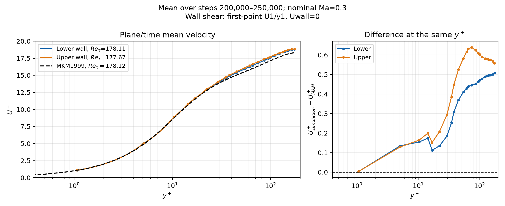

# 三维槽道湍流 LES

两块静止平行壁面之间的可压缩槽道流：x 流向、z 展向周期，y=±1 为无滑移恒温壁面，
每个 RK 阶段通过均匀流向驱动力保持恒质量流量。使用 **WALE 显式 SGS 模型**，
复用 [channel-dns](../channel-dns/README.md) 的槽道初场、扰动、统计与检查点流程。
不使用壁面模型；采用壁面加密网格直接描述近壁速度分布。

已完成 **20 万步流动发展＋5 万步时间统计**。以下保留结果采用第 200000～250000 步
时均场，以第一近壁 Gauss 解点的速度与壁面距离估算壁面剪切，分别绘制两侧壁面单位曲线。

## 时均 y⁺–U⁺ 与 MKM1999 对照



本地参考表复用 [MKM1999 数据及来源说明](../channel-dns/reference/README.md)。
上下壁分别归一化，不强制镜像平均；黑色虚线为参考 Reτ=178.12 的时间平均速度。

| 时均壁面量 | 下壁 | 上壁 |
|---|---:|---:|
| 分子剪切应力 τw | 0.963713 | 0.958988 |
| 壁面密度 ρw | 1.015937 | 1.015912 |
| 摩擦速度 uτ | 0.973959 | 0.971580 |
| 实际 Reτ | **178.1065** | **177.6672** |

| 相同 y⁺ 处的速度 | 下壁 U⁺ | 上壁 U⁺ | MKM1999 U⁺ |
|---|---:|---:|---:|
| 10 | 8.6374 | 8.6488 | 8.5223 |
| 30 | 14.0482 | 14.1602 | 13.8678 |
| 100 | 17.6165 | 17.7491 | 17.1469 |

表中按 y⁺ 线性插值取值。近壁及缓冲层曲线接近参考，外层 U⁺ 略高；
上下壁 Reτ 相差约 0.25%。这是本组网格与统计窗口的代表性验证，
尚未完成网格无关性、统计不确定度或所有雷诺应力分量的系统验证。
本次名义 Ma=0.3，参考数据为不可压 DNS，差异不能全部归为 SGS 模型误差。

### 壁面尺度的计算口径

图中使用无滑移壁面 Uwall=0 和最近原生 Gauss 解点的平面/时间平均速度：

```text
τw = μ U1 / d1
uτ = sqrt(τw / ρw)
Reτ = uτ h ρw / μ
 y⁺ = d uτ ρw / μ
 U⁺ = U / uτ
```

其中 h=1；上下壁第一点的距离均为 d1=0.0060016342h，
归一化后第一点 y⁺ 约为 1.07。ρw 由时均密度多项式在壁面求值。
这是黏性底层线性近似，不新增均匀插值点，也不修改计算得到的平均场。
第一点满足 U⁺=y⁺ 是这一估算的构造性质，不能将该点重合作为独立验证。

后处理通过 `--wall-shear-method first-point` 选择此口径。
默认 `polynomial` 使用速度多项式端点导数，仍保留用于对照；
同一时均场按该方法得到的 Reτ 为 190.4382、189.4293。
两种估算对当前网格有明显差异，不能仅以接近参考值断言哪一种更准确；
绘图时应明确方法，后续可结合求解器的 LDG 修正梯度与离散壁面通量评估。

## 物理、网格与数值配置

| 项目 | 保留结果的配置 |
|---|---|
| 计算域 | `[0,4π] × [-1,1] × [0,4π/3]`，半槽高 h=1 |
| 网格/阶数 | **32×12×16 单元，p=3，393216 个解点** |
| 网格分布 | x/z 等距；y 向对称 tanh 拉伸，stretch=1.2，壁面细、中心粗 |
| 方程与物性 | 可压缩 NS，γ=1.4，R=1，Pr=0.71，μ=1/180 |
| 参考尺度 | Reτ,ref=180；Ma=0.3，以参考速度15定义；Tw=(15/Ma)²/γ |
| 驱动 | 恒质量流量，体积平均 ρu 目标为 15.67873098359455 |
| SGS | WALE，Cw=0.5，Prt=0.9；Δ=(单元体积)^(1/3)/(p+1) |
| 空间离散 | Rusanov 界面通量、LDG 黏性离散，无去混叠 |
| 时间推进 | SSPRK(4,3)，CFL=1.6；同时考虑声学、分子及 SGS 扩散限制 |
| 扰动 | 初场幅度0.5；第10000、20000、30000步各追加一次，之后不再注入 |
| 发展/统计 | 0～200000步不累计平均场；200000～250000步累计12个场矩 |
| 平均方式 | 按物理时间作梯形积分；后处理进行 x-z 平面平均 |
| 统计区间 | t=47.36322104～59.12752912，累计时长11.76430807 |
| 后端与精度 | C++/OpenMP/AVX2/FMA，native-p3，CPU FP64 SoA |
| 线程 | 8个P核，绑定CPU 0,2,4,6,8,10,12,14 |
| 检查点/诊断 | 每10000步，原子覆盖检查点，诊断在计划扰动前采集 |

参考 Reτ 用于设置黏度，并不强制实际壁面 Reτ 恒为180。
恒流量源项作用于动量和能量，不逐点缩放速度。

y 向网格边界为 `eta_j=-1+2j/12`、`y_j=tanh(1.2 eta_j)/tanh(1.2)`：

| 网格量 | 数值 |
|---|---:|
| Δx/h | 0.392699 |
| 壁面首层 Δy/h | 0.0864392 |
| 中心层 Δy/h | 0.2367591 |
| Δz/h | 0.261799 |
| 最近 Gauss 点参考 y⁺（Reτ,ref=180） | 1.08029 |
| 最大单元边长比 | 4.5431 |

相对 DNS 的64×24×32、p=3基线，单元和解点数量均为其1/8。
近壁单元按壁面法向分辨率设计，不要求三向边长接近。

## 运行与复现

所有命令从仓库根目录执行。依赖安装见[根README](../../README.md)。
原生后端需 Linux、AVX2 CPU、支持C++17/OpenMP的编译器；动态库自动缓存到
`/tmp/fr-cartesian-ns-native/`，首次运行包含编译开销。

以下命令可一次完成相同的25万步发展和统计计划：

```bash
run_dir=results/channel-les/re180-ma03-tanh12-250k

taskset -c 0,2,4,6,8,10,12,14 venv/bin/python -u -m case.channel-les.run_logged \
  --output "$run_dir" --mesh case/channel-les/mesh/default.json \
  --steps 250000 --threads 8 --re-tau 180 --mach 0.3 --cfl 1.6 \
  --sgs wale --cw 0.5 --filter-width dof --filter-ratio 1 --turbulent-prandtl 0.9 \
  --modal-filter hifiles --filter-threshold .1 --filter-alpha 36 --filter-order 2 \
  --interval 10000 --perturbation 0.5 --perturb-until 30000 --sample-start-step 200000
```

中断后用相同配置添加 `--resume`；`--steps` 是绝对目标步数。
SGS、滤波、真实网格坐标等数值配置必须匹配检查点。
对尚未开始采样、累计时长为0的检查点，允许显式将采样起点设为当前保存步或之后；
已有平均场的运行不自动重置统计窗口。

CLI简写默认输出到 `results/channel-les/`，默认CFL=0.3、100000步、
60000步开始采样，**与上面保留结果的显式配置不同**。
默认从 `mesh/default.json` 读网格；显式 `--cells NX NY NZ` 则用tanh=1.2直接生成。
自定义拉伸应先生成网格，再通过 `--mesh` 读取：

```bash
venv/bin/python -m case.channel-les.generate_mesh --cells 32 12 16 --stretch 1.2
venv/bin/python -m case.channel-les --help
```

Python类默认关闭模态滤波，需通过 `ChannelLES(..., modal_filter='hifiles')` 显式启用；
CLI默认启用。Vreman、Smagorinsky 和关闭SGS的对照可用 `--sgs` 选择，见 `--help`。

## 后处理及保留图片的生成

`run_logged` 保存持久日志和退出状态，成功后自动导出有统计数据的平均场；
无累计平均场时跳过导出。自动后处理使用默认多项式端点剪切口径，
生成本README图片需显式切换为第一点线性估算，再生成参考对比：

```bash
MPLCONFIGDIR=/tmp/fr-matplotlib venv/bin/python case/channel-dns/postprocess.py \
  "$run_dir/checkpoint.pt" --wall-shear-method first-point
MPLCONFIGDIR=/tmp/fr-matplotlib venv/bin/python case/channel-dns/compare_wall_units.py "$run_dir"

mkdir -p case/channel-les/figures
cp "$run_dir/postprocess/u_plus_mkm_comparison.png" \
  case/channel-les/figures/y_plus_u_plus_re180_p3_200k_250k.png
```

本次实际完成的结果位于
`results/channel-les/y12-tanh12-re180-ma03-cfl16-100k-no-mean-20261118/`。
目录名保留最初发展任务的名称，实际最终配置与统计窗口以检查点和指标文件为准。
它分为两段各10万步发展、随后5万步统计；上述单次运行命令表达相同的数值计划。

仅将代表性PNG复制进 `figures/` 长期保留。原始场、检查点、CSV、PDF及日志留在
被Git忽略的 `results/`，通过上述命令重新生成，不纳入提交。

| 输出 | 内容 |
|---|---|
| `checkpoint.pt` | 当前保守状态、场矩积分、统计时长、数值配置及诊断历史 |
| `run.json`、`status.json` | 本段运行配置、进度和滤波计数 |
| `run-*.log`、`process.json`、`exit-*.json` | 持久日志、进程信息和退出状态 |
| `turbulence.json` | 每万步瞬时湍动能、脉动强度、质量通量等 |
| `postprocess/mean_fields.pt` | 三维时均密度、速度、压力、温度及已解析雷诺应力 |
| `postprocess/profiles.csv`、`wall_units.csv` | 平面/时间平均剖面和两侧壁面单位 |
| `postprocess/metrics.json`、`mkm_comparison.*` | 壁面尺度、计算方法及参考差值 |
| `postprocess/u_plus_mkm_comparison.png`、PDF | 本README中的曲线及差值图 |

只绘制某一保存场的瞬时平面平均，可用
`venv/bin/python -m case.channel-les.plot_wall_units "$run_dir/checkpoint.pt"`。
该入口默认采用多项式端点导数，在图中明确标注瞬时性质，与上面的时均结果不同。

## 模态滤波与异常诊断

模态滤波由 `delft_propeller` 分支迁移，参考 HiFiLES 的密度concentration传感器和
指数模态滤波，作三维张量积扩展；公共实现位于
[fr/modal_filter.py](../../fr/modal_filter.py) 和
[原生滤波内核](../../fr/native/hex_modal_filter.hpp)。
在初场及计划扰动后、每个RK阶段更新后应用，保留单元的质量、动量和总能量均值。
启用后，在最终过滤之后计算下一步CFL及场矩，保证统计使用过滤后的状态。

它是抑振滤波，**不是压力截断或严格保正算法**，密度传感器可能漏检其他变量的振荡。
本次第20～25万步统计期间共检查200000次RK阶段，未触发单元滤波，
因此这段时均结果没有模态滤波触发引入的直接耗散。
WALE公式与Cw=0.5的说明见 [Nicoud讲义](https://imag.umontpellier.fr/~nicoud/PDF/notes_Nicoud_1and2.pdf)。

发现非正密度/压力或NaN/Inf时立即退出，在日志和 `failure.json` 中记录范围、数量、
异常点坐标及前一步状态。默认保留最近5个成功步，失败时写入 `failure_history.pt`；
`--failure-history-steps 0` 可关闭。原子检查点不包含失败状态。

## 性能与验证

本次在 Intel Core i7-14700 上采用8个物理P核绑定；运行耗时含诊断、日志与检查点，不含首次编译及最终绘图：

| 阶段 | 耗时 | 平均每步 |
|---|---:|---:|
| 0～100000步，发展 | 1788.16 s | 17.88 ms |
| 100000～200000步，发展 | 1801.74 s | 18.02 ms |
| 200000～250000步，统计 | 954.18 s | 19.08 ms |

三段均正常完成，最终物理时间59.12752912。
以下测试覆盖WALE极限、native/Torch残差与推进对照、滤波守恒及逐阶段顺序、
网格分布、异常日志和失败前历史保存：

```bash
venv/bin/python -m unittest discover -s tests -p test_channel_les.py
venv/bin/python -m unittest discover -s tests -p test_cartesian_modal_filter.py
```
