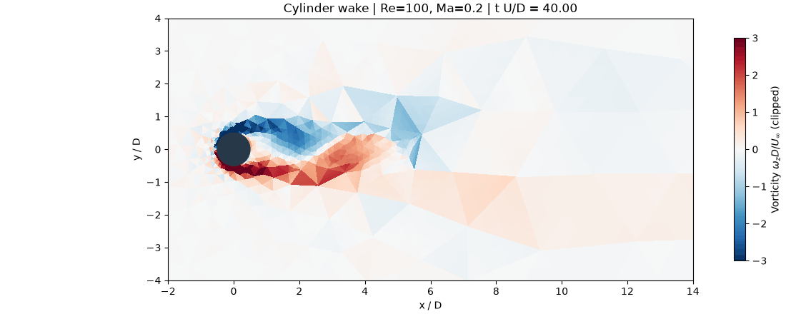
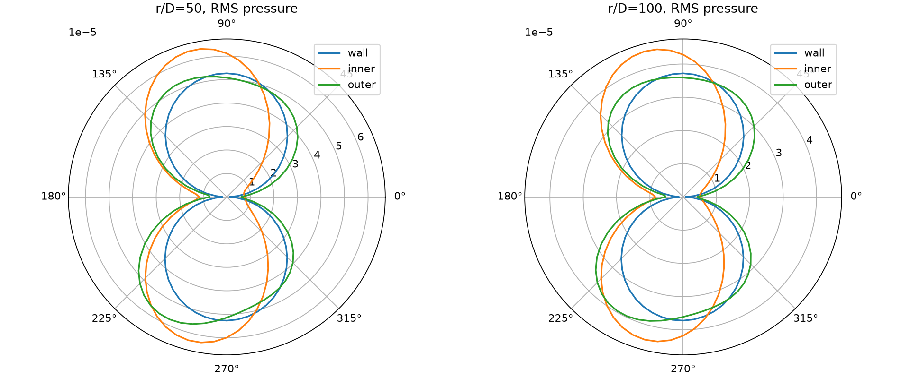
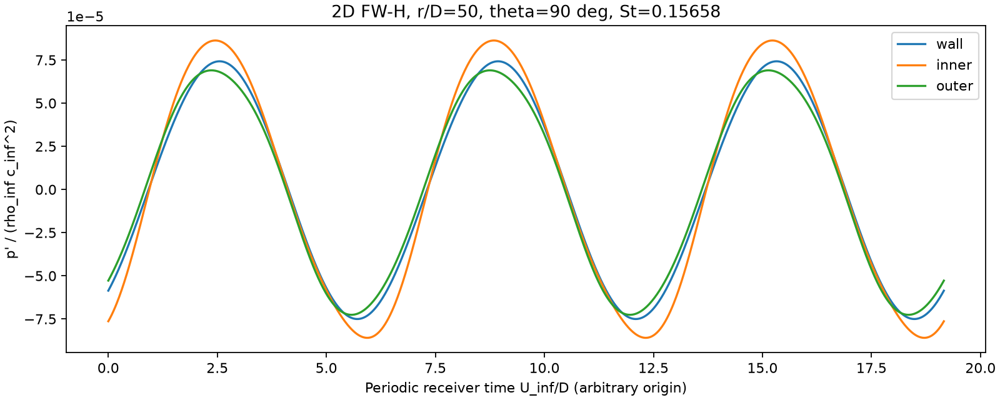
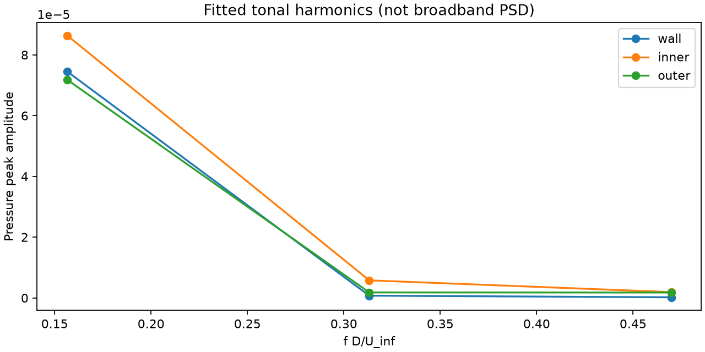

# 二维圆柱绕流

圆柱中心 `(0,0)`，直径 `D=1`。默认 `Re_D=100`、`Ma=0.1`、来流沿 +x，采用 NACA0012-NS 的二维可压缩层流 NS 离散：`gamma=1.4`、`Pr=0.72`、`rho_inf=c_inf=D=1`，因此 `U_inf=Ma`、`mu=Ma/Re_D`。CL/CD 以直径和动压归一化。

## 三角网格结果



上图为未压缩原始 GIF，文件位于本目录 [vorticity_tri.gif](vorticity_tri.gif)。使用 1,004 个三次曲边三角形、p=1、Re=100、Ma=0.2，150 帧覆盖对流时间 40–100。该粗网格用于演示，远尾迹分辨率有限；未施加跨单元平滑或降噪滤波。

## 运行三角网格算例

所有命令从仓库根目录执行。圆柱表面为静止无滑移绝热壁面（tag=2），矩形外边界为特征远场（tag=1）。对流压力壁面通量、BR1 黏性梯度、惩罚通量以及显式 SSPRK(4,3) 均复用相邻 NACA0012 算例。

需要 Python 环境、PATH 中的 Gmsh、支持 C++20/OpenMP 的 C++ 编译器和 Ninja。绘图库使用 Matplotlib、NumPy 和 Pillow：

```bash
venv/bin/python -m pip install -r requirements.txt
```

先生成三角网格，再运行求解器。下面的参数用于复现上图；显式传入 `--kind tri` 和 `--mesh`，不依赖生成器及求解器的结构网格默认值。

```bash
venv/bin/python case/cylinder_flow/generate_mesh.py \
  --kind tri --wall-size .1 --far-size 3 \
  --wake-length 6 --wake-half-width .75 \
  --output case/cylinder_flow/results/mesh/demo.msh

venv/bin/python case/cylinder_flow/solve.py \
  --mesh case/cylinder_flow/results/mesh/demo.msh \
  --p 1 --quadrature 4 --re 100 --mach .2 --threads 4 \
  --cfl .5 --viscous-step-factor 64 \
  --time 100 --max-steps 700000 --output-every 10000 \
  --plot-start 40 --frames 150 --fps 15 \
  --output case/cylinder_flow/results/karman_p1_re100
```

求解结束后，输出目录中会生成 `vorticity.gif`、`vorticity.png`、`vorticity_plot.json`、载荷/残差 CSV 和 `solution.pt` 检查点。求解器不会自动把 GIF 复制到本目录；本 README 中的 GIF 是单独保留的结果副本。

仅检查启动时，可将求解命令中的 `--max-steps` 改为 `20`，并加 `--no-plot`，同时换用独立输出目录。20 步只验证启动，不能观察到涡街。继续同一网格的计算时，在原求解参数上加 `--restart <输出目录>/solution.pt`，并提高 `--time` 和累计 `--max-steps` 上限；物理参数、网格、p、过积分参数和时间模式必须匹配。

首次求解通过 `torch.utils.cpp_extension.load` 编译并缓存自定义算子到 `/tmp/fr-cylinder-native/`，后续相同源码与构建配置复用缓存。使用 `TORCH_LIBRARY` 注册 CPU 算子，Python 通过 `torch.ops.cylinder_flow` 调用；数据直接使用 CPU FP64 Tensor，不需要 ctypes 或 NumPy 转换。默认 4 线程，可用 `--threads` 调整。

## 网格加密与可选结构网格

三角网格可独立调整圆周和尾迹尺寸。为了让涡继续向更远下游传播，应同时延长、加宽尾迹加密区。例如：

```bash
venv/bin/python case/cylinder_flow/generate_mesh.py \
  --kind tri --wall-size .08 --far-size 2 \
  --wake-size .16 --wake-length 14 --wake-half-width 2 \
  --output case/cylinder_flow/results/mesh/refined_wake.msh
```

求解时将 `--mesh` 换为新文件，并使用新的输出目录。原图中的 `--viscous-step-factor 64` 仅放宽显式扩散步长估计，不改变离散方程；换网格或阶数后需要重新检查 CFL 和数值稳定性。

默认三次曲边四边形结构网格，输出 `results/mesh/structured.msh`。圆柱周围 4 个 O 型贴体块连接到 `[-2,2]²` 方框，外围 8 个矩形块覆盖 `[-10,20] × [-10,10]`。所有块共用边及节点，无悬挂面；水平 `|y/D|<2` 和竖直 `|x/D|<2` 构成十字加密区，四角逐渐放粗。流向细网格一直延伸到出口，避免脱落涡在 x/D=6 后立即进入粗网格。

默认每四分之一圆周 20 个单元、径向 12 层、上游 20 格、下游 80 格、上下各 20 格，共 7,760 个四边形；p=1 时 31,040 解点。径向和远场分别采用 1.1、1.08 的间距比。圆周仍用精确圆弧建模，网格几何为三次近似。生成器输出 MSH、GEO、SVG、PNG 及几何检查 JSON；[结构网格预览](results/mesh/structured.png)。

```bash
# 默认 O 型贴体 + 十字加密结构网格
venv/bin/python case/cylinder_flow/generate_mesh.py
# 继续加密时调整结构块计数，而非三角形的 wall-size 参数
venv/bin/python case/cylinder_flow/generate_mesh.py --circumferential 28 --radial 18 --upstream-cells 28 --downstream-cells 112 --outer-cells 28 --output case/cylinder_flow/results/mesh/structured_finer.msh
# 仍可显式选择非结构三角形，独立设置尾迹尺寸及范围
venv/bin/python case/cylinder_flow/generate_mesh.py --kind tri --wall-size .08 --wake-size .16 --wake-length 14 --wake-half-width 2 --output case/cylinder_flow/results/mesh/refined_wake.msh
```

这仍是起始结构网格，需要进一步检查近壁分辨率、区域尺寸和载荷的网格收敛性。

## 卡门涡街

默认 Re=100 用于二维非定常脱涡；Re=40 可用于稳态绕流。周期性脱涡临界值约为 Re=47；二维尾流在 Re 约 189 后开始对三维扰动失稳，因此提高 Re 并不总适合二维模型。参考：[脱涡起始](https://journals.aps.org/pre/abstract/10.1103/PhysRevE.82.026315)、[三维稳定性](https://doi.org/10.1017/S0022112096002773)。

初场在下游加入峰值 `0.001 U_inf` 的局部横向速度扰动，并修正总能量以保持压力不变。默认采用全局物理时间（`--time-mode global`），目标对流时间 `t U_inf/D=100`，最多 1000000 步；残差停止阈值设为 `1e-30`，避免沿用稳态阈值而过早停止。步数上限可能先到达，需检查实际对流时间并按需续算。目标时间是起始设置，不保证启动瞬态已消失。

不要用 `--time-mode local` 研究涡街频率。Re=100 的周期解不会满足通常的稳态残差标准，应依据涡量场、周期性升力及多周期统计判断。壁面 CSV 的 Cf 沿用 NACA 脚本的朝 +x 切向约定，不是统一顺/逆时针切向。

## 涡量 GIF

默认在求解结束时输出 `vorticity.gif`、末时刻 `vorticity.png` 及真实采样时间/色标记录 `vorticity_plot.json`。动画绘制 `omega_z D/U_inf`，固定对称色标默认 ±3，观察区域 `-2<x/D<14, |y/D|<4`，圆柱实心遮罩。曲边单元内独立插值，保留 DG 单元间的不连续，不跨圆柱内部连接网格。

`--frames 120 --fps 15` 控制帧数与播放速率，`--plot-start 40` 排除早期启动过程，`--vorticity-limit 3` 控制固定截断色标。记录接近均匀目标时间的完整接受状态，不记录 RK 中间态，也不改变数值时间步。`--frames 0` 仅输出末时刻 PNG，`--no-plot` 关闭绘图；局部伪时间模式需要 `--no-plot`。若实际只采到一个状态，不生成 GIF。续算从本次实际起始时间开始记录，不包含上一进程的动画帧。

较低成本的演示配置如下；p=1、Ma=0.2 和较粗尾迹适合演示，不能代替网格/时间步收敛研究。`--viscous-step-factor 64` 只放宽原有保守扩散步长估计，不改变空间离散；需结合 CFL 检查数值稳定性，不能泛用到任意网格和阶数。

```bash
venv/bin/python case/cylinder_flow/generate_mesh.py --kind tri --wall-size .1 --far-size 3 --wake-length 6 --wake-half-width .75 --output case/cylinder_flow/results/mesh/demo.msh
venv/bin/python case/cylinder_flow/solve.py --mesh case/cylinder_flow/results/mesh/demo.msh --p 1 --quadrature 4 --mach .2 --re 100 --threads 4 --cfl .5 --viscous-step-factor 64 --time 100 --max-steps 700000 --output-every 10000 --plot-start 40 --frames 150 --fps 15 --output case/cylinder_flow/results/karman_p1_re100
```

Matplotlib、NumPy 和 Pillow 均包含在根目录统一的 `requirements.txt` 中。短步测试生成的动画只用于验证输出链路，不能把尚未形成涡街的瞬态称为卡门涡街。

上述演示已实际运行至对流时间 100，生成了 [150 帧涡量 GIF](results/karman_p1_re100/vorticity.gif)，覆盖对流时间 40–100。升力形成持续振荡，后段测得周期约 6.39、St 约 0.157；这只是该粗网格的观测值，尚未验证网格无关性。实测记录及短程减半时间步检查见 [perf.md](perf.md)。

## 从旧解转到结构网格

`transfer.py` 在旧曲边单元中反求参考坐标、求值旧解，再按新单元体积积分做 L2 投影。它直接转移守恒变量，不做跨单元滤波。投影后检查密度/压力，另存投影前后全域积分及网格来源。使用有限积分点穿过旧 DG 单元跳跃时，整体积分可能有小偏差，报告会明确记录；它不是严格守恒的几何交叠积分。物理时间保留，新网格步数和载荷历史重新计数。

```bash
venv/bin/python case/cylinder_flow/transfer.py --source-mesh case/cylinder_flow/results/mesh/demo.msh --checkpoint case/cylinder_flow/results/karman_p1_re100/solution.pt --mesh case/cylinder_flow/results/mesh/structured.msh --output case/cylinder_flow/results/structured_transfer/solution.pt
# 先以较小 CFL 消化网格转换瞬态
venv/bin/python case/cylinder_flow/solve.py --mesh case/cylinder_flow/results/mesh/structured.msh --p 1 --quadrature 4 --mach .2 --threads 8 --cfl .5 --viscous-step-factor 64 --restart case/cylinder_flow/results/structured_transfer/solution.pt --time 100.5 --max-steps 20000 --no-plot --output case/cylinder_flow/results/structured_trial
# 继续物理时间推进，到 120 后再记录新网格的涡街
venv/bin/python case/cylinder_flow/solve.py --mesh case/cylinder_flow/results/mesh/structured.msh --p 1 --quadrature 4 --mach .2 --threads 8 --cfl 1 --viscous-step-factor 64 --restart case/cylinder_flow/results/structured_trial/solution.pt --time 140 --max-steps 200000 --output-every 2000 --plot-start 120 --frames 120 --fps 15 --output case/cylinder_flow/results/karman_structured_re100
```

同一新网格上的普通续算仍使用 `--restart`；原驱动的网格哈希检查保持有效，不能直接把旧网格检查点传给新网格求解器。结构网格的投影质量、时间步检查及最终结果见 `perf.md`。

已完成结构网格计算至对流时间 140，最新 [120 帧结构网格 GIF](results/karman_structured_re100/vorticity.gif) 覆盖对流时间 120–140；另有[末时刻涡量图](results/karman_structured_re100/vorticity.png)。使用 Re=100、Ma=0.2、p=1、过积分参数 4，未增加跨单元平滑或降噪滤波。相较旧版，粗三角形痕迹消失，交替涡结构能持续传播到更远下游。后段测得 CL 约在 ±0.309 内振荡，周期约 6.09、St 约 0.164；这仍不是网格无关性结论。

```bash
# 加密三角形圆周及尾迹
venv/bin/python case/cylinder_flow/generate_mesh.py --kind tri --wall-size .02 --output case/cylinder_flow/results/mesh/fine.msh
venv/bin/python case/cylinder_flow/solve.py --mesh case/cylinder_flow/results/mesh/fine.msh --output case/cylinder_flow/results/re100_fine
# 同网格、物理参数及时间模式续算；max-steps 是累计步数上限
venv/bin/python case/cylinder_flow/solve.py --restart case/cylinder_flow/results/re100/solution.pt --max-steps 2000000 --time 200
```

输出与 NACA0012-NS 一致：`residuals.csv` 默认每 100 步记录残差；`history.csv`、`wall.csv`、`metrics.json`、`solution.pt` 在初始、每 1000 步和结束时保存。支持 `--re`、`--mach`、`--p`、`--cfl` 等参数，详见 `solve.py --help`。原生路径已编译，不需要 `--compile`（传入也不会再运行 Inductor）。启动壁面惩罚产生的载荷不能作为收敛气动力引用；短步测试也不能证明已形成涡街。

## FR 近场与 FW–H 远场：两个脚本、ASCII 交互

近场仍使用本仓库 FR 框架及 C++ 自定义算子；自由场远场采用二维、含均匀来流对流效应的频域 FW–H 积分，不再铺设远场 CFD 网格。两个运行入口分别是：

- `solve.py`：推进流场，向一个 ASCII 文件导出壁面和包络线数据。
- `fwh.py`：独立读取该文件，计算远处观测点的音调声压和指向性；无需加载 Torch、Gmsh 或流场检查点。

安装统一依赖（已在前面安装过则无需重复）：

```bash
venv/bin/python -m pip install -r requirements.txt
```

其中 SciPy 提供二维传播所用的 Hankel 函数和基频拟合，NumPy 负责数组与最小二乘计算，Matplotlib/Pillow 用于图像和动画，Ninja 用于编译近场的 PyTorch C++ 自定义算子。依赖文件只声明所需软件包，不包含流场参数，也不会启动计算。

下面从现有三角网格 Re=100、Ma=0.2 的检查点续算，记录对流时间约 100–160。采样参数也可用于从均匀初场启动的新计算；需将 `--fwh-start` 放在启动瞬态之后。

```bash
# 第一步：FR 近场，输出一个 ASCII 文件
venv/bin/python case/cylinder_flow/solve.py \
  --mesh case/cylinder_flow/results/mesh/demo.msh \
  --p 1 --quadrature 4 --re 100 --mach .2 --threads 4 \
  --cfl .5 --viscous-step-factor 64 \
  --restart case/cylinder_flow/results/karman_p1_re100/solution.pt \
  --time 160 --max-steps 600000 --output-every 10000 --no-plot \
  --fwh-output case/cylinder_flow/results/fwh_re100/surface.dat \
  --fwh-start 100 --fwh-interval .05 \
  --output case/cylinder_flow/results/fwh_re100/flow

# 第二步：只读 ASCII 文件，可独立反复改变观测点和谐波数
venv/bin/python case/cylinder_flow/fwh.py \
  case/cylinder_flow/results/fwh_re100/surface.dat \
  --radii 50 100 --angles 72 --harmonics 3 \
  --output case/cylinder_flow/results/fwh_re100/farfield
```

`--fwh-interval` 的单位为对流时间，写入的 `time` 列则是求解器物理时间，两者满足 `t_conv=t*Ma`。采样在相邻完整接受状态之间插值守恒变量，得到均匀时间间隔，不记录 RK 中间阶段，也不改变流动时间步。`--start` 可在远场脚本中进一步丢弃较早的数据；`--strouhal` 可指定基频，否则在 St=0.08–0.3 范围内根据壁面横向载荷拟合。记录至少需要覆盖三个基频周期，建议十个或更多。

ASCII 第一行为带 `#` 的 JSON 元数据，随后是静态积分点表：

```text
# point point_id surface_id x y nx ny ds
# columns: time point rho u v p mass_flux momentum_flux_x momentum_flux_y
```

`ds` 已包含积分权重；法向从包络区域向外，壁面法向从圆柱指向流体。`surface_id=0/1/2` 分别为壁面、内包络线、外包络线。内/外包络线由单元中心位于 `[-1.5,4]×[-1,1]`、`[-2,6]×[-1.5,1.5]` 内的单元集合边界组成，实际为沿网格面的闭合曲线。程序检查闭合性，使用 FR 面积分点、法向、几何 Jacobian 和与残差一致的法向质量/动量数值通量，避免另外插值一条曲线引入独立质量通量误差。元数据保存平均流、声速、密度、网格哈希、流动参数和检查点来源；ASCII 文件无需其他几何文件即可进行后处理。

远场使用二维对流 Green 函数（Hankel 函数），保留 Ma=0.2 平均流的传播效应。平稳周期信号先去常量和线性趋势，再同时拟合基频及指定数量的谐波；传播结果是周期音调近似，不是启动声波的因果时域解，也不是宽带 PSD。

| 输出文件 | 内容 |
|---|---|
| `farfield.csv` | 各包络线、半径、角度及谐波的复声压和峰值幅度 |
| `directivity.png` | 各半径上的总谐波 RMS 指向性，比较三条积分曲线 |
| `pressure.png`、`pressure_periodic.csv` | 第一个半径、90° 方向的三个周期声压重建 |
| `tones.png` | 同一观测点的谐波幅值 |
| `metrics.json` | 拟合 St、采样时段、各包络线 RMS 及相对壁面结果的差异 |

声压以 `rho_inf*c_inf²` 无量纲化，没有转换为真实有限长圆柱的 dB SPL。当前只积分 FW–H 面源，省略面外四极子体积项；尾涡穿过包络线可导致误差，所以壁面与不同包络线的差异必须保留检查，不能仅凭解析传播测试通过就认为圆柱远场声压已收敛。还需要声源网格、积分曲线位置和采样时长的收敛研究。经典 Re=150、Ma=0.2 的声学基准需重新计算对应近场，不能把现有 Re=100 检查点直接改参数续算。

已完成上述 Re=100 计算：1,200 个均匀时间采样，覆盖对流时间约 100–160，拟合 `St=0.15658`。在 r/D=50 处，壁面、内包络线、外包络线的最大 RMS 无量纲声压分别约为 `5.27e-5`、`6.42e-5`、`5.76e-5`；在 r/D=100 处约为 `3.72e-5`、`4.53e-5`、`3.97e-5`。最大 RMS 对积分曲线存在约 7%–22% 的差异，故当前结果用于展示耦合流程和音调特征，不作为已收敛绝对声压。ASCII 文件约 75 MiB，原始生成结果保存在被 Git 忽略的 `results/` 中；下方三张图已复制到本目录，README 可直接展示。

### 远场 RMS 指向性



左、右图分别是在距圆柱 50D、100D 的圆周上观察。角度表示观察方向，图上的径向刻度表示 RMS 声压，不是空间距离，因此这不是等强度线。0° 为下游 +x，180° 为上游，90°/270° 为两侧。当前主导声辐射呈横向双瓣形状，与升力偶极声相符。

`wall`、`inner`、`outer` 分别使用圆柱壁面、较小包络线、较大包络线提取源数据；三条线预测相同观测点的声压，是三种提取位置的对照，不能相加。它们的差异用于检查包络面位置、尾涡穿越和省略面外体积项的影响；外包络线并不自动代表更准确的结果。

### 远处观测点的周期声压



观测点为 r/D=50、90°，横坐标为对流时间，纵坐标为无量纲压力扰动。图中是拟合谐波经传播积分后重建的三个周期，不是启动阶段传播到该点的原始录音。拟合周期约为 `6.39 D/U_inf`；三种曲线的相位与幅值用于比较不同源提取方式。

### 音调及其谐波



横坐标为 `f D/U_inf`，纵坐标为声压峰值幅度。这里只展示基频及二、三次谐波，不是连续宽带 PSD。当前基频约为 St=0.1566，幅值明显强于高次谐波。换算成 Hz 需要实际流速和圆柱直径：`f=St*U_inf/D`；这些无量纲幅值不能直接当作真实有限长圆柱的 dB SPL。

公式参考：[NASA 二维可渗透 FW–H 及包络面修正](https://ntrs.nasa.gov/api/citations/20050182105/downloads/20050182105.pdf)。代码使用时间约定 `Re[p_hat exp(-i omega t)]`；二维单极/偶极、静止及均匀来流解析声场用于独立验证传播积分：

```bash
venv/bin/python -m unittest discover -s case/cylinder_flow -p 'test*.py' -v
```

## 原生计算与验证

生产路径是 [native.cpp](native.cpp) 中的 PyTorch CPU 自定义 C++ 算子：`rhs`、`step`、`valid`、`residual_norm`，支持单一类型的曲边三角形或四边形。完整 SSPRK(4,3) 步在一次算子调用中完成四次新 RHS 求值，复用起始 RHS 和步内工作区；按单元并行，体通量和面通量在单元局部计算后立即用于导数/提升。没有修改物理通量、BR1 离散、边界条件或稳定性步长估计。未开启 fast-math；允许 FMA。Python 仅承担网格预计算、运行控制、载荷后处理和文件输出。自定义算子限 CPU FP64 连续 Tensor，用于无梯度数值模拟。

`cylinder.py` 复用 NACA 的 Torch 物理作为独立参照和载荷后处理，不另保留一套 Torch 优化内核。共享 NS 驱动增加了初场、原生残差和原生后端识别钩子，NACA 默认算法不变。

```bash
venv/bin/python -m unittest discover -s case/cylinder_flow -p test_case.py -v
venv/bin/python case/cylinder_flow/benchmark.py --threads 4 --warmup 3 --steps 10 --repeats 3 --output /tmp/cylinder-performance.json
```

流场测试涵盖曲边几何、非均匀状态的完整原生 RHS、三角形 p=1/2/3、四边形 p=1/2、斜向来流、全局/局部时间步、RK 终态、正性检查、体积加权残差、两种单元间的常状态 L2 投影，以及指定 p=1 的端到端 GIF 输出；与原 NACA Torch 实现对照。黏性边界收支及绝热条件也检查了用于载荷计算的共享 Torch 路径。加上 ASCII 采样、FW–H 通量转换、二维解析声场、Green 函数导数和音调拟合，共 13 项测试。结构网格的面积为 `599.214601827346`，解析值 `599.214601836603`，最小 Jacobian 为正。

性能口径、实测数据和运行成本见 [perf.md](perf.md)。
