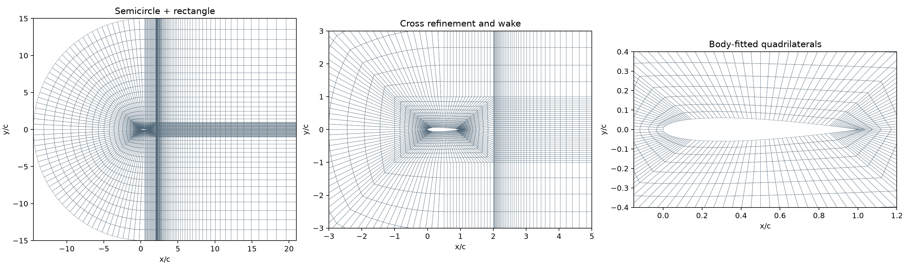
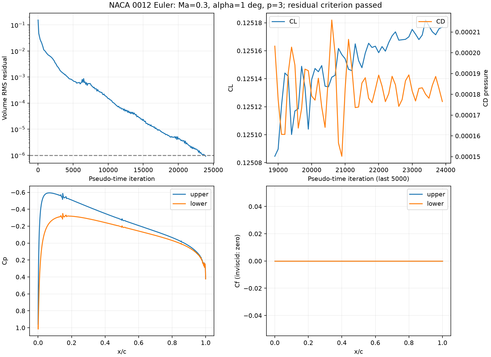

# NACA0012 二维 Euler 绕流

求解二维无黏可压缩 Euler 方程，翼面采用滑移壁条件。采用贴体结构四边形网格、FR-DG 和 native CPU FP64 后端。本文记录当前 1° 攻角基准的配置与结果。

## 网格设计



弦长 `c=1`，前缘 `(0,0)`，尾缘 `(1,0)`。对称翼型厚度为

```text
y_t = 0.6 (0.2969 sqrt(x) - 0.1260 x - 0.3516 x²
             + 0.2843 x³ - 0.1036 x⁴)
y_upper = y_t,  y_lower = -y_t,  0 <= x <= 1
```

尾缘闭合，翼面由样条表示，再生成完整三次 Lagrange 曲边几何。几何多项式次数与解的多项式次数 `p` 独立。

外域前部为圆心 `(0.5,0)` 的左半圆，后部连接矩形出口。翼型周围有 8 个贴体 O 型块；外部半圆环、上下加密带和下游矩形组成其余分块。水平尾迹带与竖向加密带形成十字形细化区域。共 18 个共形结构块，所有单元均为四边形，共享边及节点，无悬挂面；这是 C 形外域与贴体 O 层的组合。

| 参数 | 当前值 |
|---|---:|
| 半圆半径 | `15c` |
| 出口 | `x/c=21`，距尾缘 `20c` |
| 全域坐标范围 | `x/c ∈ [-14.5,21]`，`y/c ∈ [-15,15]` |
| 贴体核心范围 | `x/c ∈ [-1,2]`，`y/c ∈ [-1,1]` |
| 每段翼面细分数 `--surface-cells` | 16，共 8 段 |
| 贴体层数 `--radial` | 12 |
| 贴体向外增长比 `--radial-stretch` | 1.15 |
| 下游流向单元数 `--downstream-cells` | 60 |
| 外层单元数 `--outer-cells` | 16 |
| 外层增长比 `--stretch` | 1.08 |
| 总单元数 | **6,912** |
| 几何次数 | 3 |

`--core-left`、`--core-right` 和 `--cross-half-width` 调整细化核心范围，其余参数控制各方向的分辨率和过渡。贴体加密不保证网格已经足够细，应以近壁、尾迹及载荷收敛判断。

生成器读回 Gmsh 网格，检查边界标签、共享面匹配和采样 Jacobian。当前最小采样 Jacobian 为 `4.591226e-05`，面积相对解析几何面积的差为 `1.456e-09`。这些几何检查不替代流动精度验证。

## 物理模型与边界条件

归一化为 `rho_inf=c_inf=c=1`，`gamma=1.4`，因此 `p_inf=1/gamma`，来流速度为 `Ma (cos(alpha), sin(alpha))`。翼型保持水平，通过来流方向设置攻角。

- **远场（边界标签 1）**：亚声速特征条件。出射声学特征取自内部，入射声学特征由自由来流给定；熵和切向速度按流入/流出选择自由来流或内部值。
- **翼面（边界标签 2）**：反射法向动量，保留密度和总能量。采用与反射 Rusanov 通量一致的数值壁压；壁面质量、能量通量为零，动量通量为数值壁压乘流体外法向。滑移壁不施加黏性剪切，`Cf=0`。

## 数值方法

内界面对流通量采用 Rusanov。体内先将守恒状态插值到每单元 `6×6=36` 个 Gauss 积分点，再计算非线性通量并组装弱形式残差；每条边使用 6 个 Gauss 点计算公共通量和面提升。此体/面过积分用于降低非线性混叠，不改变解的自由度。Euler/NS 通量和曲边几何不保证在有限积分点下完全无混叠。

| 参数 | 当前基准 |
|---|---|
| 攻角 | 1° |
| Ma | 0.3 |
| 解的多项式次数 | p=3 |
| 每单元、每变量自由度 | 16 |
| 每变量总自由度 | 110,592 |
| 时间推进 | SSPRK(4,3)，局部伪时间 |
| CFL | 3 |
| 停止条件 | 残差 ≤1e-6，且相对初始残差 ≤1e-5 |
| CPU 线程 | 8 |

局部模式中各单元采用不同伪时间步，累计最小伪时间不代表真实物理时间。残差为守恒变量 RHS 的物理体积加权 RMS，取四个分量的最大值；残差达标不等于网格误差已足够小。

后端位于 [共享原生实现](../../fr/native/compressible.cpp)，通过 `torch.ops` 使用 CPU FP64 Tensor。实例私有工作区跨步复用，正性检查与下一步 CFL 复用波速/密度扫描；状态修改后扫描缓存失效。保留完整 RK 阶段、正性检查和求和顺序，不启用 fast-math。求解入口仅保留 native 后端。

载荷按 `q_inf=0.5*rho_inf*U_inf²` 和弦长归一化。阻力沿自由来流，升力沿 `(-sin(alpha), cos(alpha))`；翼面力采用与边界动量通量一致的数值压力/牵引。

## 1° 攻角结果

| 指标 | 结果 |
|---|---:|
| **CL** | **0.1251769455** |
| **Cf** | **0** |
| **CD** | **0.0001765050**，全部为压力阻力 |
| 最终残差 | `9.16424564e-07` |
| 相对初始残差 | `5.97250001e-06` |
| 完成步数 | **23,900** |
| 求解器记录用时 | 1047.3 秒，约 17.5 分钟 |

最后 1,000 步采样的 CL/CD 极差分别为 `1.397e-05` 和 `1.282e-05`。本结果通过指定残差判据，仍有小幅载荷漂移；尚未完成网格及远场尺寸收敛研究。



两例在部分时段同时运行，记录耗时包含线程争用和结果输出，不作为独立性能基准。

## 运行与输出

从仓库根目录运行。需要仓库 Python 依赖、Gmsh、支持 C++20/OpenMP 的编译器和 Ninja。native 库首次编译后缓存在 `/tmp/fr-compressible-native/`。

```bash
# 生成当前结构网格和全域/局部预览
venv/bin/python case/naca0012-euler/generate_mesh.py

# 复现 1° 基准配置
venv/bin/python case/naca0012-euler/solve.py \
  --mesh case/naca0012-euler/results/mesh/structured.msh \
  --alpha 1 --mach .3 --p 3 --quadrature 6 \
  --rk ssprk43 --time-mode local --cfl 3 --threads 8 \
  --residual-tol 1e-6 --residual-relative-tol 1e-5 \
  --sample-every 100 --max-steps 200000 \
  --output case/naca0012-euler/results/alpha1_native_dealiased
```

结果目录为 `case/naca0012-euler/results/alpha1_native_dealiased/`。重算时可用其他 `--output` 目录保留已有结果；`--restart <目录>/solution.pt` 支持同网格、参数和时间模式续算。

| 文件 | 内容 |
|---|---|
| `metrics.json` | 配置、网格哈希、载荷、残差与停止状态 |
| `history.csv` | 载荷及残差随迭代变化 |
| `cp.csv` | 翼面坐标、Cp 和 Cf=0 |
| `solution.pt` | 最后状态、坐标及运行记录 |

## 验证

```bash
venv/bin/python -m unittest tests.test_naca_native -v
venv/bin/python -m unittest discover -s case/naca0012-euler -p 'test*.py' -v
```

原生测试覆盖当前四边形 p=1/2/3 的 RHS、完整时间步、变化 CFL、正性与残差、线程一致性、扫描缓存失效、返回值独立性、网格检查和命令行续算。实现对照通过不能替代该流动的网格与边界收敛验证。
