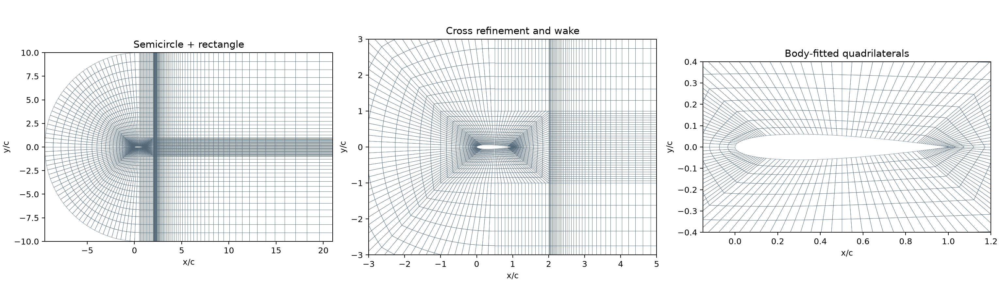
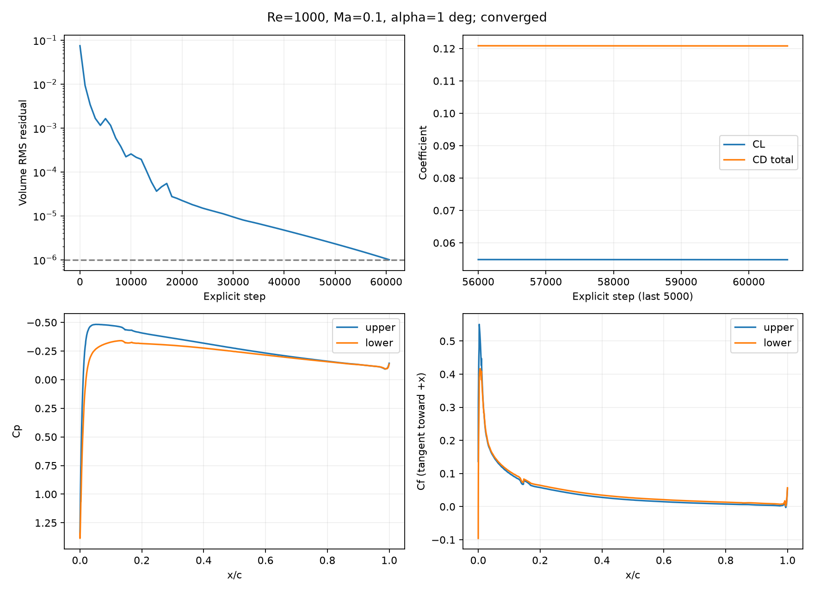

# NACA0012 二维层流 Navier–Stokes 绕流

求解二维可压缩层流 NS 方程，翼面静止、无滑移、绝热；不使用湍流模型。采用贴体结构四边形网格、FR-DG 和 native CPU FP64 后端。本文记录当前 1° 攻角基准的配置与结果。

黏性离散现由[框架公共模块](../../fr/viscous.py)提供，默认`--viscous-scheme br1-penalty --penalty 4`，
也可选择`--viscous-scheme ldg`，两者均有native实现。本文已有气动力结果对应原默认BR1加惩罚；
新增LDG通过空间算子和短步推进验证，尚未重算完整气动力基准。续算要求相同黏性配置。

## 网格设计



弦长 `c=1`，前缘 `(0,0)`，尾缘 `(1,0)`。对称翼型厚度为

```text
y_t = 0.6 (0.2969 sqrt(x) - 0.1260 x - 0.3516 x²
             + 0.2843 x³ - 0.1036 x⁴)
y_upper = y_t,  y_lower = -y_t,  0 <= x <= 1
```

尾缘闭合，翼面由样条表示，再生成完整三次 Lagrange 曲边几何。几何多项式次数与解的多项式次数 `p` 独立。

外域前部为圆心 `(0.5,0)` 的左半圆，后部连接矩形出口。翼型周围有 8 个贴体 O 型块；外部半圆环、上下加密带和下游矩形组成其余分块。水平尾迹带与竖向加密带形成十字形细化区域。共 18 个共形结构块，所有单元均为四边形，共享边及节点，无悬挂面；这是 C 形外域与贴体 O 层的组合。

| 参数 | 当前值 |
|---|---:|
| 半圆半径 | `10c` |
| 出口 | `x/c=21`，距尾缘 `20c` |
| 全域坐标范围 | `x/c ∈ [-9.5,21]`，`y/c ∈ [-10,10]` |
| 贴体核心范围 | `x/c ∈ [-1,2]`，`y/c ∈ [-1,1]` |
| 每段翼面细分数 `--surface-cells` | 16，共 8 段 |
| 贴体层数 `--radial` | 12 |
| 贴体向外增长比 `--radial-stretch` | 1.15 |
| 下游流向单元数 `--downstream-cells` | 60 |
| 外层单元数 `--outer-cells` | 16 |
| 外层增长比 `--stretch` | 1.08 |
| 总单元数 | **6,912** |
| 几何次数 | 3 |

`--core-left`、`--core-right` 和 `--cross-half-width` 调整细化核心范围，其余参数控制各方向的分辨率和过渡。贴体加密不保证网格已经足够细，应以近壁、尾迹及载荷收敛判断。

生成器读回 Gmsh 网格，检查边界标签、共享面匹配和采样 Jacobian。当前最小采样 Jacobian 为 `4.591225e-05`，面积相对解析几何面积的差为 `1.867e-09`。这些几何检查不替代流动精度验证。

## 物理模型与边界条件

归一化为 `rho_inf=c_inf=c=1`，`gamma=1.4`，因此 `p_inf=1/gamma`，来流速度为 `Ma (cos(alpha), sin(alpha))`。翼型保持水平，通过来流方向设置攻角。

常黏度 `mu=Ma/Re=1e-4`，`Pr=0.72`；动量应力采用三维 Stokes 本构的二维速度场，能量方程包含应力功与热传导。

- **远场（边界标签 1）**：对流部分使用亚声速特征条件；黏性梯度的远场原始量迹取自由来流值。
- **翼面（边界标签 2）**：静止无滑移、绝热。对流部分使用反射法向动量的 Rusanov 壁面通量；黏性梯度的速度迹设为零，温度迹取内部值，并将壁面总黏性能量通量设为零。壁面动量通量保留黏性牵引和速度跳跃惩罚。
- **黏性离散**：弱形式 BR1 梯度、平均黏性面通量及速度/温度跳跃惩罚，惩罚系数为 4。

## 数值方法

内界面对流通量采用 Rusanov。体内先将守恒状态插值到每单元 `6×6=36` 个 Gauss 积分点，再计算非线性通量并组装弱形式残差；每条边使用 6 个 Gauss 点计算公共通量和面提升。此体/面过积分用于降低非线性混叠，不改变解的自由度。Euler/NS 通量和曲边几何不保证在有限积分点下完全无混叠。

| 参数 | 当前基准 |
|---|---|
| 攻角 | 1° |
| Re / Ma / Pr | 1000 / 0.1 / 0.72 |
| 解的多项式次数 | p=2 |
| 每单元、每变量自由度 | 9 |
| 每变量总自由度 | 62,208 |
| 时间推进 | SSPRK(4,3)，局部伪时间，首阶段 RHS 复用 |
| CFL | 接受步为 1.5；起始 3 自动回退一次 |
| 黏性步长系数 | 8，仅影响步长估计 |
| 停止条件 | 每步检查残差 <1e-6 |
| CPU 线程 | 8 |

局部模式中各单元采用不同伪时间步，累计最小伪时间不代表真实物理时间。残差为守恒变量 RHS 的物理体积加权 RMS，取四个分量的最大值；残差达标不等于网格误差已足够小。

后端位于 [共享原生实现](../../fr/native/compressible.cpp)，通过 `torch.ops` 使用 CPU FP64 Tensor。实例私有工作区跨步复用，正性检查与下一步 CFL 复用波速/密度扫描；状态修改后扫描缓存失效。保留完整 RK 阶段、正性检查和求和顺序，不启用 fast-math。求解入口仅保留 native 后端。

载荷按 `q_inf=0.5*rho_inf*U_inf²` 和弦长归一化。阻力沿自由来流，升力沿 `(-sin(alpha), cos(alpha))`；翼面力采用与边界动量通量一致的数值压力/牵引。

## 1° 攻角结果

| 指标 | 结果 |
|---|---:|
| **CL** | **0.0547805492** |
| 压力 CL / 黏性 CL | 0.0559002323 / -0.0011196831 |
| **总 CD** | **0.1208103826** |
| 压力 CD | 0.0278512939 |
| 黏性 CD | 0.0929590887 |
| 最终残差 | `9.99940759e-07` |
| 完成步数 | **60,571** |
| 求解器记录用时 | 2274.3 秒，约 37.9 分钟 |

Cf 是沿翼面的局部分布，不是单个整体系数；切向统一朝 x 增大方向。`CD_viscous` 还包含黏性法向应力的阻力投影，不能简单当作 Cf 的沿面积分。



本结果通过本网格的残差判据，尚未验证网格无关性。局部伪时间推进不能用于判断真实周期性涡脱落；非定常稳定性需要另做全局物理时间计算。

两例在部分时段同时运行，记录耗时包含线程争用和结果输出，不作为独立性能基准。

## 运行与输出

从仓库根目录运行。需要仓库 Python 依赖、Gmsh、支持 C++20/OpenMP 的编译器和 Ninja。native 库首次编译后缓存在 `/tmp/fr-compressible-native/`。

```bash
# 生成当前结构网格和全域/局部预览
venv/bin/python case/naca0012-ns/generate_mesh.py

# 复现 1° 基准配置
venv/bin/python case/naca0012-ns/solve.py \
  --mesh case/naca0012-ns/results/mesh/structured.msh \
  --alpha 1 --re 1000 --mach .1 --p 2 --quadrature 6 \
  --time-mode local --cfl 3 --viscous-step-factor 8 --threads 8 \
  --residual-tol 1e-6 --output-every 1000 --time 100 --max-steps 200000 \
  --output case/naca0012-ns/results/alpha1_native_dealiased
```

结果目录为 `case/naca0012-ns/results/alpha1_native_dealiased/`。重算时可用其他 `--output` 目录保留已有结果；`--restart <目录>/solution.pt` 支持同网格、参数和时间模式续算。

| 文件 | 内容 |
|---|---|
| `metrics.json` | 配置、网格哈希、载荷、残差与停止状态 |
| `history.csv` | 载荷及残差随迭代变化 |
| `residuals.csv` | 按输出间隔记录的逐步残差 |
| `wall.csv` | 翼面坐标、Cp、Cf、法向与归一化黏性牵引 |
| `solution.pt` | 最后状态、坐标及运行记录 |
| `loads.png` / `run_summary.json` | 分布/收敛图及结果汇总 |

重新绘制 NS 结果：

```bash
venv/bin/python case/naca0012-ns/plot_loads.py \
  case/naca0012-ns/results/alpha1_native_dealiased
```

## 验证

```bash
venv/bin/python -m unittest tests.test_naca_native -v
venv/bin/python -m unittest discover -s case/naca0012-ns -p 'test*.py' -v
```

原生测试覆盖当前四边形 p=1/2/3 的 RHS、完整时间步、变化 CFL、正性与残差、线程一致性、扫描缓存失效、返回值独立性、网格检查和命令行续算。实现对照通过不能替代该流动的网格与边界收敛验证。
