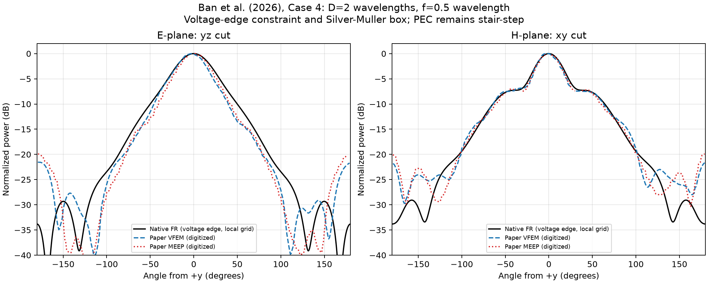

# 三维抛物面反射天线

本例采用三维 Maxwell 方程、native C++ FR 时间推进、局部分级网格和焦点电压边激励，计算 PEC 抛物面天线辐射，并与 Ban、Shi、Liu（2026）论文 Case 4 的 E/H 面方向图对比。当前 **H 面较接近论文，E 面主瓣仍偏宽**，尚未完成网格与模型参数的收敛研究。

## E/H 面论文对比



三组曲线分别为本例 native FR、论文 VFEM 和论文 MEEP，E/H 面各自按峰值归一化，纵轴为归一化功率 dB。天线轴向为 +y，馈源沿 z 极化，因此 **E 面为 yz 平面，H 面为 xy 平面**，0° 指向主辐射方向 +y。两幅图均为远场角度切面。

来源：H. Ban, X. Shi, D. Liu, *3D Vector Finite Element Modeling and Validation of High-Gain Parabolic Antennas*, Mathematics 14 (2026), 1706，[DOI](https://doi.org/10.3390/math14101706)，§3.5 Case 4、Figure 16。参考曲线从论文图片数字化获得，并非作者原始数值数据；提取方法、坐标映射和精度限制见 [reference/README.md](reference/README.md)。

## 模型与数值方法

波长、波速和阻抗均归一化为 1。反射面顶点在原点，绕 +y 轴旋转，满足 `y=(x²+z²)/(4f)`，焦点为 `(0,f,0)`。

| 参数 | 本次论文对比配置 |
|---|---|
| 口径、焦距 | `D=2λ`、`f=0.5λ` |
| PEC 实体 | `x²+z²≤(D/2)²`，`sag−0.25λ≤y≤sag` |
| 馈源 | 焦点处 z 向电压边，长度 `λ/15`，电压幅值 1 |
| 计算域 | `[-1.5λ,1.5λ]³`，边长 `3λ` |
| 外边界 | 一阶 Silver–Müller 吸收边界，无 PML |
| 网格 | `38×25×39 = 37,050` 个单元，局部分级张量积网格 |
| 单元宽度 | 天线附近 x/y 为 `0.0625λ`，z 最小约 `0.0604λ`；外部最大 `0.25λ` |
| 离散 | `p=2`，特征迎风 FR，显式 RK4 |
| 时间采样 | 预热 12 周期，随后采样 4 周期 |
| 后端 | C++17/OpenMP，CPU FP64，8 线程 |

PEC 由单元中心判定实体，在实体与自由空间交界的网格面施加镜像状态，实体单元不推进。反射面仍是阶梯近似，提高多项式阶数不能消除几何误差。局部网格无悬挂面，以过渡带连接粗细区域；细化带沿坐标方向延伸，显式时间步仍受最小单元限制。

电压激励满足 `C(E)=∫edge E·dl=V(t)`，其中 `V(t)=ramp(t) cos(2πt)`，在两个周期内光滑开启。线积分采用 Gauss 积分，共享边取相邻单元平均迹；以对角质量矩阵构造最小能量修正，在 RHS 和 RK 阶段施加约束。论文采用 FEM 边自由度罚法，本例采用 FR 线积分约束投影，两者离散实现不同。

在包围馈源及反射器的无源自由空间闭合六面体上，对接受时间步的电磁场做梯形周期相量积分，再通过 Love 等效电磁流计算远场，复用点阵算例的 `far_field`。结果包含馈源直达辐射、PEC 反射和边缘绕射；未建模馈线、支撑、实际端口阻抗与导体损耗。

## 实算结果

以下数据来自 `results/parabolic_antenna/paper_ban2026/voltage_local4/` 的 `metrics.json` 和 `paper_comparison.json`。

| 指标 | 本例 native FR | 论文 VFEM（数字化） | 论文 MEEP（数字化） |
|---|---:|---:|---:|
| E 面半功率波束宽度 | **43.92°** | 36.87° | 37.32° |
| H 面半功率波束宽度 | **33.63°** | 30.81° | 31.83° |
| E 面前半空间功率相对 L2 差 | — | 16.52% | 14.42% |
| H 面前半空间功率相对 L2 差 | — | 8.52% | 7.77% |
| E 面主瓣 dB 均方根差 | — | 1.46 dB | 1.47 dB |
| H 面主瓣 dB 均方根差 | — | 0.46 dB | 0.47 dB |

差异均为本例相对相应论文曲线的比较：前半空间为 `|θ|≤90°`，主瓣范围为 `|θ|≤50°`，只使用参考图中可提取的采样点。小数位用于记录读数，不代表论文图像具有同等精度。

本次推进 **6480 步**至 `t=16`，推进及相量采样用时 **1328.5 秒（22.1 分钟）**，平均约 `0.205 秒/步`，不含初始化编译、最终远场及绘图。E/H 面峰值均为 0°，H 面 0°/180° 功率比为 **33.82 dB**。最后两个采样周期的闭合面相量相对变化为 **0.00734%**，最大接受状态电压约束误差为 **1.44e-15**，通过周期稳定性验收。

完整球面积分得到轴向方向性系数 **11.35 dBi**。论文 Table 6 的 VFEM/MEEP 峰值分别为 11.9860/12.4062 dB；其端口功率归一化未充分公开，因此不将本例方向性系数作为可严格比较的端口增益。

当前已对齐口径、焦距、极化、焦点电压激励、外盒尺寸和外边界类型。论文未公开的激励边长和反射器背面几何，在本例中分别选为 `λ/15` 和 `0.25λ` 壳厚。阶梯 PEC 几何、馈电约束离散与这些参数仍可能影响方向图。周期稳定性通过表明时间采样已稳定，不能据此认定论文复现成功或空间离散已收敛。

## 运行与输出

以下命令均从仓库根目录执行。需要仓库 Python 依赖和支持 C++17/OpenMP 的 `g++`。首次运行自动编译 native 后端，通过 `ctypes` 调用 C ABI，编译缓存位于 `/tmp/fr-parabolic-native/`，无需 LibTorch 开发包。

```bash
# 复现本文配置，同时计算球面积分方向性系数
venv/bin/python -m case.parabolic_antenna.paper_run --threads 8 --sphere

# 已有 solution.pt 时仅重新后处理
venv/bin/python -m case.parabolic_antenna.paper_run --reuse --sphere
```

默认输出目录为 `results/parabolic_antenna/paper_ban2026/voltage_local4/`。可调整 `--refinement`、`--local-refinement`、`--p`、`--voltage-length`、`--warmup` 和 `--periods` 做敏感性检查；改变配置时应使用 `--output` 指定独立目录。

| 输出 | 内容 |
|---|---|
| `paper_comparison.png` | 本例与论文 VFEM/MEEP 的 E/H 面对比 |
| `paper_patterns.csv` | 本例 E/H 面归一化远场功率 |
| `paper_comparison.json` | 论文来源、模型差异、波束宽度和曲线差异；`--sphere` 时含方向性系数 |
| `metrics.json` | 网格、时间步、耗时、电压约束误差和周期稳定性指标 |
| `solution.pt` | 最终物理场、真实网格边坐标、PEC 掩码、闭合面相量和远场数据 |
| `pattern.csv`、`pattern.png` | 通用求解器的 H 面归一化方向图 |
| `field.png`、`mesh.png` | 场截面及局部网格图 |

本 README 仅展示论文 E/H 面对比图，已从上述结果目录复制为本目录的 [paper_comparison.png](paper_comparison.png)，无需依赖计算输出目录即可显示。

通用入口 [solve.py](solve.py) 默认使用 `D=3λ`、`f=1λ`、球状体电流馈源和 PML，与本文配置不同；复现本文应使用 [paper_run.py](paper_run.py)。历史体电流、均匀网格结果位于 `results/parabolic_antenna/paper_ban2026/r2/`，不与当前版本混用。

## 验证

```bash
venv/bin/python -m unittest discover -s tests -p 'test_parabolic*.py' -v
```

测试涵盖几何与源、native FR、完整 RK4、非均匀网格度量、线程一致性、电压边线积分及电压/导数约束、零电压能量耗散、闭合面多项式迹和绘图采样等。

论文预设自动启用 `--validate`，要求最后两个采样周期的闭合面相量相对变化小于 3%；未通过时保留输出并以非零退出码结束。此验收不替代网格、边界和馈源参数的收敛检查。
