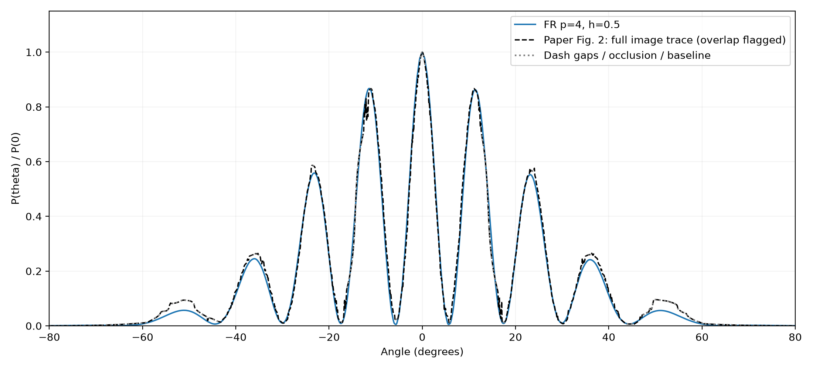

# 量子双缝波包散射

二维高斯波包穿过有限高双缝势垒，计算概率密度和远场干涉角分布。物理条件参考 De Raedt 与 Michielsen 论文的零磁场、正入射算例（图 2）：[论文 DOI](https://doi.org/10.1063/1.168483)。

## 方程与物理设置

以德布罗意波长 λ 为长度单位、`E=ħ²(2π/λ)²/(2m)` 为能量单位、`ħ/E` 为时间单位：

```text
i ∂ψ/∂t = -(∂²ψ/∂x² + ∂²ψ/∂y²)/(4π²) + Vψ
ψ(x,y,0) = C exp(-((x+22)²+y²)/(2·6²)) exp(2πix)
```

| 参数 | 设置 |
|---|---|
| 计算域 | `[-52,52]×[-26,26] λ²` |
| 外边界 | 齐次 Dirichlet，`ψ=0` |
| 屏障位置与厚度 | `0≤x<4λ` |
| 中间挡块 | `-2λ≤y≤2λ` |
| 两条缝 | `2λ<abs(y)<3λ`，缝宽 `1λ`、中心间距 `5λ` |
| 势能 | 屏障材料内 `V=100E`，其余为 0 |
| 初始波包 | 中心 `(-22λ,0)`，沿 x 正方向入射 |
| 高斯宽度 | 振幅宽度 `σx=σy=6λ`，概率密度标准差为 `6/√2 λ` |
| 磁场与入射角 | `B=0`、`θ0=0` |
| 终止时间 | `t=160 ħ/E`，同时记录 `t=140` |

初值按离散积分归一化，推进中不重新归一化。计算保留盒内高斯尾部，初始约有 `10^-7` 概率位于屏障材料内。论文未明确给出初始波包中心和截窗宽度，因此对照采用上表明确给出的设置。

## 数值方法

采用均匀笛卡尔网格，单元宽 `h=0.5λ`、多项式次数 `p=4`，共 **208×104 单元、540,800 个复自由度**。屏障及缝口边缘与单元面贴合。

空间算子使用 `CartesianLDG`：Gauss–Legendre 解点、Radau/DG 修正函数，梯度和散度采用互补交替迹。经求积权重变换得到实对称的离散 Hamiltonian。

时间推进使用 Chebyshev 指数作用，Bessel 系数按尾项容差截断。C++/OpenMP 内核融合 x/y 动能、势能、Chebyshev 递推与系数累加。Torch 用于启动时组装空间算子，NumPy/SciPy 用于系数和后处理。`--threads` 控制 native 线程数；`--dt` 为指数推进分段长度，默认 2，不是显式 RK 稳定性步长。

## 运行

需要仓库 Python 依赖、支持 C++17 和 OpenMP 的编译器。命令从仓库根目录执行，共享库按源码哈希编译到 `/tmp`。

```bash
# 求解，输出到 results/quantum_double_slit/fr_p4_h05/
OPENBLAS_NUM_THREADS=1 python -m case.quantum_double_slit --threads 8

# 与论文图像轨迹对照，并更新本目录的 comparison.png
python -m case.quantum_double_slit.compare

# 检查空间算子和 native 推进
python -m unittest tests.test_quantum_double_slit tests.test_second_order -v
```

求解输出包括波函数 `solution.npz`、角分布 CSV/PNG、网格图、概率密度图和 `report.json`。报告记录总概率、离散能量、区域概率、侧峰和两个末期时间的角分布变化。

## 当前结果

`t=160` 的远场角分布以中央强度归一化：

| 指标 | 结果 |
|---|---:|
| 第一侧峰角度 | 11.4° |
| 第一侧峰高度 | 0.86237 |
| 右侧区域概率 | 0.15030155 |
| 总概率变化 | −1.91×10⁻¹¹ |
| t=140→160 角分布相对 L2 变化 | 0.130% |



按论文式 (2.6)，对透射波包作二维 Fourier 变换，沿 `qy=qx tanθ` 对 `qx>0` 的模平方积分，再以 `θ=0` 归一化。采用复振幅局部插值、均匀网格 FFT、两倍补零和 `0≤qx≤2` 的积分区间，角度采样间距为 `0.1°`。该归一化曲线的角度积分不解释为透射概率。

论文参考由扫描图的整条曲线路径提取，包含 904 个路径点；黑色虚线表示图像轨迹，灰色点线表示虚线间隙、遮挡和基线限制部分。虚实线重叠区域不能唯一恢复作者的数值曲线。可见墨迹上的描述性 RMSE 约 `0.0215`，读图敏感性范围约 `0.0055–0.0818`；此范围不是统计置信区间，RMSE 也不是精确解误差。

数据、状态码和原图回投检查见 [reference/README.md](reference/README.md)。逐点数值和完整报告位于 [results/quantum_double_slit/summary.md](../../results/quantum_double_slit/summary.md)。
