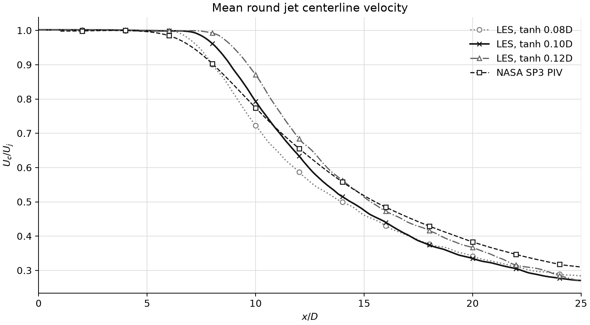

# 亚声速圆射流 LES

算例计算静止环境中的三维圆射流近场，以 [SMC000 SP3](https://aiaa-jnpw.github.io/aiaa-jnpw/cases/) 为目标工况。计算域从喷口出口开始，圆形速度入口的半径为 `0.5D`。

## 25D 圆柱域结果与 SP3 实验

三组 LES 使用同一套长 `25D`、半径 `10D` 的 28,224 单元圆柱网格，`Re_D=600000`、`Ma=0.5`、`p=3`、`CFL=1.6`，采用 WALE、`nscbc-3d-ambient` 和轴对称层流近似初场。入口持续扰动均为零。`0.08D` 和 `0.10D` 两组只改入口 `tanh` 宽度，均未施加人工扰动。`0.12D` 组在第 6,000 步施加一次峰值为 `0.005 Uj` 的横向扰动，也会影响剪切层发展。

| 入口 `tanh` 宽度 | 等权统计步数区间 | 统计时长 `Δt Uj/D` |
| --- | --- | ---: |
| `0.08D` | 200,001–300,000 | 381.907 |
| `0.10D` | 200,001–300,000 | 386.827 |
| `0.12D` | 200,001–300,023 | 391.034 |

### 平均中心线速度与射流扩展



| 指标 | `0.08D` | `0.10D` | `0.12D` | NASA SP3 |
| --- | ---: | ---: | ---: | ---: |
| 势核末端 `x/D`（首次达到 `Uc/Uj = 0.95`） | 7.39 | 8.20 | 8.98 | 7.10 |
| `Uc/Uj`，`x/D = 10` | 0.723 | 0.793 | 0.871 | 0.774 |
| `Uc/Uj`，`x/D = 12` | 0.587 | 0.634 | 0.684 | 0.656 |
| `Uc/Uj`，`x/D = 20` | 0.342 | 0.335 | 0.367 | 0.383 |
| 半速度半径 `r₁/₂/D`，`x/D = 10` | 0.735 | 0.659 | 0.593 | 0.743 |
| 中心线速度平均绝对相对误差，`1D–25D` | 6.96% | 6.82% | 4.85% | — |

从 `0.08D` 加宽到 `0.10D`，势核延长 `0.81D`，`10D` 处速度升高、半宽减小。`0.08D` 的势核和 `10D` 半宽最接近实验，`0.10D` 的中心线速度在 `10D` 和 `12D` 更接近实验。`0.12D` 的中心线全段误差最小，势核也最长。三组在 `20D` 的中心线速度均低于实验，且不再随入口宽度单调变化。中心线误差用 `1D–25D` 内 241 个共同 PIV 测点计算，按当地 PIV 速度归一化。[中心线速度数据](validation/centerline_vs_sp3.csv) · [半宽数据](validation/half_velocity_radius_vs_sp3.csv)

### 径向自相似与瞬时截面

| 入口宽度 | 自相似剖面 | `10D–20D` 归一化速度最大差值 | 第 300,000 步的 `z=0` 瞬时轴向速度 |
| --- | --- | ---: | --- |
| `0.08D` | [径向剖面](figures/azimuthal_mean_similarity_tanh_008D.png) | 0.023 | [截面](figures/axial_velocity_z0_step300000_tanh_008D.png)，`t Uj/D=1138.585` |
| `0.10D` | [径向剖面](figures/azimuthal_mean_similarity_tanh_010D.png) | 0.050 | — |
| `0.12D` | [径向剖面](figures/azimuthal_mean_similarity_10D_20D_with_1D_24D.png) | 0.029 | [截面](figures/axial_velocity_z0_step300000.png)，`t Uj/D=1175.051` |

自相似图使用方位平均速度，以当地中心线速度和半速度半径归一化。表内最大差值在 `0.25 ≤ r/r₁/₂ ≤ 2` 上逐半径比较。`0.08D` 的剖面从约 `8D` 开始重合，`0.10D` 在 `15D–20D` 的最大差值降至 0.023。瞬时截面采用相同色标，`0.12D` 的连续高速带更长，`0.08D` 的剪切层起伏更早出现。[径向统计数据](validation/velocity_similarity.csv) · [与 RANS 的对照](../round_jet_rans/README.md)

## 近场求解

默认初场从圆形 tanh 喷口剖面构造。轴向速度求解常速对流与圆截面层流黏性扩散，径向速度由连续性给出，压力和密度设为环境值。这是轴对称层流对流–扩散近似。入口使用已完成启动的喷口剖面，扰动幅度默认为零。开放边界默认采用 `nscbc-3d-ambient`，允许环境卷吸。黏性梯度在入口使用带喷口窗函数的原始变量边界值，其余面使用内部迹。

时间单位为 `D/Uj`。默认 `Re_D=600000`、环境声速定义的 `Ma=0.5`、入口 tanh 参数 `0.12D`。数值设置为 `p=3`、`CFL=1.6`、Rusanov、LDG、SSPRK(4,3)、WALE（`Cw=0.5, Prt=0.9`）及 HiFiLES 模态滤波（阈值 0.1、系数 36、阶数 2）。默认 `native-hex-p3`，场数据使用 CPU FP64 SoA。原生编译要求同 [channel-les](../channel-les/README.md)。显式指定 `--backend torch` 可运行笛卡尔参考实现。

[default.json](default.json) 保存网格几何、流向坐标和求解参数。默认网格为长 `25D`、半径 `10D` 的圆柱，周向 36 格、外环径向每侧 10 层、中心块 `9 × 9`、流向 64 层。径向 tanh 参数为 2.1，全域有 28,224 个六面体。启动命令会根据配置生成或核对 `mesh.msh`。默认发展到 200,000 步，每 1,000 步保存检查点。

```bash
# 在仓库根目录用本机的 8P 绑核启动
bash case/round_jet_les/run.sh

# 只生成默认网格
python -m case.round_jet_les.generate_tanh_mesh
```

也可以用 `python -u -m case.round_jet_les` 自行安排 CPU 亲和性。默认输出目录是 `results/round_jet_les/sp3_cylindrical_25d_tanh_r10_theta36_radial10_ambient_laminar/`。每 10,000 步向 `slices/` 单独写一张 `z=0` 轴向速度图，文件名带步数，续算时保留同名图片。色标线性且零速为白色。可用 `--slice-every` 调整写图间隔，`--initial-flow rest` 可用于静止初场对照。可用 `--output` 指定另一目录，还可用 `--max-steps` 做短跑。显式传入 `--hex-mesh`、`--mesh` 或 `--cells` 可运行网格对照。结束时输出中心线速度和半宽 `centerline.csv`、方位平均径向剖面 `radial_profiles.csv` 和 `summary.json`。开始时间统计前结束时，剖面为瞬时值。

长跑可用 `--checkpoint-every 1000` 保存场、累计统计和步数。在相同网格和数值设置下，对同一输出目录使用 `--resume` 续算。`--max-steps` 指定总步数。`--sample-from-step` 指定首次采样的绝对步数，后续按固定的无量纲时间间隔采样。续算时加 `--reset-samples` 可清空已有统计并指定新的起始步数。后续续算沿用新参数，省略 `--reset-samples`。

原生融合残差和 RK 阶段默认按每包 2 个空间组动态领取，每组完整包含 `4×4×4` 个单元。
推进复用两块 RK 阶段缓冲区，并在两块完整步状态之间轮换，统计采样在状态被覆盖前完成。
对流和 LDG 复用 FP64 密度倒数。对流在解点逐单元、分量计算体通量后立即做提升，
每个分量使用 64 个解点的临时区。

笛卡尔启动段示例推进到 `t Uj/D=2`。使用 `--cells 32 24 24 --time 2 --sample-from 1.5 --sample-interval .1`
可生成启动段剖面，历史示例位于 `results/round_jet_les/native_p3_cfl16_t2/`。
这段短算例展示发展中的近场，时间窗口为 `t Uj/D=1.5–2`。

## 统计与实验后处理

参考数据采用 [NASA SP3 共识 PIV](https://ntrs.nasa.gov/citations/20110023688)。该工况按环境声速定义的入口马赫数为 0.50。近场发展对入口剪切层和扰动设置敏感。

长跑使用 `32 × 24 × 24` 网格、入口扰动系数 `0.03`、`--max-steps 160000 --time 1000000 --sample-from-step 100000 --sample-interval .25 --checkpoint-every 1000 --full-field-statistics`。图上标明实际采样时间窗口和样本数。

`--full-field-statistics` 在每个 FR 解点在线累计密度、压力和三分量速度的时间平均，以及六个速度协方差。采样间隔与剖面相同。检查点按原周期保存，包含续算所需的统计量。完成时写出 `field_statistics.pt`，可用 `torch.load(..., weights_only=True)` 读取。标量场维度为 `(cx, cy, cz, i, j, k)`，矢量和应力的分量在第一维。文件包含无量纲网格边界、参考解点、采样窗口及分量顺序，解析尺度湍动能为三个法向雷诺应力之和的一半。

高频续算从第 160,000 步的检查点重开统计窗口，并推进到第 260,000 步。首次启动使用 `--resume --reset-samples --sample-from-step 160000 --sample-interval .02 --sample-max-steps 100 --max-steps 260000`。如果 100 个推进步内尚未到达下一个物理采样时刻，就提前采样，并从该时刻重新计时。各样本按距上次采样的实际物理时间加权，输出记录最后采样时刻。

逐步等权统计使用 `--sample-max-steps 1 --sample-weighting step`。从 `--sample-from-step` 指定步的下一步开始，每个已完成的时间步权重都为 1，采样间隔参数不裁切时间步。重开窗口时使用一次 `--reset-samples`，随后从检查点续算时省略此参数。

出口位置对照将原 `32 × 24 × 24` 网格的流向边界数组追加 `17D, 18D, ..., 24D`，横向坐标沿用原值。扩展网格位于 `results/round_jet_les/sp3_native_24d/mesh_40x24x24.json`。24D 算例由静止初场启动，使用 `--sample-from-step 100000 --max-steps 200000 --time 1000000 --sample-interval .02 --sample-max-steps 100 --checkpoint-every 1000 --full-field-statistics`。流向中心线的采样间隔保持为 `0.1D`。

20D 声学出口算例将原流向边界数组追加 `17D, 18D, 19D, 20D`，使用 `36 × 24 × 24` 网格及相同的统计设置。`--outlet nscbc` 在下游面采用 [Poinsot–Lele](https://ntrs.nasa.gov/citations/19920065566) 的局部一维特征条件。利用 FR 单元的面法向导数和提升算子，将亚声速出口的入射声学振幅设为零。局部回流携带环境熵和切向速度。该选项仅改下游边界面的通量。默认 `--outlet characteristic` 用于原算例和对照。

将 [NASA 的 consensus1.zip](https://www.nasa.gov/wp-content/uploads/2026/01/consensus1.zip?emrc=696f8b38e07ce) 下载到 `results/round_jet_les/reference/` 后，使用包含时间平均的求解结果生成叠图和配对 CSV。

```bash
python -m case.round_jet_les.compare \
  results/round_jet_les/sp3_native_100k results/round_jet_les/reference/consensus1.zip \
  --expected-steps 160000
```

`piv_centerline.csv` 给出中心线平均轴向速度和半速度半径。`piv_radial_profiles.csv` 给出 `x/D=1, 2, 5, 8, 10, 12` 的平均轴向速度。实验剖面取 PIV 中心面两侧的平均，LES 剖面采用方位角平均。半速度半径为速度降至当地中心线值一半的半径。PIV 速度按实验理想喷速归一化，LES 按设定喷速归一化。`piv_comparison.png` 汇总上述曲线。

### 25D 圆柱域结果复现

`0.08D` 和 `0.10D` 从默认层流近似初场启动。用下列参数运行两组计算，并与 SP3 数据配对。

```bash
for width in 0.08 0.10; do
  run="results/round_jet_les/sp3_tanh_width${width#0.}_300k_repro"
  bash case/round_jet_les/run.sh --output "$run" --shear-width "$width" \
    --sample-from-step 200000 --sample-max-steps 1 --sample-weighting step \
    --full-field-statistics --max-steps 300000 --slice-every 10000
  python -m case.round_jet_les.compare "$run" \
    results/round_jet_les/reference/consensus1.zip --expected-steps 300000
done
```

`0.12D` 的原 300,000 步结果从已在第 6,000 步施加横向扰动的检查点续算。下列命令从发展阶段接入等权统计，产生瞬时截面和原 300,000 步对照。[原中心线对比图](figures/mean_centerline_velocity_vs_nasa_sp3.png) · [0.08D 中心线对比图](figures/mean_centerline_velocity_vs_nasa_sp3_tanh_008D.png)

```bash
bash case/round_jet_les/run.sh --resume --reset-samples \
  --sample-from-step 200000 --sample-max-steps 1 --sample-weighting step \
  --full-field-statistics --max-steps 300000 --slice-every 10000

python -m case.round_jet_les.compare \
  results/round_jet_les/sp3_cylindrical_25d_tanh_r10_theta36_radial10_ambient_laminar \
  results/round_jet_les/reference/consensus1.zip --expected-steps 300000
```

综合对比图采用恢复至第 300,023 步的 `0.12D` 平均场，比原对比图多 23 个等权样本。自相似图使用 `field_statistics.pt`，在整数 `x/D` 截面按 `Δr=0.02D` 取样，每个半径用 192 个等角度点做周向平均，再用线性插值找半速位置。

### RANS 验证用对比数据

`validation/` 保留三组 SMC000 LES 的最终平均结果与 NASA SP3 共识 PIV 的配对数据。列名前缀 `les_008`、`les_010`、`les_012` 和 `sp3` 分别对应三种入口 tanh 宽度和实验。后缀 `_Uj`、`_Uj2` 表示按喷速或喷速平方归一化。PIV 使用实验理想喷速，LES 使用设定喷速。

| 数据 | 内容 |
| --- | --- |
| [中心线速度和湍流统计](validation/centerline_vs_sp3.csv) | 在 `1D–25D` 的 PIV 测点比较平均轴向速度、湍动能和轴向速度脉动 RMS。 |
| [半速度半径](validation/half_velocity_radius_vs_sp3.csv) | 每隔 `1D` 比较 `r₁/₂/D`。PIV 径向覆盖只能在整数测站上确定到 `18D`，缺失值记为 `nan`。 |
| [径向速度和雷诺应力](validation/radial_profiles_vs_sp3.csv) | 在 `x/D=5, 8, 10, 12, 16, 18` 的有效 PIV 半径上比较平均轴向和径向速度、湍动能、轴向–径向雷诺协方差 `uxur_Uj2` 和轴向速度脉动 RMS。 |
| [自相似剖面](validation/velocity_similarity.csv) | 每隔 `1D` 导出三组 LES 以当地中心线速度和半速度半径归一化的轴向速度。 |
| [截面通量诊断](validation/section_flux_diagnostics.csv) | 每隔 `1D` 对 `r≤5D` 的三组 LES 积分。包含平均密度与平均速度的质量通量、平均流轴向动量通量，以及加上解析尺度轴向速度方差后的对流动量近似。 |

LES 径向数据用 192 个等角度点做周向平均，PIV 用中心面两侧折叠平均。径向速度和轴向–径向雷诺协方差先转换为向外的径向分量，再做平均。湍动能取三个法向速度方差之和的一半，LES 列只含解析尺度。截面质量通量以 `ρ∞ Uj D²` 归一化，动量通量以 `ρ∞ Uj² D²` 归一化。积分只用导出的平均密度、平均速度和解析尺度轴向速度方差，完整的轴向动量收支还需计入密度波动关联、压力、应力及侧边界通量。

从三组平均场和 SP3 共识数据重新导出这些小表，可在仓库根目录运行以下命令。

```bash
python -m case.round_jet_les.export_validation results/round_jet_les/reference/consensus1.zip \
  --width-008 results/round_jet_les/sp3_tanh_width008_100k \
  --width-010 results/round_jet_les/sp3_tanh_width010_300k \
  --width-012 results/round_jet_les/sp3_tanh_width012_300023_recovered
```

### 三维 FW–H 面采样

从 300,000 步检查点续算时，保留累计统计，使用 `--fwh-surface` 指定包络面 JSON。其 `upstream_cap_x_D`、`nominal_downstream_cap_x_D` 和 `alternative_downstream_caps_x_D` 定义端盖位置。侧面使用 `radius_coefficients=[a,b,c]` 定义 `r/D=a+b·s+c·s²`，其中 `s=x/D-upstream_cap_x_D`。`secondary_surface_radius_offset_D` 给出用于侧面位置敏感性对照的外移量。

```bash
run=results/round_jet_les/sp3_fwh_410k
bash case/round_jet_les/run.sh --output "$run" --resume \
  --sample-from-step 200000 --sample-max-steps 1 --sample-weighting step \
  --full-field-statistics --max-steps 410000 --slice-every 10000 \
  --fwh-surface "$run/fwh_candidate_surface_step300000.json" --fwh-interval 0.04
```

新输出目录需要放入原算例的 `mesh.msh`、第 300,000 步的 `checkpoint.pt` 和候选面 JSON。记录器在相邻两个已接受状态间插值，统一采样时间间隔而不裁切推进步长。输出目录下的 `fwh/` 含 `metadata.json`、`quadrature.npz` 和 `surface.f32`。后者按 `[sample,point,channel]` 排列、使用小端 float32，通道为 `rho-1,u,v,w,p-p0`，单位沿用 LES。元数据记录时间原点、采样间隔和供各闭合面共享的面片索引。检查点保存已提交的帧数，恢复运行时截去超出检查点的末尾数据并接着写入。

采样结束后用静止均匀介质的三维自由场格林函数投影。默认观测球半径为 `50D` 和 `100D`，以喷口中心为球心，极角零度朝下游。通过周向傅里叶展开共享同一纬圈上的积分核，保留各闭合面的独立结果。面外四极子项和黏性面应力省略，使用不同面形和端盖的结果检查敏感性。声压单位为 `rho_inf Uj²`，图中的分贝以该无量纲压力单位为参考。

```bash
python -m case.round_jet_les.fwh results/round_jet_les/sp3_fwh_410k/fwh \
  --radii 50 100 --band 0.05 2 --window 100
```

输出目录 `fwh/farfield/` 保存各球面的分角度功率谱、带内 RMS、球面声级图和端盖、测距对照图。处理时从记录两端去掉传播时延和加窗影响的区间，再用 50% 重叠的 Welch 窗平均。

有桌面图形环境时，可用 Matplotlib 查看并拖动旋转球面声级。箭头标记射流下游的零度方向，球面绘制 (5°) 到 (90°) 每隔 (5°) 的等极角线，每隔 (15°) 加粗。默认显示 `100D` 球面和 `22D` 主端盖。

```bash
./case/round_jet_les/view_sound_sphere.sh
```

启动脚本优先读取正式投影结果，正式结果完成前使用最新预览。用 `--radius 50` 切换到 `50D`，也可以显式传入其他 `spherical_spectra.npz`。

### 单次剪切层扰动续算

`--perturb-at-step` 接受绝对步数列表。每到指定步，在 `x/D=3–9` 的近喷口剪切层给横向速度叠加一次扰动。`--perturb-amplitude` 是扰动速度增量的峰值，以 `Uj` 为单位，默认 0.005。更新时保持密度、压力和轴向动量，并重新计算步长。已施加和待施加的步数随检查点保存，续算时自动恢复。

从复制出的 380,000 步流场检查点启动三次扰动的对照。该分支使用独立目录，声学时序在原分支结束。从第 400,001 步开始重新做 100,000 步逐步等权全场统计。

```bash
bash case/round_jet_les/run.sh --output results/round_jet_les/sp3_shear_seeds_500k \
  --resume --reset-samples --sample-from-step 400000 --sample-max-steps 1 \
  --sample-weighting step --full-field-statistics --max-steps 500000 \
  --perturb-at-step 380000 390000 400000 --perturb-amplitude 0.005 --slice-every 10000
```

该分支首次写入自己的检查点后，续算时省略 `--reset-samples`。

## 笛卡尔网格对照

坐标以喷口直径 `D` 为单位，流向为 `x`。沿用槽道的 `CartesianMesh` 文件格式。两个横向方向用对称的双曲正弦映射，沿轴线聚集单元，向外逐渐放粗。流向用指数映射，在入口附近加密。

| `--cells 32 24 24` 对照 | 数值 |
| --- | --- |
| 计算域 `(x, y, z)/D` | `[0, 16] × [-4, 4] × [-4, 4]` |
| 单元数 | `32 × 24 × 24 = 18432` |
| 流向单元宽度 | `0.1615D–1.1211D` |
| 横向单元宽度 | `0.0823D–0.9647D` |
| 轴向截面上跨过喷口边缘的横向单元宽度 | 约 `0.152D` |

网格是全域张量积，横向细网格贯穿流向。喷口圆周是入口截面上的几何参考线，射流剪切层的分辨率后续随入口剖面厚度和 FR 阶数检查。

### 圆柱网格

圆柱域长 `40D`、半径 `6D`，由中心方块和四个外环块共形拼接。截面中心块为 `16 × 16`，四个外环块各为 `16 × 10`。流向沿用前 `16D` 的 32 层，之后加 12 层，依据 SP3 下游中心线衰减拟合使单元宽度约与 `x - 0.64D` 成正比。新增流向宽度为 `1.253D–2.969D`。全域共 39,424 个二次曲边六面体，物理标签为 `inlet`、`outlet`、`ambient` 和 `fluid`。

```bash
python -m case.round_jet_les.generate_cylindrical_mesh
```

用 `--length 25` 可生成长 `25D`、半径 `6D` 的短域网格。前 `16D` 仍为 32 层，下游增加 6 层，合计 34,048 个六面体。默认输出为 `results/round_jet_les/sp3_cylindrical_25d/mesh.msh`，用 `--output` 可指定其他位置。求解器从网格读取流向分层和总长度。

`--length 25 --axial-cells 40` 生成流向等间距的短域，流向单元宽度为 `0.625D`，横截面仍为 896 个单元，全域共 35,840 个六面体。默认输出为 `results/round_jet_les/sp3_cylindrical_25d_uniform40/mesh.msh`。

默认 25D tanh 网格的 64 层轴向坐标按 SP3 中心线速度分配，首格宽 `0.21D`，相邻格宽增长率不超过 1.03。坐标保存在 `default.json`，生成时直接使用。若要从实验参考重新计算轴向分布，可以为 `generate_tanh_mesh` 传入 `consensus1.zip`。横截面可用 `--radius`、`--circumferential-cells`、`--radial-cells` 修改。原生内核为轴对齐的仿射六面体使用常量几何度量，为曲网格单元使用逐点度量，两类单元共用面通量和 group 打包。

`native-hex-p3` 在模态滤波实际修改单元时，随该步后续 RK 残差一起复核对流和黏性步长。任一子步超限就从上一个已接受状态缩步重试。重试期间步数、模拟时间和统计量保持原值。未触发滤波时仍按设定 CFL 选步长。运行日志中的 `filter_retries` 记录最近一段的缩步重试次数。

生成器调用 Gmsh，默认输出 `results/round_jet_les/sp3_cylindrical_40d/mesh.geo` 和 ASCII MSH 2.2 网格 `mesh.msh`。`fr.HexGeometry.read` 读取网格并预计算解点度量、面面积向量和相邻面点的排列。`native-hex-p3` 在初始化时计算固定网格的雅可比倒数，用 C++ AVX2 分组内核推进 Rusanov、LDG、WALE、SSPRK(4,3) 和保持物理单元均值的模态滤波。圆柱侧面允许环境卷吸。全场统计文件记录原网格路径、哈希和单元重排。

组间 LDG 黏性 trace 由所属组计算后供邻组复用。面数据就绪时立即修正，等待期间仅暂存待修正单元的残差，收尾时从只读 RK 输入重插值两侧状态。默认每个 OpenMP 批次处理 8 个相邻组，可用 `--group-packet` 调整。用现有检查点和同目录的网格测量单步耗时可运行 `python -m case.round_jet_les.benchmark_interfaces <checkpoint.pt> --threads 8`。

下游可选 `--outlet nscbc-3d`。亚声速出流点用两个物理切向的无黏输运项修正入射声波，横向项权重为 `0.25(1-|M_n|)`。环境压力松弛采用系数 0.25，长度尺度为域长。局部回流点使用原有的远场特征状态，从静止环境取得入射信息，由域内确定出射信息。下游的回流点跳过三维修正。修正使用预计算的曲网格度量和 FR 面提升系数。原 `--outlet nscbc` 可以用于一维声学修正对照。

`--outlet nscbc-3d-open` 同时在下游使用上述处理，并在所有 `ambient` 面使用三维特征边界。侧面的局部亚声速回流仍将入射熵和两条剪切波的法向振幅置零。使用每个曲面 Gauss 点的外法向判断出流或回流，保留 `inlet` 上的喷口条件。该模式适用于 `native-hex-p3`。边界模式是检查点配置的一部分，切换模式时应保留旧的检查点并在独立输出路径续算。

`--outlet nscbc-3d-unified` 对三个开放面逐点应用同一套特征判断。亚声速出流使用带横向项的三维修正，亚声速入流使用环境特征状态。上游端面继续使用原有喷口入口。窗函数低于 `1e-3` 时逐渐启用开放面出流修正，到 `1e-6` 时全量启用。端面与侧面的交界在相邻的一层单元内将出流处理平滑过渡到环境特征状态，两侧在交界采用同一环境参考状态。三维修正的权重按到交界的参考坐标距离用三次光滑插值计算。

`--outlet nscbc-3d-ambient` 用于检查开放边界的环境压力约束。圆柱侧面和端面外圈使用基于静止环境的特征通量，允许局部流入和流出。喷口速度剖面和黏性处理与原算例相同。下游端面在 `r/R <= 0.4` 处使用三维声学出流修正，`0.4 < r/R < 0.8` 内平滑过渡，`r/R >= 0.8` 处使用与侧面相同的环境特征状态。用独立目录可从静止初场进行对照。

```bash
bash case/round_jet_les/run.sh --outlet nscbc-3d-ambient --initial-flow rest \
  --output results/round_jet_les/sp3_cylindrical_25d_tanh_r10_theta36_radial10_ambient \
  --max-steps 40000
```

小域出口对照采用 `4D × 3D × 3D` 的 `16 × 12 × 6` 均匀六面体网格、`p=3` 和 CFL 1.6，并以延长至 `6D` 的同间距网格为参考。对约 37° 入射的斜向压力脉冲，在 `tUj/D=1` 时，近出口区域的无量纲压力 RMS 误差从 `7.58e-4` 降至 `4.08e-4`。在强涡穿越出口测试中，最低出口法向速度从 `-0.61Uj` 变为 `-0.37Uj`，仍有局部回流。该测试中后期压力误差有所增大。

```bash
OMP_PROC_BIND=close OMP_PLACES='{0},{2},{4},{6},{8},{10},{12},{14}' \
  taskset -c 0,2,4,6,8,10,12,14 python -u -m case.round_jet_les \
  --hex-mesh results/round_jet_les/sp3_cylindrical_40d/mesh.msh \
  --backend native-hex-p3 --outlet nscbc-3d --p 3 --cfl 1.6 --threads 8 \
  --time 1000000 --sample-from-step 100000 --max-steps 200000 \
  --sample-interval .02 --sample-max-steps 100 --checkpoint-every 1000 \
  --full-field-statistics --output results/round_jet_les/sp3_cylindrical_40d_nscbc_3d
```

## 生成和绘图

在仓库根目录使用安装了 PyTorch 与 Matplotlib 的环境运行。

```bash
python -m case.round_jet_les.generate_mesh
```

这个命令用 `40 × 32 × 32` 单元生成笛卡尔对照模板 [mesh/cartesian.json](mesh/cartesian.json) 和 `results/round_jet_les/mesh.png`。预览包括轴向截面、完整入口截面及喷口放大图。使用 `--cells NX NY NZ`、`--length`、`--half-width` 修改域和单元数，使用 `--axial-stretch`、`--transverse-stretch` 修改拉伸强度，设为 `0` 即均匀分布。使用 `--output` 和 `--plot` 指定替代输出路径。
