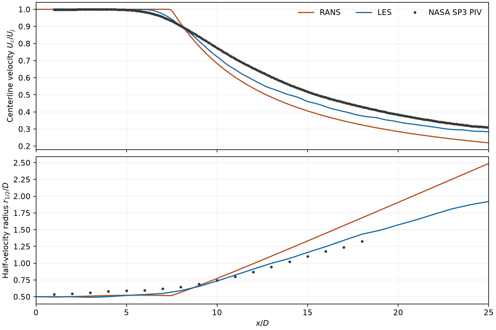

# 圆射流 RANS

算例计算从圆形喷口流出的定常、不可压、轴对称自由射流。沿用 [圆射流 LES](../round_jet_les/README.md) 的无量纲单位 `D`、`Uj` 和环境密度，以及 `Re_D=600000`。采用 [Launder–Spalding 标准 k–ε 闭合](https://doi.org/10.1016/0045-7825(74)90029-2) 和轴对称薄剪切层方程。该近似取平均压力恒定，保留径向扩散和轴、径向对流，忽略轴向扩散及径向动量方程。径向速度由连续性求得，空间离散采用环形有限体积。与马赫数 0.5 的 SP3 实验对比时，密度变化和可压缩性构成模型差异。

## LES、RANS 与 SP3 实验对比

两种计算均取 `Re_D=600000`、入口 `tanh` 宽度 `0.08D`、域长 `25D`、外半径 `10D`。LES 使用 28,224 个六面体、`p=3`、WALE，`Ma=0.5`，取第 200,001–300,000 步平均。RANS 使用默认 `500×192` 轴向步数与径向单元、入口湍流强度 `1.3%`、湍流长度尺度 `0.005D`。LES 的静止环境在 RANS 中以 `Ua/Uj=0.001` 的伴流近似。[LES 工况与统计](../round_jet_les/README.md#25d-圆柱域结果与-sp3-实验) · [NASA SP3 共识 PIV](https://ntrs.nasa.gov/citations/20110023688)



| 指标 | WALE LES | 标准 k–ε RANS | SP3 PIV |
| --- | ---: | ---: | ---: |
| 势核末端 `x/D`（`Uc/Uj=0.95`） | 7.39 | 7.78 | 7.10 |
| `Uc/Uj`，`x/D=10` | 0.723 | 0.683 | 0.774 |
| `Uc/Uj`，`x/D=16` | 0.430 | 0.374 | 0.484 |
| `Uc/Uj`，`x/D=25` | 0.284 | 0.219 | 0.310 |
| `r₁/₂/D`，`x/D=10` | 0.735 | 0.773 | 0.743 |
| `r₁/₂/D`，`x/D=16` | 1.248 | 1.447 | 1.179 |
| `r₁/₂/D`，`x/D=25` | 1.921 | 2.488 | — |
| 中心线速度平均绝对相对误差，`1D–25D` | 6.96% | 15.28% | — |

两种计算在势核长度上相差 `0.39D`。势核后，RANS 的中心线速度更低、半宽更大。到 `16D`，RANS 半宽比实验大约 23%，LES 大约 6%。到 `25D`，RANS 比 LES 的中心线速度低 23%，半宽大 30%。中心线误差使用 241 个共同测点，实验半宽数据覆盖到 `18D`。LES 和 PIV 的半宽取当地中心线速度的一半，RANS 取相对环境伴流的超额速度的一半。[中心线数据](../round_jet_les/validation/centerline_vs_sp3.csv) · [半宽数据](../round_jet_les/validation/half_velocity_radius_vs_sp3.csv)

入口宽度从 `0.08D` 增至 `0.10D` 时，LES 和 RANS 的势核分别延长 `0.81D` 和 `0.27D`，`10D` 处均表现为速度升高、半宽减小。RANS 复现了近场变化方向，变化幅度较小。LES 与 RANS 同时存在控制方程、湍流闭合及入口湍流条件的差异，这组对照未单独测定各项的贡献。

## 模型与网格

以 `U,V` 表示轴向和径向平均速度，`ν=1/Re_D`。连续性为 `∂x U + (1/r)∂r(rV)=0`。对 `φ=U−Ua、k、ε` 求解

```text
∂x(U φ) + (1/r) ∂r(r V φ) = (1/r) ∂r(r Γφ ∂rφ) + Sφ
νt = 0.09 k²/ε,  P = νt (∂r U)²
ΓU = ν + νt,       SU = 0
Γk = ν + νt,       Sk = P − ε
Γε = ν + νt/1.3,   Sε = (1.44 P − 1.92 ε) ε/k
```

- 喷口半径为 `0.5D`。入口轴向速度为 `Ua+(Uj−Ua) [1−tanh((r−0.5D)/δ)]/2`，默认 `δ=0.08D`。湍动能用同一窗函数过渡，喷流侧取 `k/Uj²=1.5 I²`，默认 `I=1.3%`。入口耗散率由 `ε=0.09^(3/4) k^(3/2)/ℓ` 得出，默认 `ℓ=0.005D`。入口湍流尺度为计算假设。
- 轴线上径向通量为零。外缘允许径向卷吸，流入时取环境值 `Ua/Uj=0.001`、`k/Uj²=10⁻⁹`，环境耗散率用同一长度尺度计算。微弱轴向伴流使外缘也能向下游推进。流向方程从喷口单向推进到域末端。
- 默认区域为 `0≤x/D≤25`、`0≤r/D≤10`。轴向均匀取 500 步，步长 `0.05D`。径向取 192 个单元，面位置按 `sinh(3j/N)/sinh(3)` 拉伸。
- 轴向采用后向差分。径向对流用一阶迎风通量，扩散用相邻单元的中心差分。每站同时求轴向速度和径向质量通量，使离散连续性与超额轴向动量平衡。湍流输运使用上站涡黏度和局部隐式耗散，随后更新 `νt`。

## 运行

在仓库根目录运行，依赖仓库环境中的 Python、NumPy、SciPy、Matplotlib 和 PyTorch。用 `--help` 查看网格、雷诺数、入口和环境参数。

```bash
venv/bin/python -m case.round_jet_rans
venv/bin/python -m case.round_jet_rans --axial-steps 1000 --radial-cells 384 \
  --output results/round_jet_rans_refined
```

默认输出为 `results/round_jet_rans/`，可用 `--output` 更改。

- `centerline.csv` 给出中心线速度、半速度半径、超额体积流量和超额动量通量。半速度半径以当地中心线超额速度 `Uc−Ua` 的一半定义。
- `radial_profiles.csv` 给出各轴向站和径向单元中心的 `U、V、k、ε、νt`。
- `summary.json` 记录计算设置、势核长度、出口值及逐站积分守恒误差。势核末端为中心线速度首次降到 `0.95 Uj` 的位置。
- `mean_flow.png` 汇总轴截面速度、中心线速度及半宽。使用 `--no-plot` 可跳过绘图。

## 复现对比图与网格检查

传入 `--sp3-tables` 后，求解入口使用 [LES 导出的 SP3 后处理表](../round_jet_les/README.md#rans-验证用对比数据) 生成 RANS/PIV 配对 CSV 及误差摘要。绘图命令读取同一批表中的 `les_008` 列，生成上方三组曲线。

```bash
venv/bin/python -m case.round_jet_rans --sp3-tables case/round_jet_les/validation
venv/bin/python -m case.round_jet_rans.plot_comparison results/round_jet_rans \
  --output case/round_jet_rans/figures/les_rans_sp3.png
```

| 计算 | 势核长度 `x/D` | `Uc/Uj`（10D） | `Uc/Uj`（25D） | `r₁/₂/D`（25D） |
| --- | ---: | ---: | ---: | ---: |
| 默认 500 × 192 | 7.78 | 0.683 | 0.219 | 2.488 |
| 加密 1000 × 384 | 7.82 | 0.686 | 0.218 | 2.504 |

默认网格的出口与入口超额动量通量之比为 `1.000000000006`，18 个半宽测点的均方根差为 `0.162D`。网格加密后，`25D` 的中心线速度和半宽各变化约 0.6%，而默认网格的 `25D` 中心线速度比 SP3 低 29.3%。
