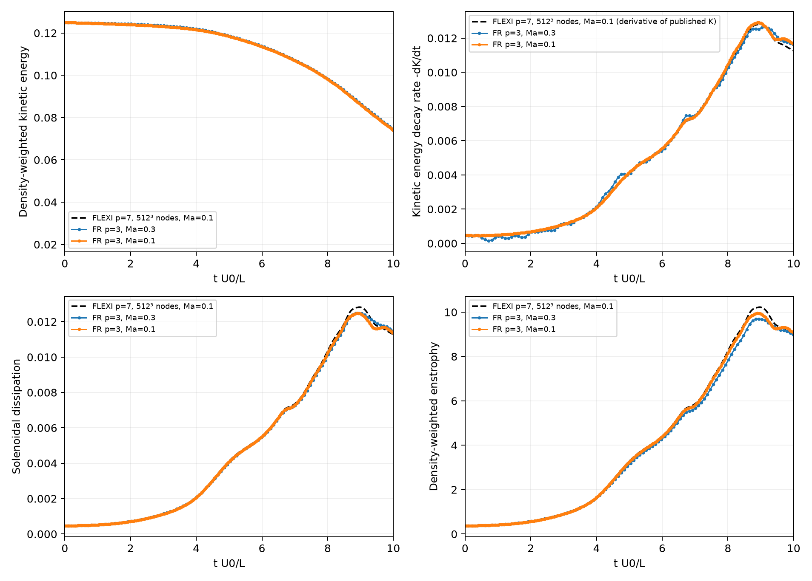
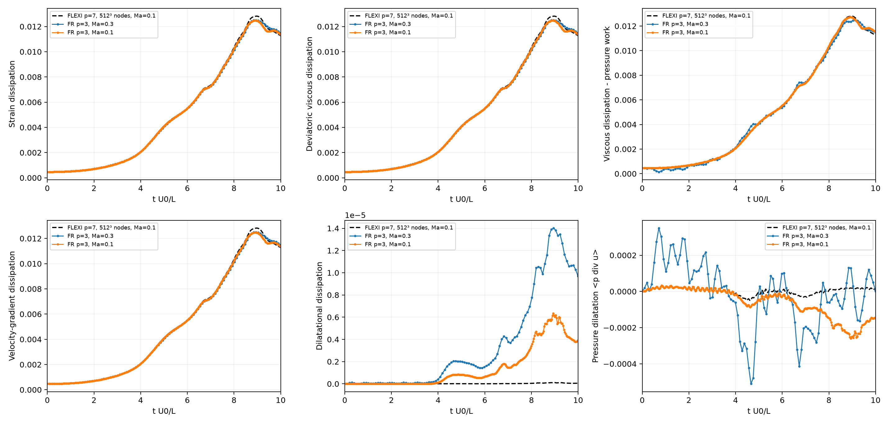
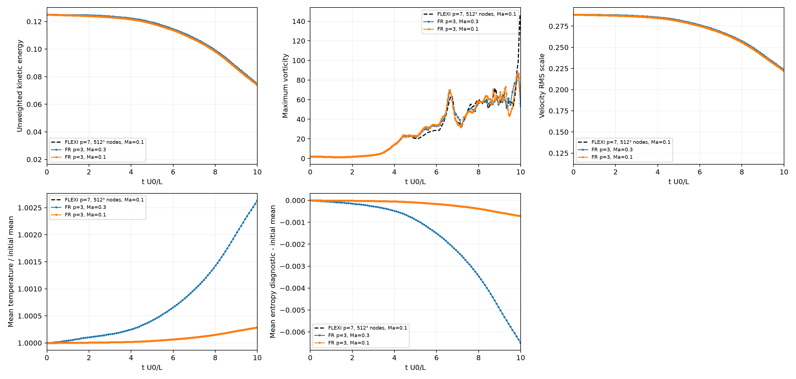

# 三维 Taylor–Green 涡：Ma=0.1 / 0.3 统计对照

这个算例计算三向周期盒中的三维 Taylor–Green 涡自由衰减：初始的大尺度涡经过拉伸、相互作用，
产生小尺度结构，随后由黏性耗散动能。计算采用公共
[CartesianNavierStokes](../../fr/navier_stokes.py) 的常物性可压缩 NS 方程和 `native-p3` 预配置。

已完成 **Ma=0.1 和 Ma=0.3 两组计算，均推进到 t=10**，并与作者公开的高分辨率 FLEXI 结果比较。
主要关注全场动能、耗散率和涡量平方积分的演化，以及提高 Mach 数以降低显式计算成本时的影响。

**本次结果：两种 Mach 数的主要动力学统计曲线相差约0.3%～3%；密度波动、相对温升及熵增量约相差9倍，
与 Ma² 量级关系一致。Ma=0.3 本次计算耗时约为 Ma=0.1 的37%。**
这些结论限于当前算例、分辨率和离散配置；尚未完成网格及时间步收敛验证。

## 配置与初始场

| 项目 | 两组共同配置 |
|---|---|
| 区域与边界 | `[-π,π]³`，x/y/z三向周期，无固壁 |
| 驱动 | 无外力，不启用恒质量流量约束 |
| 参考尺度 | ρ₀=U₀=L=R=1，时间为 tU₀/L |
| Reynolds数 | 1600，常动力黏度 μ=0.000625，参考运动黏度 ν=μ/ρ₀ |
| 气体与传热 | γ=1.4，Pr=0.71，理想气体、Stokes假设、Fourier导热 |
| 网格 | **64³单元、p=3**，每单元4³个Gauss解点，共 **256³=16,777,216个解点** |
| 空间离散 | Cartesian FR/Rusanov对流通量，互补交替迹LDG黏性离散，未开启去混叠 |
| 时间推进 | SSPRK(4,3)，全局物理时间，CFL=0.8，同时满足声学及显式黏性步长限制 |
| 终止时间 | t=10 |
| 统计与保存 | 每100步记录统计，每500步刷新比较图，每10000步保存检查点 |
| 硬件 | Intel Core i7-14700，8个P核绑定0/2/4/6/8/10/12/14，CPU FP64，AVX2/FMA |

初始速度及压力为：

\[
u=\sin x\cos y\cos z,\qquad
v=-\cos x\sin y\cos z,\qquad w=0,
\]
\[
p=p_0+\frac{(\cos2x+\cos2y)(\cos2z+2)}{16},
\qquad p_0=\frac{1}{\gamma Ma^2}.
\]

本次两组均使用 `initialization='constant-density'`：ρ=1，T=p，以匹配所下载FLEXI参考参数的
`IniConstDens=T`。改变Mach数只改变背景压力和声速，保持初始速度幅值、Re、网格和物性一致。

程序也支持 `--initialization constant-temperature`：T=p₀，ρ=p/p₀，对应HiOCFD说明中的均温版本。
本次结果采用常密度版本，两种初值不能混作同条件对照。

## 与公开参考的比较

参考为 Kurz等发布的 [GALÆXI Validation: Taylor-Green Vortex](https://doi.org/10.18419/DARUS-4139)
数据集中的 **FLEXI CPU、Ma=0.1、64³单元、p=7，即512³解点**计算，Re、γ、Pr及常密度初场与本次对照一致。
原始CSV、参数、引用、许可和SHA256见 [reference/README.md](reference/README.md)。
本次使用原始数值表，不依赖图片数字化。

下表为 **0≤t≤10整段曲线的相对时间L₂差异**，不是只比较最终时刻。
比较时将参考线性插值到各组实际统计时刻：

\[
 e_{L_2}=\left[
 \frac{\int_0^{10}(q(t)-q_{\mathrm{ref}}(t))^2\,dt}
 {\int_0^{10}q_{\mathrm{ref}}(t)^2\,dt}
 \right]^{1/2}.
\]

| 统计量 | Ma=0.3相对参考 | Ma=0.1相对参考 | Ma=0.3与0.1直接差异 |
|---|---:|---:|---:|
| 密度加权动能 | 0.209% | 0.149% | 0.294% |
| 动能衰减率 −dK/dt | 2.588% | 1.609% | 2.620% |
| 黏性耗散率 | 1.952% | 1.667% | 1.338% |
| 涡量耗散率 | 2.002% | 1.695% | 1.334% |
| 密度加权涡量平方积分 | 4.091% | 1.691% | 2.930% |

最后一列将Ma=0.3曲线插值到Ma=0.1的物理时刻，以Ma=0.1为分母归一化。
湍动能和速度RMS尺度的两组直接曲线差异分别为 **0.746%** 和 **0.392%**。
数值及定义归档在 [mach_sensitivity.csv](comparison/mach_sensitivity.csv) 和
[mach_sensitivity.json](comparison/mach_sensitivity.json)。

### 动能、衰减率与涡量统计



[PDF](comparison/reference_comparison.pdf)。
动能衰减、耗散增长及峰值后的变化趋势与参考接近。
Ma=0.1的动能衰减率峰值为0.012917，参考由动能表差分得到的峰值为0.012808，
峰值偏差约+0.85%；峰值时刻为8.900，参考约8.974，差约−0.074。

参考的−dK/dt由公开 `Ekin comp` 表使用二阶非均匀时间差分估计，有参考采样误差；
本次的−dK/dt由离散RHS通过链式法则直接计算。图例和JSON明确区分此定义。

### 耗散分项与压力功



[PDF](comparison/dissipation_components.pdf)。
应变、偏应变、梯度和涡量耗散等主要积分项整体接近。
膨胀耗散和压力功是较小的压缩性分项，相对差异较大，Ma=0.1时也未全部与参考重合。
因此不能把所有分项偏差都归因于Mach数，也不能以总动能吻合代替对各分项的检查。

### 其他统计与热力学变化



[PDF](comparison/additional_statistics.pdf)。
平均温度以各自初始平均温度归一化，熵诊断减去各自初始值；这样可以观察变化量，而不是背景偏置。
在t=10，Ma=0.3相对Ma=0.1的密度RMS波动、相对温升及熵增量之比分别约为 **8.94、9.19、9.08**，
与 (0.3/0.1)²=9 的量级关系一致；它们不应被要求像主要动力学统计那样直接重合。

图中的最大涡量为瞬时全场极值，仅保留作辅助观察。
它对局部结构、极值采样和分辨率敏感，不将两种算法的最大值曲线逐时刻重合作为主要验收依据。

## 耗时与结论

| 项目 | Ma=0.3 | Ma=0.1 |
|---|---:|---:|
| 步数 | 10410 | 28211 |
| 统计时刻数（含初末） | 106 | 284 |
| 实际总耗时 | 6886秒，约1小时55分 | 18575秒，约5小时10分 |
| 平均耗时 | 0.661秒/步 | 0.658秒/步 |

两组单步耗时相近，Ma=0.3主要通过降低背景声速、增大声学允许时间步减少总步数，
本次总耗时比Ma=0.1减少约 **63%**。
质量及总能量相对漂移：Ma=0.3约4×10⁻¹³，Ma=0.1约10⁻¹²。

当前证据支持在这个Re=1600周期涡衰减问题上，以Ma=0.3研究整体动能与积分耗散，获得几个百分点内的近似并降低成本。
严格复现Ma=0.1参考、或研究热力学/压缩性分项时，应使用对应Mach数。
改变Mach数也会改变Rusanov数值耗散及实际时间步，所以两组差异不全是物理压缩性的单独效应。

这里尚未完成多组网格与时间步收敛验证，也未取得同时间、同定义的公开参考能谱做定量对照。
256³解点达到了先前平均耗散尺度的名义估算量级，但不能据此保证解析所有局部极端梯度。

## 统计量定义

用 ⟨·⟩ 表示FR Gauss质量权及真实单元体积得到的体积平均，ω=∇×u，
S=(∇u+∇uᵀ)/2，Sd=S−(∇·u)I/3。

| 本次输出 | 定义 | FLEXI对应列 |
|---|---|---|
| `kinetic_energy` | ⟨ρ\|u\|²/2⟩ | `Ekin comp` |
| `kinetic_energy_unweighted` | ⟨\|u\|²/2⟩ | `Ekin incomp` |
| `enstrophy` | ⟨ρ\|ω\|²/2⟩ | `Enstrophy comp` |
| `epsilon_strain` | 2μ⟨S:S⟩ | `DR_S` |
| `epsilon_viscous` | 2μ⟨Sd:Sd⟩ | `DR_Sd` |
| `epsilon_velocity_gradient` | μ⟨∇u:∇u⟩ | `DR_u` |
| `epsilon_vorticity` | μ⟨\|ω\|²⟩ | `ED_S` |
| `epsilon_dilatation` | (4/3)μ⟨(∇·u)²⟩ | `ED_D` |
| `pressure_dilatation` | ⟨p∇·u⟩ | `−DR_p` |
| 物理动能损失 | `epsilon_viscous−pressure_dilatation` | `Dissipation Rate Compressible` |
| `epsilon_kinetic` | −⟨u·RHS(ρu)−\|u\|²RHS(ρ)/2⟩ | 对参考动能表求时间导数 |

熵诊断采用 −⟨ρ(ln p−γ ln ρ)/(γ−1)⟩，对应参考 `Mean Entropy`，比较时减去各自初始值。

另外记录相对全场平均速度的湍动能、Favre湍动能、三个速度RMS、密度范围/RMS、平均温度、
熵诊断、局部Mach数、质量/动量/总能量，以及离散动能收支残差。
该流动持续衰减，主要比较空间统计随时间的演化，不采用定常槽道的长时间平均方式。

## 复现运行与绘图

从仓库根目录执行，复现时使用新的输出目录：

```bash
# Ma=0.3，统计优先，不输出额外瞬时场。
venv/bin/python -m case.taylor_green_vortex.run_logged \
  --n 64 --p 3 --mach .3 --time 10 --threads 8 --cfl .8 \
  --diagnostic-interval 100 --checkpoint-interval 10000 \
  --snapshot-times --no-fields \
  --output results/taylor_green_vortex/ma03-new

# Ma=0.1；将上面一组也放入参考叠图。
venv/bin/python -m case.taylor_green_vortex.run_logged \
  --n 64 --p 3 --mach .1 --time 10 --threads 8 --cfl .8 \
  --diagnostic-interval 100 --checkpoint-interval 10000 \
  --snapshot-times --no-fields \
  --output results/taylor_green_vortex/ma01-new \
  --compare-with results/taylor_green_vortex/ma03-new

# 从保存的统计量重新生成完整对比，无需加载三维场。
venv/bin/python -m case.taylor_green_vortex.postprocess \
  results/taylor_green_vortex/ma03-n64-p3-t10-stats100 \
  results/taylor_green_vortex/ma01-n64-p3-t10-stats100 \
  --output results/taylor_green_vortex/replot

# 小网格检查入口。
venv/bin/python -m case.taylor_green_vortex --n 4 --time .05 --threads 2 \
  --diagnostic-interval 1 --snapshot-times --no-fields \
  --output results/taylor_green_vortex/quick-check
```

`--time`为绝对终止时间，`--steps`为可选绝对步数上限；`--resume`要求有可用检查点且数值配置一致。
`--max-dt`用于限制时间步；`--cells NX NY NZ`可替代等向`--n`。
`--backend torch --anti-alias 'flux, surf-flux'`用于独立Torch路径的去混叠实验，native会明确拒绝不支持的配置。
如需场输出，可设 `--snapshot-times 10`；VTK含ρ、p、速度、涡量和Q，能谱由等距子单元中心采样后计算。

## 目录与保留文件

| 路径 | 内容 |
|---|---|
| [solve.py](solve.py) | 初场、统计、时间推进、检查点与恢复 |
| [postprocess.py](postprocess.py) | 参考对照、均匀采样、能谱及VTK输出 |
| [run_logged.py](run_logged.py) | 持久日志、命令与退出状态 |
| [visualize.py](visualize.py) | 已保存瞬时场的能谱/Q等值面可视化 |
| [reference/](reference/README.md) | 作者公开的参考CSV、参数、许可和校验和 |
| [comparison/](comparison/) | 本README中的PNG/PDF、两组统计CSV、误差表及归档来源 |

[Ma=0.3完整运行记录](../../results/taylor_green_vortex/ma03-n64-p3-t10-stats100/)与
[Ma=0.1完整运行记录](../../results/taylor_green_vortex/ma01-n64-p3-t10-stats100/)保留在工作区。
按要求，Ma=0.3暂存三维场及状态检查点已清理；其统计、能谱CSV和已生成的涡结构图片保留。
Ma=0.1本轮未导出额外瞬时场，检查点目前仍保留在其运行目录。

```bash
venv/bin/python -m unittest discover -s tests -p test_taylor_green_vortex.py
```

验证覆盖初值/周期性、涡量空间收敛、黏性动能离散收支、native/Torch多步一致性、
无驱动守恒、恢复逐位一致、采样频率不改变状态、均匀采样与FFT Parseval，以及参考比较定义。
