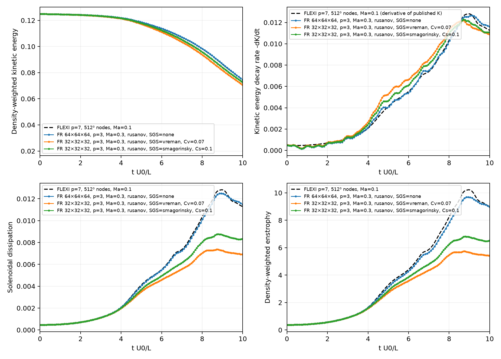
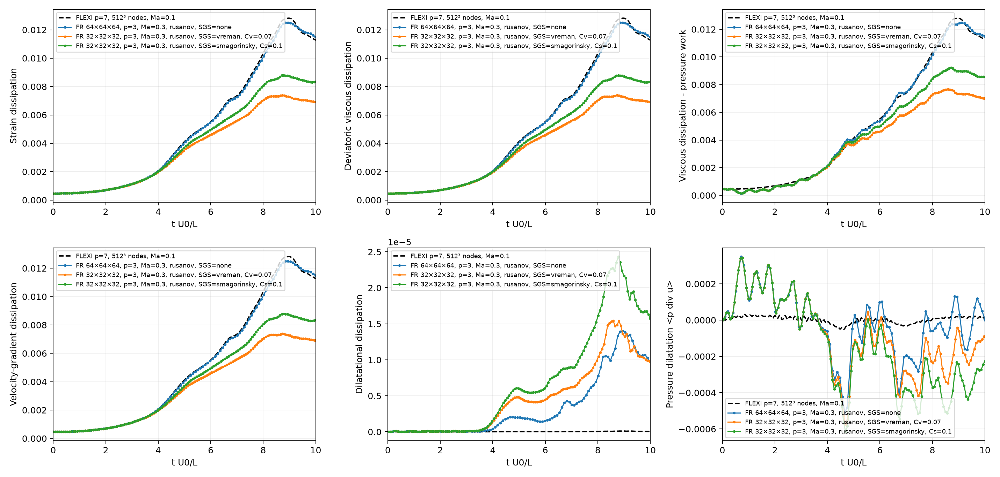
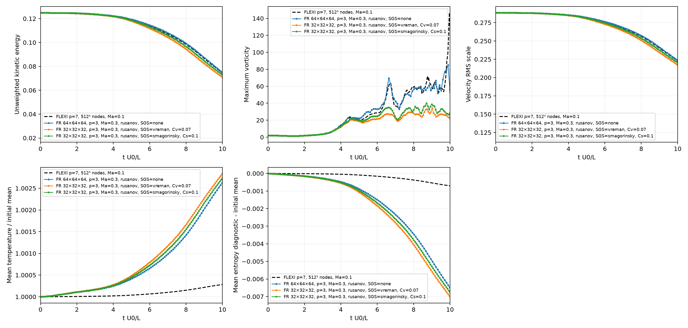
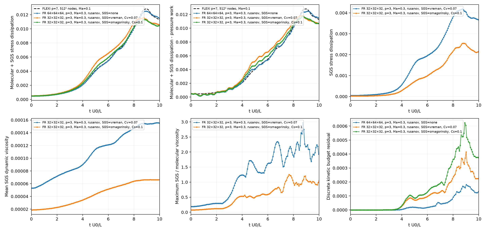
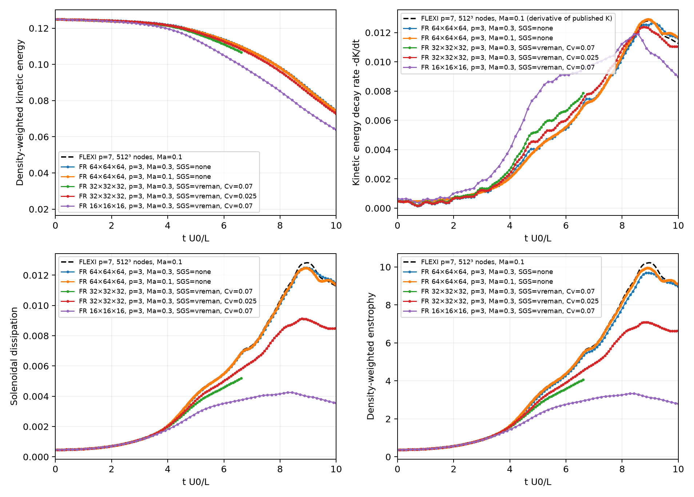
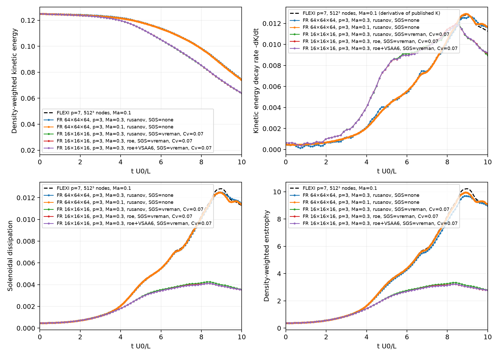
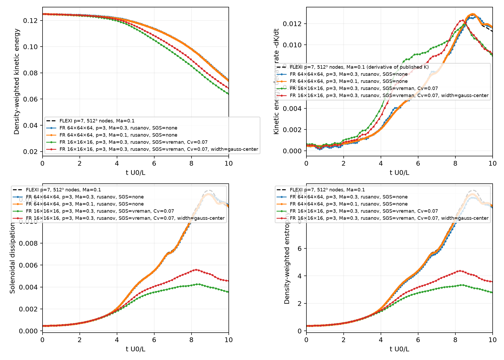

# Taylor–Green 涡 LES

三维可压缩 Taylor–Green 涡，区域 `[-π,π]³`，三向周期、无外力。
复用 `case.taylor_green_vortex` 的初值、检查点、统计及后处理。

默认 `Re=1600, Ma=0.3, γ=1.4, Pr=0.71`，`ρ₀=U₀=L=R=1`，
常密度初值；分子动力黏度 `μ=1/Re`。默认使用 Vreman SGS 模型，也支持静态 Smagorinsky。

当前默认计算方式恢复并固定为 **Rusanov 界面通量＋无去混叠**，`Cv=0.07`。
类、`run()` 和 CLI 均使用相同默认；下面的 Roe/过积分命令与结果是历史对照，
不会自动启用。网格可继续显式用 `--n` 选择，已有16³/32³结果分别保留。
Roe 和去混叠算法归公共框架，接口见[公共 NS 对流模式](../../doc/framework.md#公共-ns-对流模式)。

## 32³ 结果汇总：Vreman 与静态 Smagorinsky（统一 Δ=h/(p+1)）

两组均已完成至 **t=10**，采用相同网格和滤波宽度：

- LES：32³ 单元，p=3，每方向 128 个解点；Δ=h/(p+1)=2π/128≈0.0490874，filter_ratio=1。
- 模型：Vreman Cv=0.07；静态 Smagorinsky Cs=0.1；Pr_t=0.9。
- 共同设置：Re=1600、Ma=0.3、γ=1.4、Pr=0.71、常密度初值，周期边界；
  Rusanov 界面通量、无去混叠、LDG、native-p3、CPU FP64、8 线程、CFL=0.3。
- 每 100 步采集统计，每 1000 步保存检查点；Vreman 从原 t=6.614367 检查点续完。
- 误差基准：本框架同 Ma=0.3 的 64³、p=3 无显式 SGS DNS，时间范围统一为 0≤t≤10。

表中前三列是时间积分相对 L₂ 误差：将 DNS 线性插值到各 LES 的统计时刻，
用梯形积分计算 `sqrt(∫(q_LES−q_DNS)²dt / ∫q_DNS²dt)`。
最终动能偏差是 t=10 的有符号相对偏差，不是整段曲线误差。

| 模型 | 动能误差 | 动能衰减率误差 | 已解析 enstrophy 差异 | 最终动能偏差 |
|---|---:|---:|---:|---:|
| Vreman，Cv=0.07 | 2.469% | 11.405% | 34.245% | −5.406% |
| 静态 Smagorinsky，Cs=0.1 | **1.328%** | **6.825%** | 24.183% | −2.697% |

| 模型 / 基准 | 动能衰减率峰值 | 峰值时刻 | 相对 DNS 峰值偏差 |
|---|---:|---:|---:|
| 同 Ma DNS | 0.01265694 | 9.13076 | — |
| Vreman，Cv=0.07 | 0.01218458 | 8.65952 | −3.732% |
| 静态 Smagorinsky，Cs=0.1 | 0.01227822 | 8.70831 | −2.992% |

在本组固定系数和同宽度下，Smagorinsky 的动能和衰减率更接近 DNS；
两种模型的峰值均提前，不能只凭峰值幅度判断整个衰减过程。
用户接受该 32³ LES 结果用于当前整体统计比较；这不代表已解析全部 DNS 小尺度。
LES 的 enstrophy 来自已解析场，DNS 未做相同滤波，因此其差异不全是模型误差。
两组质量和总能量相对漂移均小于 6×10⁻¹³。

以下四张 PNG 为本次统一配置重新生成并拷贝的关键图。
图中本地 DNS 为 Ma=0.3；FLEXI 虚线为公开 Ma=0.1 参考，提供额外参照，
**不用于上表的同 Ma 误差**。后处理自动输出的 `*-metrics.csv` 对应 FLEXI，
上表同 Ma 指标单独存于结果目录 `same-ma-dns-metrics.json`。

### 动能、衰减率与涡量统计



### 分子耗散与压力功分项

这里的分子耗散不包含 SGS 贡献；LES 总模型耗散见后面的 SGS 图。



### 附加统计



### SGS 耗散、黏度及动能预算



### 复现与输出

在仓库根目录执行；全新运行不加 `--resume`，已有同配置检查点可加 `--resume`：

```bash
taskset -c 0,2,4,6,8,10,12,14 venv/bin/python -u \
  -m case.taylor_green_vortex_les.run_logged \
  --n 32 --p 3 --sgs vreman --cv 0.07 --filter-width dof --filter-ratio 1 \
  --mach 0.3 --reynolds 1600 --time 10 --cfl 0.3 --threads 8 \
  --backend native-p3 --diagnostic-interval 100 --checkpoint-interval 1000 \
  --snapshot-times --no-fields \
  --output results/taylor_green_vortex_les/vreman-ma03-n32-p3-t10-stats100
```

Smagorinsky 使用同一命令，将 `--sgs vreman --cv 0.07` 换为
`--sgs smagorinsky --cs 0.1`，输出目录改为
`results/taylor_green_vortex_les/smag-cs01-ma03-n32-p3-ratio1-t10-stats100`。
原 DNS 统计目录的归档来源见下文“完整统计对比”；不需要为绘图重新运行 DNS。

统一生成四组比较图：

```bash
venv/bin/python -m case.taylor_green_vortex.postprocess \
  results/taylor_green_vortex_les/dns_baselines/ma03-n64-p3-t10-stats100 \
  results/taylor_green_vortex_les/vreman-ma03-n32-p3-t10-stats100 \
  results/taylor_green_vortex_les/smag-cs01-ma03-n32-p3-ratio1-t10-stats100 \
  --output results/taylor_green_vortex_les/sgs-n32-dof-comparison
```

将该结果目录的 `reference_comparison.png`、`dissipation_components.png`、
`additional_statistics.png`、`les_dissipation.png` 拷贝至本目录 `figures/`，
分别命名为上面引用的 `sgs-n32-dof-*.png`。原始场、CSV、检查点和 PDF
均保留在被 Git 忽略的 `results/` 中。

后文保留早期系数、滤波宽度和格式试验记录；不应将它们与本节同宽度结果混用。

## 模型和尺度

定义 `α_ij = ∂u_j/∂x_i`，采用各向同性滤波尺度
`Δ = (hx hy hz)^(1/3)/(p+1)`；均匀立方体单元即 `h/(p+1)`。

```text
β_ij = Δ² Σ_m α_mi α_mj
Bβ = β11 β22 − β12² + β11 β33 − β13² + β22 β33 − β23²
ν_sgs = Cv sqrt(Bβ / Σ_ij α_ij²)
μ_sgs = ρ ν_sgs
```

默认 `Cv=0.07`（直接乘在平方根外，不再平方），零梯度取零。
实现使用梯度行向量叉积平方和计算非负不变量，避免小量相减造成负值。
参考 [Vreman 原论文（2004）](https://www.vremanresearch.nl/Vreman-PF2004-subgridmodel.pdf)。
Vreman 会在若干无 SGS 能量传递的梯度构型中给出零黏性，
但不是对所有光滑或层流场都自动关闭；初始 TGV 的 SGS 黏性不为零。

应力使用 `2(μ+μ_sgs)(S − tr(S)I/3)`，其中 `S=(∇u+∇uᵀ)/2`；
热导率为 `κ + μ_sgs cp/Pr_t`，默认 `Pr_t=0.9`、`cp=γ/(γ−1)`。
SGS 黏性在每个 RK 阶段重算，时间步计入 SGS 黏性和热扩散。
这是低马赫数起步实现：省略 SGS 应力各向同性部分，不求解 SGS 动能方程。
当前算例支持静态 Smagorinsky（`--sgs smagorinsky --cs 0.1`）；动态模型及 WALE 尚未接入。

## 运行

依赖仓库 Python 环境（PyTorch、NumPy；绘图需 Matplotlib），在仓库根目录运行：

```bash
source venv/bin/activate
python -m case.taylor_green_vortex_les --n 32 --p 3 --time 10 \
  --backend native-p3 --interface-flux rusanov --anti-alias none \
  --cv 0.07 --turbulent-prandtl 0.9 --cfl 0.3 \
  --threads 8 --output results/taylor_green_vortex_les/vreman-n32-p3-t10
```

默认 `32³` 单元、`p=3`，每方向 128 个解点，`Δ=2π/128≈0.04909`。
`--sgs vreman`（默认）启用 Vreman，`--sgs smagorinsky` 启用静态 Smagorinsky，
`--sgs none` 关闭显式 SGS。
`none` 网格充分分辨时对应 DNS；粗网格时应称无显式 SGS/隐式 LES，
不会因选择 `none` 自动成为 DNS。

默认 native-p3 后端需要 CPU、AVX2、C++ 编译器和 `p=3`；仅支持 LDG，
支持体通量和界面通量过积分。Torch 后端可用 `--backend torch`，支持不同阶数和设备。
两种后端均可通过 `--anti-alias`、`--quadrature-order` 配置对流去混叠。

native 在计算块内融合所选 SGS 应力、热通量与 RK 推进，每个解点的涡黏性
只计算一次，并由三个方向复用，不分配全场 SGS 张量。
邻居单元计算完整速度梯度以保证 SGS 通量正确。
包含 SGS 的 CFL 估算也在 native 内完成，复用相同 LDG 梯度和 SGS 本构；
对最终状态独立扫描，避免使用滞后 RK 阶段梯度低估扩散限制。

C++ 公共入口为 `fr/native/cartesian_ns/kernels/sgs.hpp`，提供 `Model`、
`Config` 和内联本构函数。模型类型在计划创建时选择缓存的编译特化，
`none` 路径消除 SGS 计算及额外缓存；Cv 或 Cs、Pr_t、宽度缩放是运行时计划参数，
修改它们不触发重新编译。后续 WALE、动态 Smagorinsky 可扩展模型接口，
其中动态模型还需另行实现测试滤波，不能仅增加一个局部本构函数。

`--max-dt` 限制时间步，`--steps` 限制绝对步数；`--resume` 续算，
改变 SGS 类型、Cv、Pr_t、后端或网格等数值配置时必须使用新输出目录。
`--snapshot-times` 接受快照时刻列表；空列表关闭快照。
`--no-plot --no-fields` 可关闭快照绘图和场输出。

默认输出 `results/taylor_green_vortex_les/`，含 `run.json`、`history.csv`、
`status.json`、检查点及指定时刻快照。原 TGV 统计中 `epsilon_viscous` 等仍表示
分子贡献；新增 `epsilon_sgs`、`mu_sgs_mean`、`mu_sgs_max`、`mu_sgs_over_mu_max`。
动能预算残差扣除分子及 SGS 应力耗散，并保留压力膨胀项；它仍可能包含离散误差。
`--sgs none` 是无显式 SGS 的同网格基线；`--cv 0` 数学上退化到同样的方程，
但仍走 Vreman 的计算路径，不适合代表无模型性能。

## 验证与短时试算

```bash
python -m unittest tests.test_taylor_green_les tests.test_taylor_green_vortex tests.test_viscous
python -m case.taylor_green_vortex_les --n 32 --p 3 --time 0.1 \
  --diagnostic-interval 25 --snapshot-times --no-plot --no-fields --threads 8 \
  --output results/taylor_green_vortex_les/vreman-n32-p3-t01
```

模型测试检查零梯度/单剪切零黏性、解析不变量、旋转不变性、零系数退化、
守恒、native/Torch 跨计算块残差及推进一致性、SGS 时间步、检查点续算一致性。

上述 `32³, p=3` 短时试算已完成：CPU、8 线程、FP64、native-p3/LDG、
默认 Cv/Pr_t、CFL=0.3、无反混叠，共 132 步至 `t=0.1`。
动能体积均值由 `0.125` 降至约 `0.12494899`，密度范围约
`[0.999511, 1.0005]`。第 50～100 步共耗时 29.42 秒，约 `0.588 秒/步`，
这是优化前版本的测量。移除 Torch 时间步扫描后，同样的 132 步完成于
`results/taylor_green_vortex_les/vreman-n32-p3-t01-native-scan/`，
第 50～100 步约 `0.141 秒/步`，两版本末态最大绝对差约 `3.2×10⁻¹⁴`。
两项数据包括每 25 步诊断的摊销，排除初始编译和初始化；测试时同时运行了回归检查。
此结果仅验证执行链路，尚未覆盖 `t≈8–9` 的湍流耗散峰。
Rusanov 数值耗散与显式 SGS 会叠加，网格尺度或动能解析比例本身不是精度保证。


## 整步性能复现

```bash
python -m case.taylor_green_vortex_les.benchmark --threads 8 --steps 10 --cfl 0.3
```

默认输出 `results/taylor_green_vortex_les/benchmark.json`。
依次测试 `32³ + none`、`32³ + vreman`、`64³ + none`，统一 `p=3, Ma=0.3, Re=1600`。
每组先预热 3 步，再测 10 步；整步时间包含四个 RK 阶段、状态检查和下一步 CFL
（含 SGS 扩散）扫描，排除编译、初值构造、诊断和文件输出。
同时记录时间步和单位物理时间成本，避免只比较每步耗时或混用 CFL。
短时性能不代表耗散峰附近的步长、稳定性或最终精度。


最终融合版本的独立短时测量（CPU：Intel(R) Core(TM) i7-14700，8 线程，FP64，
`--steps 30 --cfl 0.3`，其余条件如上）：

| 单元与模型 | 整步平均耗时 | 平均 Δt | 推进单位物理时间的秒数 |
|---|---:|---:|---:|
| 32³，none | 0.0798 秒 | 0.00076313 | 104.6 |
| 32³，Vreman | 0.0758 秒 | 0.00076313 | 99.3 |
| 64³，none | 0.6790 秒 | 0.00038155 | 1779.5 |

两组 32³ 的整步中位数分别为 0.0748、0.0750 秒，差异接近计时波动，
不能据此断言 Vreman 比无模型更快。Vreman 的 native 时间步扫描中位耗时为
0.00482 秒。此次 32³ Vreman 的单位物理时间成本约为 64³ 无模型的 1/18；
该比值仅适用于这段早期、同 CFL、无诊断输出的测量，尚非完整湍流阶段加速比。


## 与已有 DNS 同口径的完整运行

2026-11-11 启动 `Ma=0.3, Re=1600, 32³, p=3, Vreman Cv=0.07, Pr_t=0.9`，
CFL=0.3，目标 `t=10`，8 个 P 核绑定 `0,2,4,6,8,10,12,14`。
每 100 步采集一次原 DNS 的全部统计，每 500 步刷新对比图，每 1000 步保存检查点。
本次以统计为主，不输出额外场或快照；最终检查点可用于后处理。

```bash
taskset -c 0,2,4,6,8,10,12,14 venv/bin/python -u   -m case.taylor_green_vortex_les.run_logged   --n 32 --p 3 --sgs vreman --cv 0.07 --turbulent-prandtl 0.9   --mach 0.3 --reynolds 1600 --time 10 --cfl 0.3 --threads 8   --backend native-p3 --diagnostic-interval 100 --checkpoint-interval 1000   --snapshot-times --no-fields   --compare-with results/taylor_green_vortex_les/dns_baselines/ma03-n64-p3-t10-stats100                  results/taylor_green_vortex_les/dns_baselines/ma01-n64-p3-t10-stats100   --output results/taylor_green_vortex_les/vreman-ma03-n32-p3-t10-stats100
```

上述两组 DNS 统计从 Git 跟踪的 `case/taylor_green_vortex/comparison/ma03-history.csv`、
`ma01-history.csv` 恢复到结果目录，并校验归档 SHA256；数值配置取自归档 `comparison.json`。
这不是重新运行 DNS，也没有恢复旧三维场。独立复现时需先按同样方式准备统计目录，
或将 `--compare-with` 指向你已有的原 DNS 输出目录。

`history.csv` 保留原 DNS 的动能/衰减率、涡量平方积分、分子耗散各分项、压力功、
速度 RMS/TKE、密度、温度、熵、局部 Mach 数及质量/动量/总能量统计。
同目录的 `comparison/` 生成与原 DNS 相同的三组 PNG/PDF、逐时刻差异表、时间 L₂
及峰值幅值/时刻误差，并叠加两组本地 DNS 和公开 FLEXI 参考。
额外的 `les_dissipation` 图展示 SGS 黏性/耗散、分子+SGS 总耗散及动能收支残差。
`epsilon_modelled_viscous = epsilon_viscous + epsilon_sgs`，
`epsilon_modelled_physical = epsilon_modelled_viscous − pressure_dilatation`；
原有分子耗散列保持原定义。LES 的动能、涡量和 RMS 是已解析场统计，
参考是未滤波 DNS，不能要求 LES 小尺度统计与其完全重合。

`run-*.log`、`process-*.json`、`exit-*.json` 记录持续日志、运行命令和退出状态；
`status.json` 是当前进度。日志入口可接受求解器的全部参数，包括 `--resume`。

### 历史：Cv=0.07 运行暂停与系数对照准备

该次运行当时按用户要求停止，保存检查点为 9000 步、`t=6.614367111564056`；
未到耗散峰，不能将这次数据当作完整 `t=10` 结果。原目录保留统计、检查点和对比图，
当时 `status.json` 标记为 `stopped`。本次同宽度模型汇总从该检查点续算，
以下暂停记录仅用于保留早期实验背景。

Vreman 原论文第 II 节、式 (35) 后给出均匀各向同性湍流估计 `Cv≈0.07`，
来自 `Cv≈2.5 Cs²`、`Cs≈0.17`。因此原参数是标准理论估计，并非任意选择。
同段亦列出 `Cs=0.1 ↔ Cv=0.025`；后者可作为当前 FR/Rusanov 离散下的低耗散
系数对照，不能先验称为本算例最佳值。固定滤波尺度时，黏性对 Cv 线性变化。

下一组准备显式指定 `--cv 0.025`，其余网格、Mach 数、CFL、Pr_t、统计和比较配置
全部保持不变，输出到 `results/taylor_green_vortex_les/vreman-cv0025-ma03-n32-p3-t10-stats100/`。
截至本记录仅准备配置，尚未启动。可执行参数数组已保存为原运行目录中的
`planned-cv0025-run.json`；从初始场重新计算，不从 Cv=0.07 的晚期检查点换系数续算，
以免混入此前模型对转捩和能量损失的影响。公共模型及 CLI 的标准默认值仍为 0.07。

### Cv=0.025 对照运行已启动

用户确认后，2026-11-11 从初值启动 `Cv=0.025` 对照，目标 `t=10`，输出到
`results/taylor_green_vortex_les/vreman-cv0025-ma03-n32-p3-t10-stats100/`。
除系数外，数值配置及统计频率与暂停的 `Cv=0.07` 运行一致。
比较列表增加该次 Cv=0.07 输出，自动叠加两组系数、原 Ma=0.3/0.1 DNS 及 FLEXI。
旧系数数据只到 `t=6.614367`，两系数的定量对照应限制在共同时间区间，
不能直接比较不同积分时段的曲线 L₂ 误差。

### 当前基线与物理耗散尺度

按用户要求，后续评估恢复使用标准 `Cv=0.07`；类、运行函数及 CLI 的默认值本来即为
0.07，上一组 0.025 通过显式参数运行，结果保留作敏感性对照。本次仅确认基线，未重启。

Re=1600、ρ₀=1 时参考运动黏度 `ν=0.000625`。FLEXI 参考在 `t≈8.974` 的峰值
体积平均不可压缩耗散率约 `ε=0.01282193`，因此
`η=(ν³/ε)^(1/4)≈0.0117469`。同 Ma=0.3 的原 FR DNS 用峰值分子偏应变耗散
`ε≈0.01249498` 得 `η≈0.0118230`，两者接近。
`32³, p=3` 的名义分辨率 `Δ≈0.0490874`，约为参考 η 的 4.18 倍。
这里 η 是按体积平均耗散估计的峰值时段尺度，不是全场局部 η 的最小值；
不将 SGS 涡黏性加入分子黏性来重新定义该物理尺度。

### 16³、Cv=0.07 网格对照

用户确认后，2026-11-11 启动 `16³, p=3, Vreman Cv=0.07`，从初值算至 `t=10`。
其余数值参数与原 32³、Cv=0.07 基线相同：Ma=0.3、Re=1600、Pr_t=0.9、CFL=0.3、
native-p3/LDG、无反混叠、8 个 P 核绑定，每 100 步统计、每 1000 步保存检查点。
每方向 64 个解点，`δx=2π/64≈0.09817≈8.36η`；η 采用上述参考耗散峰平均尺度。
输出为 `results/taylor_green_vortex_les/vreman-cv007-ma03-n16-p3-t10-stats100/`。
比较列表包含两组 DNS、32³/Cv=0.07 及 32³/Cv=0.025；同系数的网格比较只在
32³/Cv=0.07 已完成的 `t≤6.614367` 共同区间内有直接依据。

#### 16³ 完整结果

上述运行正常完成 `t=10`，6765 步，求解统计耗时约 115.1 秒（1 分 55 秒；
含运行期间的统计及对比图刷新，不含最后一次完成后绘图）。
与同 Ma=0.3、64³/p=3 的原 FR DNS 比较，DNS 曲线线性插值到 LES 统计时刻：

| 统计量 | 0≤t≤10 曲线相对时间 L₂ 差异 | t=10 相对偏差 |
|---|---:|---:|
| 动能 | 7.14% | −14.38% |
| 动能衰减率 | 30.50% | −22.84% |
| 已解析涡量平方积分 | 59.49% | −68.86% |

衰减率峰值约 0.011884，发生于 t≈8.572；原同 Ma DNS 峰值约 0.012657，
发生于 t≈9.131。峰值幅值低约 6.1%、时刻提前约 0.56；早期衰减率却显著偏高，
不能仅用峰值幅值判断整段耗散准确性。每 100 步统计的早期时间间隔约 0.153，
峰值时间存在采样不确定性。

固定 Cv=0.07，在两网格共同覆盖的 `0≤t≤6.52234` 区间，用相同的 16³ 统计时刻
分别插值 32³ 及 DNS 后计算：

| 统计量 | 16³ 相对 DNS | 32³ 相对 DNS |
|---|---:|---:|
| 动能 | 3.44% | 1.03% |
| 动能衰减率 | 72.21% | 23.28% |
| 已解析涡量平方积分 | 32.77% | 15.30% |

质量和总能量最大相对漂移分别约 2.9×10⁻¹³、2.7×10⁻¹³，执行稳定且守恒。
但当前 Vreman/FR/Rusanov 组合下，δx≈8.36η 的 16³ 网格相对 DNS 差异明显增大，
不支持将“δx≈8η”单独作为本算例足够准确的判据。
涡量项是已解析量与未滤波 DNS 的比较，不是纯 SGS 模型误差。



图的生成命令：

```bash
venv/bin/python -m case.taylor_green_vortex.postprocess \
  results/taylor_green_vortex_les/dns_baselines/ma03-n64-p3-t10-stats100 \
  results/taylor_green_vortex_les/dns_baselines/ma01-n64-p3-t10-stats100 \
  results/taylor_green_vortex_les/vreman-ma03-n32-p3-t10-stats100 \
  results/taylor_green_vortex_les/vreman-cv0025-ma03-n32-p3-t10-stats100 \
  results/taylor_green_vortex_les/vreman-cv007-ma03-n16-p3-t10-stats100 \
  --output results/taylor_green_vortex_les/vreman-cv007-ma03-n16-p3-t10-stats100/comparison
```

原始统计、检查点、完整比较图表及同 Ma DNS 定量汇总均留在对应 results 目录；
这里仅归档一张关键对比图及简短数值表。

### 仅替换界面通量的 native Roe 对照

增加 `--interface-flux roe`，默认仍为 `rusanov`。Roe 在公共 Euler/NS 模块提供
Torch 参考实现，并在 C++ native 界面核内以 AVX2 实现；体通量和 FR/LDG 求导不变。
采用 Roe 平均的特征波耗散，声学波加宽度 0.05c 的 Harten 二次熵修正，
接触/剪切波保留 |u_n|，不是低 Mach 修正 Roe。模型配置和图例记录通量名称，
续算检查拒绝更换界面通量。native/Torch 残差、多步 RK、跨块守恒和特征波测试
见 `tests/test_roe.py`。

本次试验固定 `16³, p=3, Cv=0.07, Pr_t=0.9, Ma=0.3, Re=1600, CFL=0.3`，
8 个 P 核绑定、每 100 步统计、每 1000 步检查点，从初值计算至 t=10。
仅相对前述 16³ Rusanov 组更改界面通量，输出目录为
`results/taylor_green_vortex_les/vreman-cv007-ma03-n16-p3-roe-t10-stats100/`。

```bash
taskset -c 0,2,4,6,8,10,12,14 venv/bin/python -u \
  -m case.taylor_green_vortex_les.run_logged \
  --n 16 --p 3 --interface-flux roe --sgs vreman --cv 0.07 \
  --turbulent-prandtl 0.9 --mach 0.3 --reynolds 1600 --time 10 \
  --cfl 0.3 --threads 8 --backend native-p3 \
  --diagnostic-interval 100 --checkpoint-interval 1000 --snapshot-times --no-fields \
  --compare-with results/taylor_green_vortex_les/dns_baselines/ma03-n64-p3-t10-stats100 \
                 results/taylor_green_vortex_les/dns_baselines/ma01-n64-p3-t10-stats100 \
                 results/taylor_green_vortex_les/vreman-cv007-ma03-n16-p3-t10-stats100 \
  --output results/taylor_green_vortex_les/vreman-cv007-ma03-n16-p3-roe-t10-stats100
```


#### 单独替换 Roe 的完整结果

16³/p=3/Cv=0.07 的 native Roe 已正常完成 t=10：6774 步，约 119.5 秒。
与同 Ma=0.3 原 DNS 比较，整段动能、动能衰减率、已解析涡量平方积分的相对时间 L₂
差异分别为 7.10%、30.17%、60.48%；相同条件的 Rusanov 组分别为
7.14%、30.50%、59.49%。因此仅更换界面通量没有明显改善这组粗网格结果。

### Roe＋体/界面对流通量去混叠

native-p3 已支持 `flux`、`surf-flux` 和二者组合；插值和离散 L₂ 投影矩阵复用
公共 FR 算子，与 Torch 求解路径相同。体积张量变换在单元内进行，面上张量变换
逐面执行，求积暂存为线程私有；不分配全局加密网格场。
非去混叠分支仍使用原算术和缓存布局。解自由度和 SGS/黏性离散不变。
测试覆盖 5/6 点求积、Roe/Rusanov、体/面/组合去混叠、跨块 RK 一致性、
守恒、常状态及非均匀网格等温壁面，见 `tests/test_native_dealiasing.py`。

组合对照固定 16³/p=3/Cv=0.07/Ma=0.3/Re=1600/CFL=0.3，显式选用每方向
6 个 Gauss 求积点（原解点为每方向 4 个），从初值算至 t=10。
过积分减轻非线性通量混叠；可压缩通量和 Roe 通量不是一般的有限阶多项式，
不能声称有限求积点数将所有混叠严格消除。
输出：`results/taylor_green_vortex_les/vreman-cv007-ma03-n16-p3-roe-aa6-t10-stats100/`。

```bash
taskset -c 0,2,4,6,8,10,12,14 venv/bin/python -u \
  -m case.taylor_green_vortex_les.run_logged \
  --n 16 --p 3 --interface-flux roe --anti-alias 'flux, surf-flux' --quadrature-order 6 \
  --sgs vreman --cv 0.07 --turbulent-prandtl 0.9 --mach 0.3 --reynolds 1600 \
  --time 10 --cfl 0.3 --threads 8 --backend native-p3 \
  --diagnostic-interval 100 --checkpoint-interval 1000 --snapshot-times --no-fields \
  --compare-with results/taylor_green_vortex_les/dns_baselines/ma03-n64-p3-t10-stats100 \
                 results/taylor_green_vortex_les/dns_baselines/ma01-n64-p3-t10-stats100 \
                 results/taylor_green_vortex_les/vreman-cv007-ma03-n16-p3-t10-stats100 \
                 results/taylor_green_vortex_les/vreman-cv007-ma03-n16-p3-roe-t10-stats100 \
  --output results/taylor_green_vortex_les/vreman-cv007-ma03-n16-p3-roe-aa6-t10-stats100
```

#### Roe＋去混叠完整结果

组合运行正常完成 t=10：6774 步，求解统计耗时约 197.1 秒（3 分 17 秒）。
与同 Ma=0.3 的原 FR DNS 比较，0≤t≤10 曲线相对时间 L₂ 差异：

| 16³/p=3/Cv=0.07 配置 | 动能 | 动能衰减率 | 已解析涡量平方积分 | 求解耗时 |
|---|---:|---:|---:|---:|
| Rusanov | 7.14% | 30.50% | 59.49% | 115 秒 |
| Roe | 7.10% | 30.17% | 60.48% | 119 秒 |
| Roe＋体/面6点过积分 | 7.05% | 30.06% | 60.54% | 197 秒 |

去混叠组相对普通 Roe 的曲线差异分别约 0.066%、0.659%、0.483%，
最终动能仍比 DNS 低约 14.19%；质量及总能量最大相对漂移均约 3×10⁻¹³。
本组证据不支持将界面 Rusanov 耗散或对流通量混叠视为主要偏差来源；
增加过积分成本没有换来显著统计改善。该结论不排除其他空间/时间离散误差，
也不能单由 SGS 耗散占比确定闭合模型误差，需要与网格/已解析尺度共同解释。



图由上述原命令的三个算例目录及两组 DNS 目录通过公共
`case.taylor_green_vortex.postprocess` 生成；图例中的 `roe+VSAA6` 表示 Roe＋体/面
每方向6点求积。原始统计与定量汇总 `same-mach-dns-summary.json` 留在 results 目录。

### 滤波尺度与模型系数的解释

当前等效模型长度使用 Δ=(hx hy hz)^(1/3)/(p+1)，是按单元内解自由度计数的常用
高阶 FR/DG 约定，不是根据当前离散谱响应严格标定出的显式滤波器宽度。
该约定见 [Duan & Wang 的 FR/CPR 比较，式(29)](https://link.springer.com/article/10.1186/s42774-023-00169-7)。
文献中的长度尺度标定还依赖其 SGS 离散、单元平均与面通量处理，不能直接迁移最优值。

在当前各向同性 Vreman 中 ν_sgs = Cv Δ² F(∇u)，没有其他独立依赖 Δ 的运算。
因此 Cv=0.025、Δ=Δ0，与 Cv=0.07、Δ=sqrt(0.025/0.07)Δ0≈0.5976Δ0
在模型方程上等价（浮点运算舍入除外），热扩散和 SGS 时间步限制亦同。
此前 Cv 对照只能识别 CvΔ² 的组合强度，不能单独区分系数或滤波宽度的不匹配。
改变 Δ 以拟合 DNS，同样属于参数标定，不能据此声称修复了模型；当前仍保持
Cv=0.07、上述原滤波尺度及 Rusanov/无去混叠基线，不自动启动新的尺度试验。

### 中心到最近 Gauss 解点距离的 SGS 尺度对照

公共 `fr.les.filter_width`/`filter_width_scale` 增加 `gauss-center` 约定；CLI 用
`--filter-width dof|gauss-center` 选择，默认仍为原 `dof`。
`dof` 取 `(hx hy hz)^(1/3)/(p+1)`，`gauss-center` 取
`min|ξ_Gauss| × (hx hy hz)^(1/3)/2`。对立方体单元即中心到最近解点的物理距离；
非立方体使用等体积立方体长度定义各向同性尺度。
偶数 p 的 Gauss 解点含中心点，后一尺度为零，因此实验模式明确拒绝偶数 p。

p=3 时，`min|ξ|=0.3399810435848562`，所以
`Δ=0.1699905217924281h`，为原 `h/4` 的 `0.6799620871697124` 倍。
固定 Cv 和速度梯度时，SGS 黏性为原来的 0.46234844 倍。
16³ 单元对应 `Δ≈0.06675512`，32³ 对应 `Δ≈0.03337756`。
该选项只改变 SGS 模型长度，不改变网格、解点、对流通量或黏性系数。

宽度缩放作为 runtime 参数同时传给 native 应力/热通量和 SGS CFL 扫描，
并写入计划元数据；Torch 诊断使用完全相同的公共宽度函数。
数值配置记录非默认模式，拒绝跨宽度续算；默认配置保留旧检查点兼容。
针对性测试见 `tests/test_les_filter_width.py`，覆盖解析点位、黏性缩放、
原生/Torch 残差和推进、扩散限制主导的 CFL，以及续算与零宽度拒绝。

本次固定原 `16³,p=3,Cv=0.07,Pr_t=0.9,Ma=0.3,Re=1600,CFL=0.3`，
Rusanov、无去混叠、native-p3、8 个 P 核绑定，每100步统计、每1000步检查点。
从初值计算至 t=10，仅将滤波尺度改成 `gauss-center`。
输出到 `results/taylor_green_vortex_les/vreman-cv007-ma03-n16-p3-gauss-center-t10-stats100/`。

```bash
taskset -c 0,2,4,6,8,10,12,14 venv/bin/python -u \
  -m case.taylor_green_vortex_les.run_logged \
  --n 16 --p 3 --sgs vreman --cv 0.07 --filter-width gauss-center \
  --interface-flux rusanov --anti-alias none --turbulent-prandtl 0.9 \
  --mach 0.3 --reynolds 1600 --time 10 --cfl 0.3 --threads 8 --backend native-p3 \
  --diagnostic-interval 100 --checkpoint-interval 1000 --snapshot-times --no-fields \
  --compare-with results/taylor_green_vortex_les/dns_baselines/ma03-n64-p3-t10-stats100 \
                 results/taylor_green_vortex_les/dns_baselines/ma01-n64-p3-t10-stats100 \
                 results/taylor_green_vortex_les/vreman-cv007-ma03-n16-p3-t10-stats100 \
  --output results/taylor_green_vortex_les/vreman-cv007-ma03-n16-p3-gauss-center-t10-stats100
```

#### Gauss 中心距离尺度的完整结果

对照正常完成 t=10，6797 步，求解统计耗时约117.7秒；质量和总能量相对漂移均约3×10⁻¹³。
同 Ma=0.3、64³/p=3 原 DNS 线性插值至各组统计时刻后，0≤t≤10 曲线相对时间 L₂ 差异：

| 16³/p=3/Cv=0.07/Rusanov/无去混叠 | 原 Δ=h/4 | 新 Δ=0.1699905h |
|---|---:|---:|
| 动能 | 7.14% | 4.51% |
| 动能衰减率 | 30.50% | 22.00% |
| 已解析涡量平方积分 | 59.49% | 49.86% |
| t=10 动能相对偏差 | −14.38% | −8.46% |

新尺度的动能衰减率峰值约0.012316，时刻t≈8.395；相对同Ma DNS，幅值约低2.69%，
时刻提前约0.736。峰值幅值改善不能代替整段曲线检查，且每100步统计存在时间采样误差。
结果支持减弱 SGS 强度可以改善这组粗网格统计，但仍不足以使16³接近DNS。
由于当前模型仅通过CvΔ²依赖长度，新尺度与原尺度下Cv≈0.0323644等价；
该对照不能独立证明中心距离是更正确的物理滤波宽度。
已解析涡量仍与未滤波DNS对照，不应将其全部差异解释为纯SGS模型误差。



图由本节运行命令自动生成，原始统计、检查点、完整比较及
`same-mach-dns-summary.json` 保留在相应 results 目录。

### 32³、Gauss 中心距离尺度对照

用户确认后，从初值启动 `32³,p=3,Cv=0.07,filter_width=gauss-center`，目标t=10。
`Δ≈0.03337756`；相对上一组16³中心距离尺度，只有网格单元数改变。
Rusanov、无去混叠、Ma=0.3、Re=1600、Pr_t=0.9、CFL=0.3、native-p3、
8个P核绑定及统计频率不变。输出：
`results/taylor_green_vortex_les/vreman-cv007-ma03-n32-p3-gauss-center-t10-stats100/`。
叠图包含原32³/Cv=0.07（仅到t≈6.614）、32³/Cv=0.025、16³中心距离尺度及两组DNS；
原Cv=0.07宽度对照只能在共同时间段比较，网格对照可在两组完成后比较0～10全段。

```bash
taskset -c 0,2,4,6,8,10,12,14 venv/bin/python -u \
  -m case.taylor_green_vortex_les.run_logged \
  --n 32 --p 3 --sgs vreman --cv 0.07 --filter-width gauss-center \
  --interface-flux rusanov --anti-alias none --turbulent-prandtl 0.9 \
  --mach 0.3 --reynolds 1600 --time 10 --cfl 0.3 --threads 8 --backend native-p3 \
  --diagnostic-interval 100 --checkpoint-interval 1000 --snapshot-times --no-fields \
  --compare-with results/taylor_green_vortex_les/dns_baselines/ma03-n64-p3-t10-stats100 \
                 results/taylor_green_vortex_les/dns_baselines/ma01-n64-p3-t10-stats100 \
                 results/taylor_green_vortex_les/vreman-ma03-n32-p3-t10-stats100 \
                 results/taylor_green_vortex_les/vreman-cv0025-ma03-n32-p3-t10-stats100 \
                 results/taylor_green_vortex_les/vreman-cv007-ma03-n16-p3-gauss-center-t10-stats100 \
  --output results/taylor_green_vortex_les/vreman-cv007-ma03-n32-p3-gauss-center-t10-stats100
```

### 16³、Δ=h/[2(p+1)] 独立对照

新增公共模型尺度模式 `--filter-width half-dof`，取
`Δ=(hx hy hz)^(1/3)/[2(p+1)]`。这是用户指定的尺度试验，不由 Gauss 求积精度推导；
默认 `dof` 不变。native 使用现有 runtime 宽度缩放0.5，应力、热通量和扩散扫描同步生效，
无需改变Cv或重新编译内核。固定同一流场时，其SGS黏性为原dof模式的1/4。

从初值另起16³/p=3/Cv=0.07/Rusanov/无去混叠，目标t=10，
`Δ=2π/(16×8)≈0.04908739`，其余物理、CFL和统计配置保持不变。
输出：`results/taylor_green_vortex_les/vreman-cv007-ma03-n16-p3-half-dof-t10-stats100/`。
已有32³中心距离尺度计算继续运行，不覆盖旧结果。两组同时使用相同8个P核，
并发阶段的墙钟耗时不能当作独立性能基准。

```bash
taskset -c 0,2,4,6,8,10,12,14 venv/bin/python -u \
  -m case.taylor_green_vortex_les.run_logged \
  --n 16 --p 3 --sgs vreman --cv 0.07 --filter-width half-dof \
  --interface-flux rusanov --anti-alias none --turbulent-prandtl 0.9 \
  --mach 0.3 --reynolds 1600 --time 10 --cfl 0.3 --threads 8 --backend native-p3 \
  --diagnostic-interval 100 --checkpoint-interval 1000 --snapshot-times --no-fields \
  --compare-with results/taylor_green_vortex_les/dns_baselines/ma03-n64-p3-t10-stats100 \
                 results/taylor_green_vortex_les/dns_baselines/ma01-n64-p3-t10-stats100 \
                 results/taylor_green_vortex_les/vreman-cv007-ma03-n16-p3-t10-stats100 \
                 results/taylor_green_vortex_les/vreman-cv007-ma03-n16-p3-gauss-center-t10-stats100 \
  --output results/taylor_green_vortex_les/vreman-cv007-ma03-n16-p3-half-dof-t10-stats100
```


## 静态 Smagorinsky：HiFiLES 宽度定义（16³）

公共 Torch 和 native-p3 均支持静态 Smagorinsky：
`μ_sgs = ρ (Cs Δ)² sqrt(2 Sᵈ:Sᵈ)`，使用去迹应变率。
`--filter-ratio r` 为所选宽度额外乘以 r（默认 1），进入检查点配置；
在 `--filter-width dof` 下，`Δ = r V_cell^(1/3)/(p+1)`。
这与 [HiFiLES 源码](https://github.com/HiFiLES/HiFiLES-solver/blob/4c55159185667196884961b107260efc62ee3dc0/src/eles.cpp#L2626-L2689)
的 SGS 宽度和静态 Smagorinsky 系数定义一致；并不代表完整离散或能量闭合与 HiFiLES 相同。
本次采用输入模板倍率 r=2、Cs=0.1，即 p=3 时 Δ=h/2；其余保留
Ma=0.3、Re=1600、Pr_t=0.9、Rusanov、无去混叠、CFL=0.3。

```bash
taskset -c 0,2,4,6,8,10,12,14 venv/bin/python -u \
  -m case.taylor_green_vortex_les.run_logged \
  --n 16 --p 3 --sgs smagorinsky --cs 0.1 --filter-width dof --filter-ratio 2 \
  --mach 0.3 --reynolds 1600 --time 10 --cfl 0.3 --threads 8 \
  --backend native-p3 --diagnostic-interval 100 --checkpoint-interval 1000 \
  --snapshot-times --no-fields \
  --compare-with results/taylor_green_vortex_les/dns_baselines/ma03-n64-p3-t10-stats100 \
                 results/taylor_green_vortex_les/vreman-cv007-ma03-n16-p3-half-dof-t10-stats100 \
                 results/taylor_green_vortex_les/vreman-cv007-ma03-n16-p3-t10-stats100 \
  --output results/taylor_green_vortex_les/smag-cs01-ma03-n16-p3-ratio2-t10-stats100
```

Smagorinsky 在 native 内按模型专门化，Cs、Pr_t 与宽度倍率为运行时参数，
SGS 应力、热通量、扩散 CFL 和推进均沿用融合路径。


该计算已完成：6736 步到 t=10，求解耗时 123.58 秒（8 线程，CPU FP64）。
对同 Ma=0.3 的 64³、p=3 DNS，在 0≤t≤10 上插值对齐后做时间积分相对 L2 比较：

| 16³ 模型及宽度 | 动能 | 动能衰减率 | 已解析 enstrophy | t=10 动能偏差 |
|---|---:|---:|---:|---:|
| Smagorinsky Cs=0.1，Δ=h/2 | 9.929% | 40.152% | 66.988% | −20.348% |
| Vreman Cv=0.07，Δ=h/4 | 7.136% | 30.498% | 59.494% | −14.381% |
| Vreman Cv=0.07，Δ=h/8 | 3.227% | 17.983% | 43.445% | −5.669% |

Smagorinsky 的衰减率峰值为 0.01125118，位于 t=8.60334；DNS 为
0.01265694、t=9.13076，即峰值低 11.107%、提前约 0.527。
质量和总能量相对漂移分别不超过 2.90e−13、2.67e−13。
该模型与模板倍率组合在本 16³ 离散上累计动能损失较大，未改善与 DNS 的吻合；
由于模型和宽度同时变化，不能据此单独判定 Smagorinsky 比 Vreman 差。
已解析 enstrophy 与未滤波 DNS 的差异含未解析小尺度贡献，不等同于纯模型误差。
原始统计和全部对比图位于上述输出目录的 history.csv、comparison/。


### 静态 Smagorinsky，倍率 1（Δ=h/(p+1)）

同一条 Smagorinsky 运行命令将 `--filter-ratio 2` 改为 `--filter-ratio 1`，
输出改为 `results/taylor_green_vortex_les/smag-cs01-ma03-n16-p3-ratio1-t10-stats100`；
对比目录使用同 Ma DNS、倍率 2 的 Smagorinsky 与原宽度 Vreman。
16³、p=3、Cs=0.1、Ma=0.3、Re=1600、CFL=0.3，其他离散及统计设置不变。
已完成至 t=10，耗时 131.31 秒；相对同 Ma DNS 的 0～10 时间积分相对 L2
误差：动能 4.356%、动能衰减率 21.406%、已解析 enstrophy 49.450%。
最终动能偏差 −8.135%；衰减率峰值 0.01226860，t=8.39261，
相对 DNS 峰值低 3.068%，提前约 0.738。
质量及总能量相对漂移分别小于 2.93e−13、2.69e−13。
相较 Δ=h/2 明显改善，也优于同宽度 Vreman 的动能和衰减率吻合度；
但峰值时间仍提前，不能只凭峰值幅度认定衰减过程准确。


### 32³ 静态 Smagorinsky，倍率 1

32³、p=3、Cs=0.1、Δ=h/(p+1) 的计算已完成至 t=10。
沿用上述倍率 1 命令，`--n 32`，输出为
`results/taylor_green_vortex_les/smag-cs01-ma03-n32-p3-ratio1-t10-stats100`。
Ma=0.3、Re=1600、Pr_t=0.9、CFL=0.3、8 线程、native-p3、Rusanov、无去混叠，
每 100 步统计、1000 步检查点，不输出场快照。
`--compare-with` 使用同 Ma 的 64³ DNS、16³/倍率 1 的 Smagorinsky，
以及 32³/高斯中心距离的 Vreman；后者滤波宽度不同，比较时须区分。
本组 Δ=2π/(32×4)≈0.0490874，完整结果如下。


32³/Smagorinsky 倍率 1 已完成：13792 步到 t=10，耗时 1412.36 秒（23 分 32 秒）。
相对同 Ma DNS 的 0～10 时间积分相对 L2 误差：动能 1.328%、动能衰减率
6.825%、已解析 enstrophy 24.183%；t=10 动能偏差 −2.697%。
衰减率峰值 0.01227822，t=8.70831；相对 DNS 峰值低约 2.99%，提前约 0.422。
相较 16³ 的动能 4.356%、衰减率 21.406% 显著改善。
32³ 高斯中心宽度 Vreman 的对应误差为 1.379%、6.923%，两者整体接近；
该 Vreman 宽度约为本组的 0.680 倍，不能视为相同宽度下的模型比较。

## 网格文件与重新生成

命令行入口默认读取 [mesh/default.json](mesh/default.json)。文件采用 `fr-cartesian-v1` JSON 格式，保存三个方向的完整单元边界坐标，三维单元由其张量积确定；求解点仍由框架按阶数生成。统一读写接口为 `fr.CartesianMesh`，不属于三维 Gmsh 非结构网格格式。

从仓库根目录执行：

```bash
venv/bin/python -m case.taylor_green_vortex_les.generate_mesh
venv/bin/python -m case.taylor_green_vortex_les --output results/taylor_green_vortex_les/mesh-run --mesh case/taylor_green_vortex_les/mesh/default.json
```

生成脚本支持 `--cells NX NY NZ`、`--output PATH` 和 `--stretch`（y 方向双曲正切加密）。`--mesh` 优先于单元数参数，并从文件确定单元数；区域必须符合算例的物理区域。显式指定原来的单元数参数且不传 `--mesh` 时，保留直接生成路径；Python 算例类也支持 `mesh=path`。文件路径不参与续算匹配，文件中的边界坐标保存在运行配置中，防止续算时改变网格。

旧版本直接生成网格的检查点仍应使用原单元数参数续算（channel 用 `--cells`，TGV 用 `--n` 或 `--cells`，LES 用 `--n`），以保持原运行配置。
