# 三维均匀电流源阵列辐射

从仓库根目录运行：

```bash
source venv/bin/activate
python -m case.uniform_array.solve --validate
# 仅保存最终场图和方向图，关闭 GIF
python -m case.uniform_array.solve --validate --frames 0
# 相位扫描；独立保存结果
python -m case.uniform_array.solve --steer 30 --validate --frames 0 --output results/uniform_array/steer30
# 加密网格或增加 PML 厚度，检查数值敏感性
python -m case.uniform_array.solve --refinement 2 --frames 0 --output results/uniform_array/refined
python -m case.uniform_array.solve --pml-thickness 1 --frames 0 --output results/uniform_array/thick_pml
```

## 经典相位激励

四组均使用等幅四阵元、半波长间距，只有激励相位变化。相位按 x 从小到大的阵元顺序给出，电流为 `cos(omega*t-phi_n)`；所有阵元同时增加同一个相位不会改变功率方向图。

| 预设 | 阵元相位（度） | 解析预期（xy 切面） |
|---|---|---|
| `scan30` | 0, 90, 180, 270 | 主瓣在 30°、150° |
| `scan_minus30` | 0, -90, -180, -270 | 主瓣在 -30°、-150° |
| `endfire` | 0, 180, 360, 540 | 两端射主瓣，沿 ±x，即 ±90° |
| `difference` | 0, 0, 180, 180 | 左右半阵反相，0°/180° 为零点，法向两侧出现分裂波束 |

`endfire` 是普通端射激励。半波长间距下，相邻 +180° 与 -180° 等价，因此这里的端射阵同时向 +x 和 -x 辐射。`difference` 是差波束示例，可以与全同相的和波束比较；它不是两个独立扫描波束，也没有实现完整的单脉冲测角系统。

```bash
python -m case.uniform_array.solve --preset scan30 --validate --frames 0
python -m case.uniform_array.solve --preset scan_minus30 --validate --frames 0
python -m case.uniform_array.solve --preset endfire --validate --frames 0
python -m case.uniform_array.solve --preset difference --validate --frames 0
# 四组完成后生成同一张 dB 对照图及汇总指标
python -m case.uniform_array.compare
```

预设结果默认分别保存到 `results/uniform_array/phases/<preset>/`，不覆盖默认同相算例。比较图为 `results/uniform_array/phases/comparison.png`，汇总为 `summary.json`；比较工具要求四组均已经通过验收。图中 dB 按 `10*log10(归一化功率)` 计算，显示下限 -40 dB。

也可以任意指定每个阵元的相位，数量必须与 `--elements` 一致：

```bash
python -m case.uniform_array.solve --phases 0 45 90 135 --validate --frames 0 --output results/uniform_array/custom45
```

`--preset`、`--phases` 互斥，均不能与非零 `--steer` 同时使用。显式相位对应的 `steer_degrees` 记录为 `null`，实际激励记录于 `phase_degrees`。新增指标 `front_peak_angle_degrees` 在 [-90°,90°] 内寻找峰值，`broadside_normalized_power` 给出 0° 的功率；对称峰相等时只报告其中一个。

这是实际推进三维 Maxwell 方程的 FR 算例。默认四个等幅、同相、z 向理想电流源沿 x 轴排列，间距 `0.5 lambda`，波长、波速、自由空间阻抗均归一化为 1。激励在前两个周期光滑开启，默认预热 8 周期，再用后 2 周期的场提取单频相量。空间三次 FR、Maxwell 特征迎风通量、RK4 时间推进，外层复用公共方向分裂 PML，最外边界为 PEC。

电流源具有半径 `.35 lambda` 的紧支撑球对称分布 `cos²(pi*r/(2*radius))`，每个源独立积分归一化。它们是给定的体电流，不是金属天线或端口；允许相邻源的光滑分布重叠，重叠处线性相加。模型包含辐射场叠加，但没有实际阵元因互耦而改变馈电电流的过程，也没有导体、馈线、介质基板或散度清理。电流的散度可通过电荷连续方程对应源电荷，不假定源区电场无散。

## 近远场变换与参考

近场与远场使用同一套 Maxwell 方程。计算只覆盖阵列周围有限区域，在 PML 之前取包围所有源的六面闭合盒，使用内侧单元多项式迹和面 Gauss 积分。默认采样盒为 `[-1.5,1.5] x [-.5,.5] x [-.5,.5]`；源数、间距变化时自动扩展 x 方向。采样面附近均为无源自由空间。

约定 `Re(Uhat exp(-i omega t))`，相量通过接受时间步上的梯形积分提取；逐周期记录相量变化，检查预热是否充分。等效面电流 `Js=n×H`、磁流 `Ms=-n×E`，远场为：

```text
N(s) = integral Js(r') exp(-ik s·r') dS
L(s) = integral Ms(r') exp(-ik s·r') dS
Efar(s) = ik/(4pi) [N-s(s·N)-s×L]
E(r s) ~ exp(ikr)/r Efar(s)
```

输出 xy 平面的完整 360 度功率切面；角度从 +y 向 +x 增大。`--steer 30` 表示激励相位 `phi_n=k*x_n*sin(30°)`，电流时间因子为 `cos(omega*t-phi_n)`。线阵在该平面有前后对称波束，不会自动抑制背瓣。间距较大时可能出现栅瓣。

球对称源的径向 Fourier 因子不依赖方向，z 向源的单元方向图在 xy 平面内为常数，因此归一化参考功率严格为：

```text
P(theta) = |sum_n exp(i*phi_n-ik*x_n*sin(theta))|²
```

数值和解析功率分别按各自最大值归一化。这里比较的是功率方向图形状，不是绝对增益、辐射效率或三维方向性系数。`peak_angle_degrees` 在对称峰/等高峰中只报告采样数组中的一个峰。

## 输出与验证

默认目录 `results/uniform_array/`：

- `pattern.csv`、`pattern.png`：角度、FR 功率与解析功率。
- `metrics.json`：方向图相对 L2、最大绝对误差、相邻采样周期相量变化、网格和时间步。
- `solution.pt`：最终六分量场、闭合面位置/法向/权重/相量、远场复电场。
- `array.png`、`array_plot.json` 及 GIF：xy 截面 Ez，沿用公共 PlotRecorder，`--frames 0` 关闭 GIF，`--no-plot` 关闭全部绘图。

`--validate` 要求归一化功率方向图相对 L2 < 8%，相邻采样周期的闭合面场相量变化 < 3%；不满足时在保存结果后以非零状态退出。这是本算例的验收门槛，不能代替网格、时间步和 PML 独立收敛研究，不能据此推广为任意三维 Maxwell 问题的 PML 验证。

独立单元测试：

```bash
python -m unittest tests.test_uniform_array -v
```

测试用解析电偶极子完整近场检查闭合面积分所得复远场，包含反应近场项，另检查面积/法向闭合、扫描相位和参数约束。

## 实测结果

CPU FP64，默认 `10 x 6 x 6` 个单元、`p=3`，共 1110 个 RK4 时间步，计算 10 个周期：归一化功率方向图相对 L2 **0.4491%**，最大绝对误差 **0.003455**，最后两个采样周期的闭合面相量相对变化 **1.1584e-5**。结果在 `results/uniform_array/`。这说明默认配置通过方向图与周期稳定性验收，不是网格收敛阶或任意阵列精度的结论。

同一配置扫描至 `30°`：功率方向图相对 L2 **1.5492%**，最大绝对误差 **0.016874**，周期相量变化 **1.1450e-5**，通过验收；方向图在 `30°` 及其前后对称方向 `150°` 出现主瓣。结果在 `results/uniform_array/steer30/`。

专项测试共 6 项，包含解析电偶极子近远场变换、几何闭合、扫描相位、预设波束/零点、体电流相位符号/归一化及无效参数检查。

加入相位预设后，通用测试 `python -m unittest discover -s tests -v` 共 **89 项通过**。

四组经典预设均以同一默认网格完成 10 周期 FR 实算并通过方向图/周期稳定性验收：

| 预设 | 归一化功率相对 L2 | 数值方向图表现 |
|---|---|---|
| `scan30` | 1.5491% | 前半平面峰值 30° |
| `scan_minus30` | 1.5492% | 前半平面峰值 -30° |
| `endfire` | 2.3495% | 沿阵列两端辐射，粗网格的平顶附近出现峰位偏移，见下文 |
| `difference` | 0.8283% | 法向零点，前半平面双峰约 ±23° |

四组最后两周期相量变化均约 `1e-5`。`endfire` 的解析峰在 ±90°，当前粗网格离散峰出现在约 ±82° 及其前后对称位置，最大归一化功率绝对误差为 `0.02922`。端射峰顶很平，较小的功率误差也会使取最大值报告的角度偏移；本轮只验证了功率方向图形状，没有完成端射峰角的网格收敛验证。因此不能将其峰角指标作为精确指向结果。可使用 `--refinement 2 --preset endfire` 继续检查。


## 仿真结果图

以下 PNG 从 `results/uniform_array/` 复制到本算例的 `images/` 目录。方向图展示 FR 数值解与解析阵列因子的对照，场图展示最终时刻的 xy 截面 Ez。

### 经典相位预设对比

四组预设的归一化功率方向图以 dB 显示，显示下限为 -40 dB。端射峰位的粗网格偏移说明见上文实测结果。

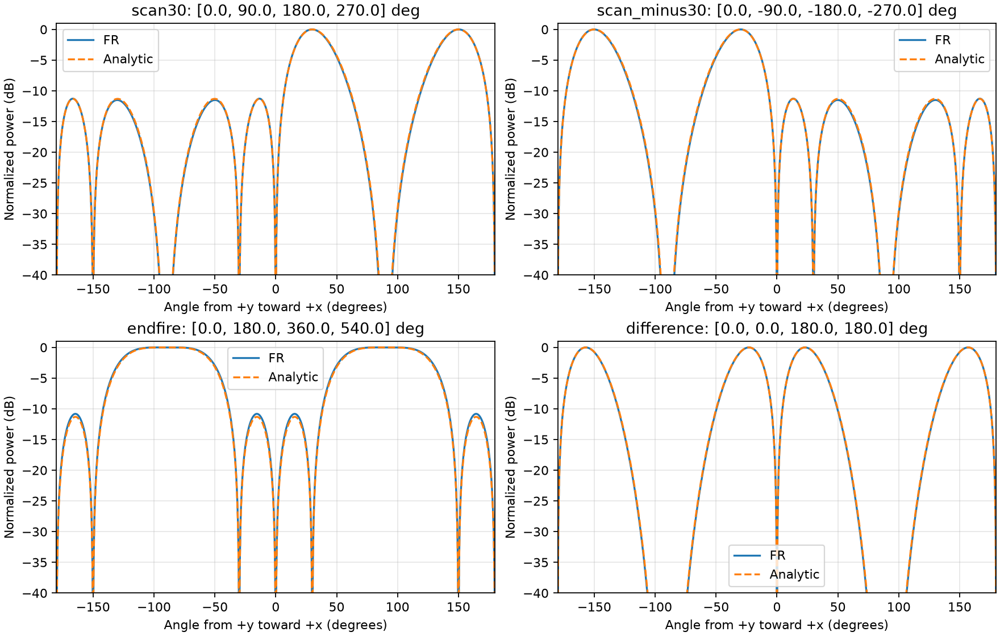

### 默认同相阵列

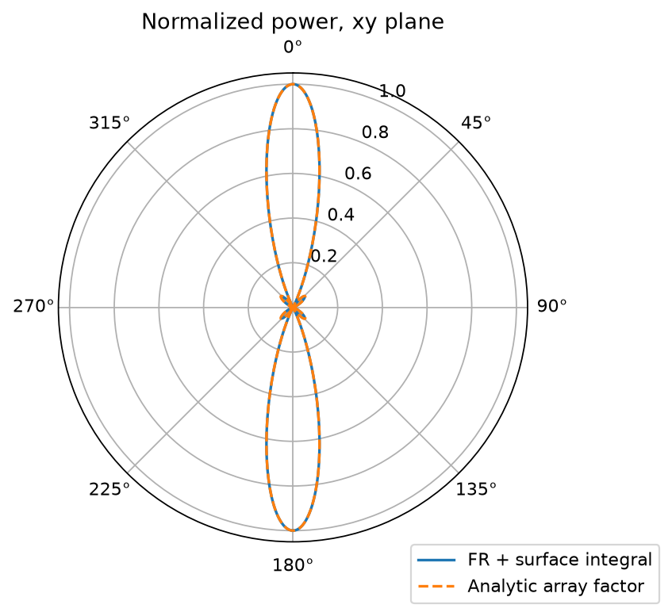

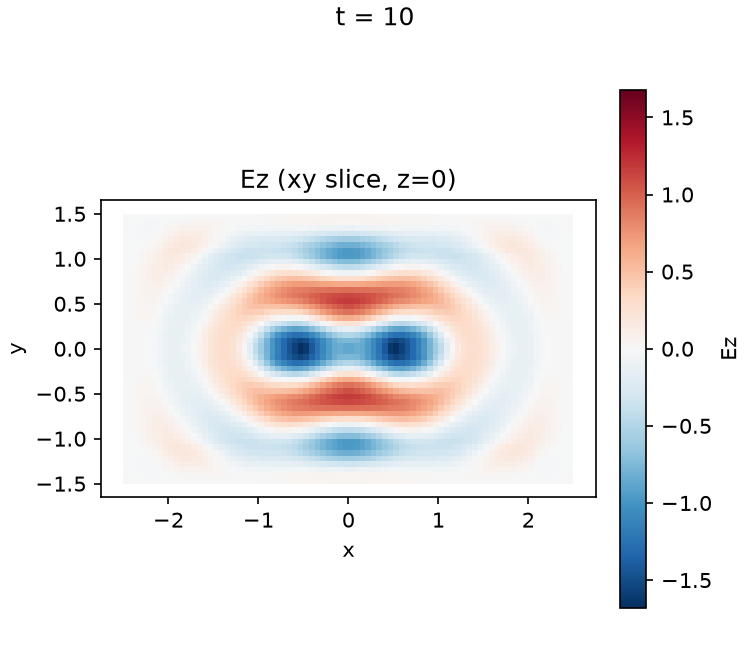

### 30° 扫描（--steer 30）

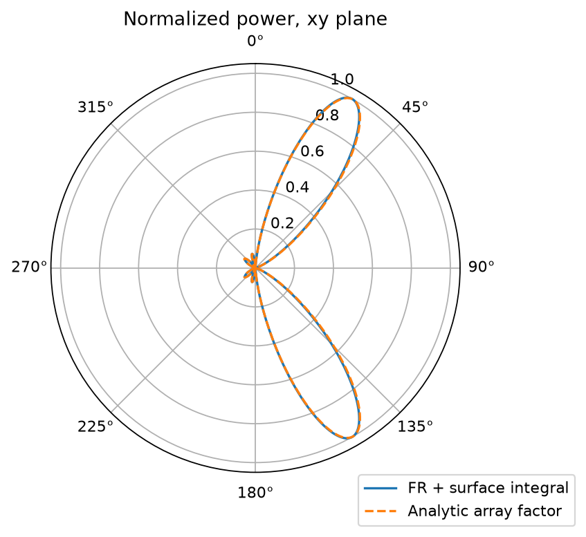

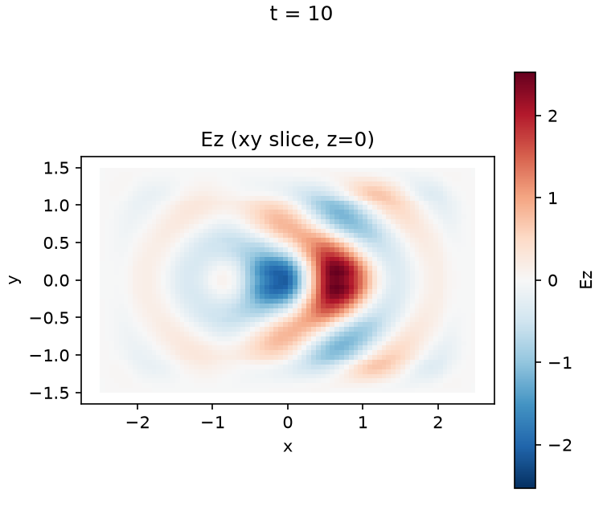

### 30° 扫描预设（scan30）


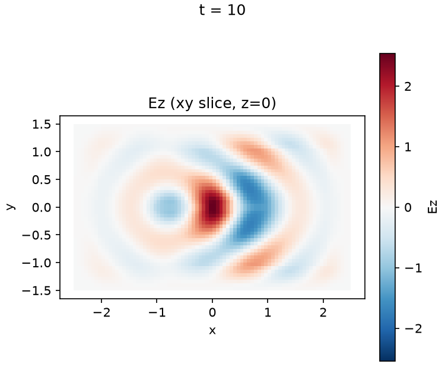

### -30° 扫描预设（scan_minus30）

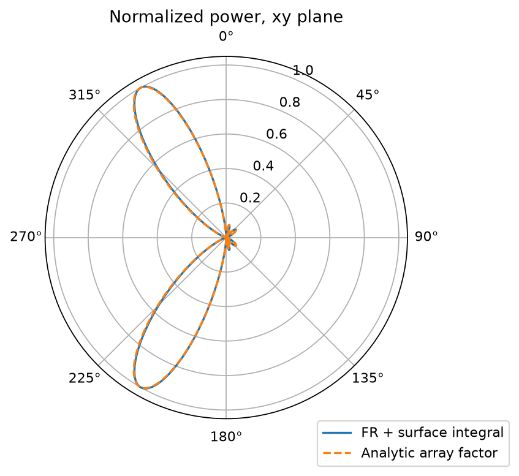

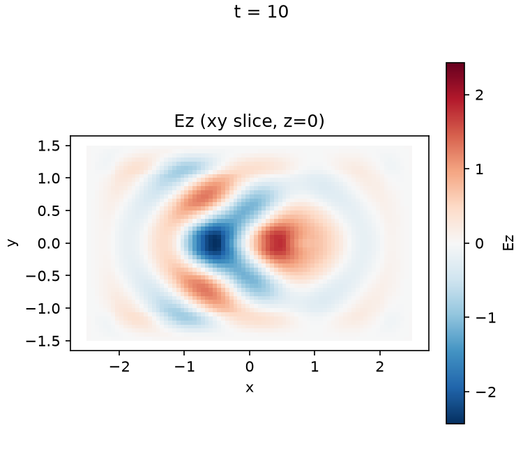

### 端射预设（endfire）

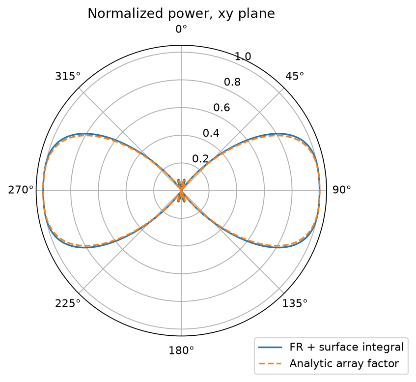

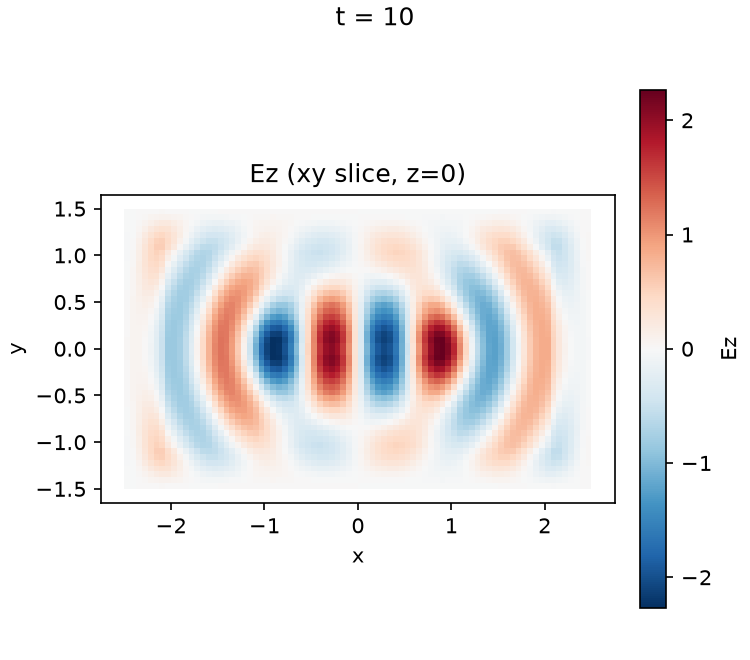

### 差波束预设（difference）

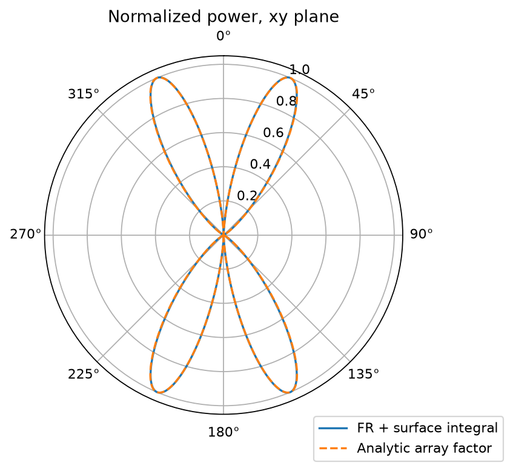

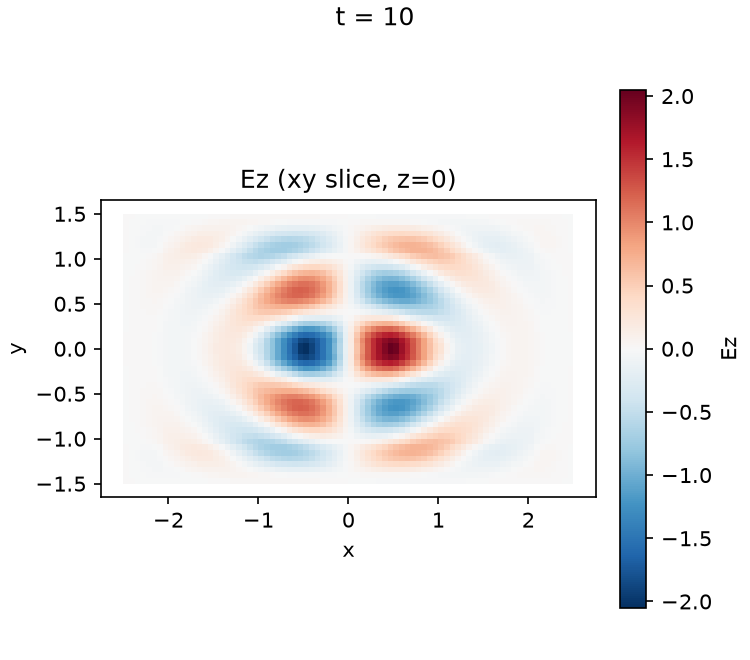
